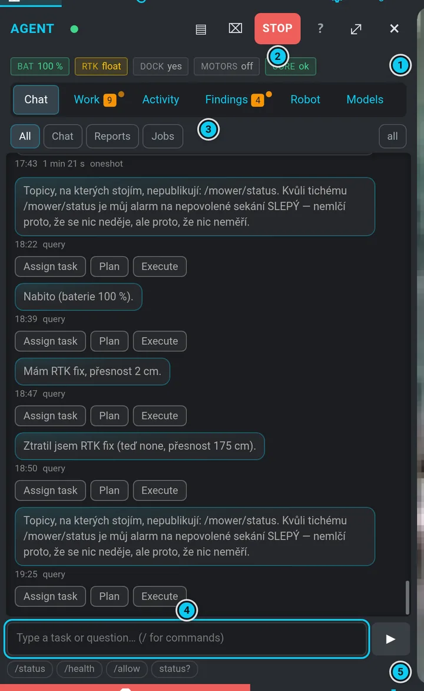
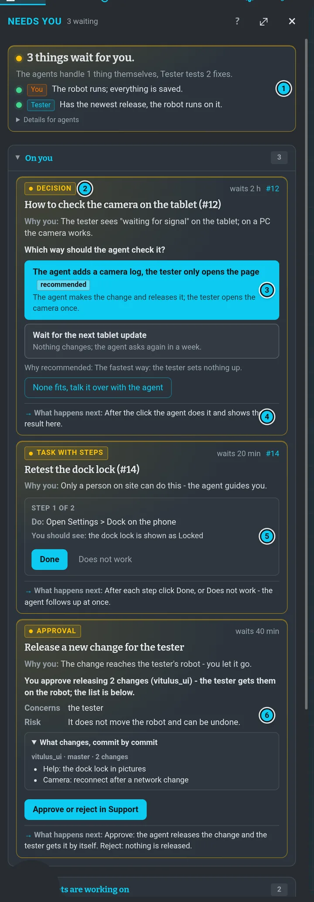

# Vitulus agent

The agent is an assistant on the robot. It reads the robot's state, answers questions, keeps an
eye on problems and — within strict limits — drives the robot for you. Open **Agent** in the menu
band. Write to it in Czech or English; most of its replies are in Czech.

Tabs: **Chat** · **Work** · **Activity** · **Findings** · **Robot** · **Models**.



## Give a task

Type into **Chat** what you want, in plain words. A simple drive becomes a **mission** straight
away, for example:

```
udělej undock, dojeď na TEST, počkej 10 s a vrať se do doku
```

A mission is a numbered job (**#N**) of steps: *undock*, *drive to a named waypoint*, *drive a
saved route* (*po trase ZonaA*, *projeď trasu ZONA_A_Path* — spaces, underscores and the *_Path*
ending do not matter), *wait* (*počkej 10 s*, *minutu počkej*, *půl minuty*, up to 10 min),
*dock*. The plan is checked before anything moves (the waypoints and routes must exist on the
active map). The chat answers with **one short message** — the number and the plan, e.g.
*Mise #240: 1) vyjet z doku 2) trasa ZONA_A_Path 3) počkat 60 s 4) do doku. Jedu.* — then one
line per step, and when it stands, *why* and what to do. Anything more complex (photos, maps,
conditions, repeats) goes to its planner first.

The plan holds **only what you asked for**: steps that just look around (*measure the state*,
*wait for RTK*, *where am I*, *summary*…) are dropped unless your task asks for them (*zjisti
polohu*, *vyfoť*, *řekni mi*…). RTK, motors and the robot's state are the agent's own business
while it drives. **The blade is never switched on by the agent itself** — a
mission may only run a saved mowing program after your unlock ([Mowing programs](#mowing-programs)).

The way back is understood in the usual words — *zadokuj*, *zadockuj*, *dokuj*, *zaparkuj se do
doku*, *vrať se (do doku / domů)*, *a zpátky* — and the announced plan always lists every step,
the docking included. Every plan (simple or from the planner) is checked against what you wrote:
the waypoints in your order, the way back to the dock, a wait, mowing. A plan that leaves a step
out is planned again; if even that fails, the mission does not start and the chat says what does
not match. A word the simple path does not understand sends the task to the planner instead of
being dropped.

```flow
You write | "drive to TEST and back"
Plan + check | waypoints exist, actions allowed
warn: Dock lock | the owner allows the move
Run | step by step, a report after each
ok: Report | done, or why not
```

Above the conversation, the pills **All / Chat / Reports / Jobs** filter what you see; the people
icon at the end of that row switches between the whole conversation from every device (two
people) and this browser only (one person).

### Continue and cancel

| You write | What happens |
|---|---|
| `pokračuj` (or *jeď dál*, *dokonči to*, *odblokuj*…) | resumes the newest parked mission; also restarts the newest cancelled / failed one (within 2 h) from the step where it stopped |
| `pokračuj v úkolu zóna A` / `pokračuj v misi …` | resumes the stopped mission whose task matches the words (*zóna A* ↔ *ZonaA*, *ZONA_A_Path*); two matches → it asks which one |
| `pokračuj na 223` / `pokračuj misi #223` | resumes mission #223; `pokračuj na 223: …` adds information |
| `proveď plán z práce #223` / `spusť misi #223` | the same mission #223: resumes it if it stands, says the step if it runs, says *done* if it finished |
| `znovu #223` / `zopakuj #223` | runs finished mission #223 again from its first step — the same mission, no new one |
| `zruš misi #223` (or *zrušit job 223*, *stop mise 223*) | cancels #223 at once — a running step ends, the robot is stopped, no further step starts |
| `zruš to` | cancels the current job |

Only these fixed words continue or cancel — never a model's guess, and **a continuation never
starts a new mission**: when nothing stands, the chat says so and names the last mission. A
mission stopped by a takeover continues on `pokračuj` from the step where it stood (an undock is
skipped when the robot is already out); if the supervisor is not READY yet, it starts by itself
the moment it is. A mission report that waits for you has one button, **Continue** (sends
`pokračuj #N`); the mission card has **Resume** and **Cancel**.

### During a mission: cancel, step in, ask

While a mission runs (or waits), **every chat message belongs to it** — none starts an action of
its own next to it.

| You write | What happens |
|---|---|
| `zruš to`, `přestaň`, `konec`, `nech toho`, `zruš misi` | cancels the mission at once: the running step gets a brake (*dock.stop*, cancel of the route / goal, stop of a direct drive or a mowing program) and the supervisor stops the robot |
| `zastav`, `stop`, `stůj` | the same — **stops this mission** (brake + cancel) in one sentence; the agent is **not** locked, your next order (*vrať se do doku*) runs at once, and *pokračuj* carries the stopped mission on |
| `zruš to a vrať se do doku`, `jeď domů`, `jeď rovnou do doku` | brakes the step, drops the rest of the plan and docks; the mission ends as cancelled with the robot in the dock |
| `zruš sekání a jeď na TEST` | cancels the mission and takes the rest of the sentence as a new task |
| anything else (*najeď na bod UNDOCK a počkej tam na GPS, pak pokračuj*, *čekáš na špatném místě*, *přeskoč čekání*, *co děláš?*) | a model reads it with the mission's context (task, finished steps, what it waits for now, live state, the actions it may use) and either answers, or brakes the step and **inserts steps before the rest of the plan** — then the mission carries on |

Cancel and *go home* are fixed words and work even with every model down. Inserted steps are
checked exactly like a plan (registry, waypoint names, no blade); when the model does not answer
or its steps fail the check, the mission carries on unchanged and the chat says so. When a step
waits inside the robot for long (after the undock dock_smach waits for RTK at the point
*UNDOCK*), the mission says once after about a minute what it waits for, and at most every
3 minutes after that. Outside a mission, a message that tells the robot to move (*jeď*, *dojeď*,
*vrať se*, *otoč se*, *posekej*…) is always a mission — *dojeď do zóny A* drives the route of that
zone (*ZONA_A_Path*) — never just a reply.

### The operator: a model drives step by step

A task that is not a plain routine drive (*undock / waypoint / route / wait / dock*) — and every
instruction like *pípni 2×*, *zobraz zónu A*, *počkej tam na signál* — is led by the
**operator**: a model (Sonnet, Haiku as a fallback) that reads what you wrote, picks the robot's
**skills** — everything the UI can do and the agent's action registry knows — and carries them
out **one step at a time, like you would in the UI**: *go to this point*, *drive this route*,
*run a program*, *show a zone on the map*, *rotate*, *back up*, *take a photo*, *wait*, *wait for
RTK*, *wait for your signal*, *beep*, *write on the display*. It checks every result before it
says *done*.

```
jeď po trase ZONA_A_Path, pak počkej na RTK fix a vyfoť to
zobraz zónu A
otoč se 3× doprava a jednou doleva, pak 2× pípni
dej go na bod TEST a počkej tam na signál
```

- **Same gates as every mission.** Each step goes through the action registry, the signed list of
  allowed actions, the dock lock (leaving the dock needs your unlock; going home never does), the
  supervisor and the actuation token. The blade turns only in a saved program after your **Mow**
  unlock. When a step is refused the operator says why in one sentence and what you can do.
  Skills the UI has but you have not signed yet are listed as *waiting for signature*.
- **Step in at any time.** Every message during the mission goes into **the same conversation**
  with the model: it sees it in the result of the current step (a drive runs to its end, a wait is
  interrupted at once) and changes course. *Počkej tam na signál* makes it stand and wait — your
  next message (*jeď*, *hotovo*) is the signal. Answer its questions the same way.
- **Cancel and go home stay fixed words** (*zruš to*, *jeď domů*) — the core handles them without
  the model, see the table above.
- **It tells you what it does.** First a numbered plan, then every step that moves the robot gets
  one line when it starts (*Krok 2: jedu po trase ZONA_B_Path.*) and one when it ends (*Trasa
  ZONA_B_Path hotová (70 s).*, or what failed and why) — these lines come from the core, so they
  are there even when the model is quiet. Before a decision the operator says in one sentence why
  (*the saved route only ends at zone B, so I drive around its corners*), and it ends with a short
  summary. A question it asks you lights up in **Needs you**.
- **Dock lock without typing.** When a step needs the dock exit unlocked, the core posts the usual
  *waits for your unlock* report with the right preset (*Undock only* for leaving the dock, *Mow*
  for a program) and the **Open Dock lock** button under it; the mission shows in **Needs you**.
  The moment you unlock, the chat says *Dok je odemčený (ui#N) — vyjíždím z doku.* and the same
  step runs by itself.
- **It knows the shape of your zones.** The operator reads the zones, routes and points of the
  site map (polygon, centre, size, the farthest corner from the robot or the dock, a point just
  inside the zone, a loop around it, which saved routes run along its edge) and can look at the
  map picture itself. *Jeď do nejvzdálenější části zóny B* or *objeď zónu B* therefore work even
  when no saved route goes around that zone.
- **Showing on the map.** *Zobraz zónu A* / *ukaž bod TEST* / *ukaž trasu …* draw the zone, the
  point or the route on your live map, the same as the **Show** buttons.
- **Budget and safety.** At most ~40 tool calls and 15 model turns per mission (and a daily cap —
  the model runs on the subscription you share). When the model does not answer, fails or runs out
  of budget the robot **stands**; when it is outside and you do not write within 5 minutes it
  drives back to the dock. A question you do not answer within 15 minutes (outside) also sends it
  home. A person on the controls always wins. While a **STOP** stands the operator does not drive
  anywhere, not even home: it keeps waiting for your answer and, if none comes, says once that the
  STOP is on and how to release it (*stop odvolávám*). *Pokračuj #N* carries on an operator
  mission in the same conversation — also one that stopped or ended.
- Every step is recorded (*~/.vitulus/agent/operator/*); the mission card shows the steps, the
  model's latency and the tool calls used.

### The agent's plan on the map

Whenever the operator plans a drive or looks for a goal or a way — anything other than *go to
point TEST* or *drive route X*: *the far end of zone B*, *around zone A*, *2 m behind the dock*, a
detour — it does not guess coordinates. It **looks at the map** (a picture with a metre grid and
axis numbers, zones, points, routes, the robot and the dock), **draws its plan into it** (points,
routes, areas, arrows with short labels like *b1 goal*), **checks every point** (free or in an
obstacle, in which zone, reachable from the robot, how long the way is — a point in an obstacle is
replaced by the nearest free one) and shows you the picture of the plan in **Chat** before the
robot moves. A saved route named after a zone is checked on the map first — it does not have to go
around that zone.

When it starts, the same plan appears on **your live map** as the layer **Agent's plan**
(Map › Layers, amber ◆; warnings red, helper lines blue). If the agent changes the plan on the
way, the map gets the new version before the next move; a free map point the agent drives to is
always on the map first. A card in the bottom-left corner of the map says which mission it belongs
to: **Show** moves the map onto the plan, **Clear** removes it from your view (the agent keeps its
plan). A fresh plan brings the map forward once per mission (a large camera view steps back). The
plan disappears by itself when the mission ends — also when it stops.

- **Around a zone**: the agent takes the zone's outline half a metre inside, turns it into a few
  points (corners, long edges split, the last point back at the start), checks each one and drives
  them one by one. Chat counts them: *Step 2, point 3/8 (outline of zone A): driving to x 11.4,
  y −4.6.*
- **After arriving** the agent compares where the robot really is with the plan (position, distance
  from the goal, which zone) and tells you — it never says *the farthest point*, *inside the zone*
  or *went around it* without that measurement.

## When a step fails

The agent does not give up after the first failure. It **measures what went wrong** and tries a
fitting alternative by itself; you only get a short report.

```flow
Step fails | e.g. no path to TEST
Measure | dock messages, navigation codes, GPS, supervisor
Pick | best untried alternative
Try | then the step again
warn: Nothing left | robot outside → back to the dock
bad: Not even that | stop, motors off, asks you
```

What it reads: the dock sequence's own messages (the same ones the robot's display shows, e.g.
*Navigation readiness timeout*, *Intensity timeout*), the navigation result codes (*no path
found*, *path blocked*, *robot stuck*, *oscillation*), the GPS/RTK state, the battery and the
supervisor.

| What happened | What the agent tries (in this order, best first) |
|---|---|
| no RTK after the undock | waits for RTK up to 10 min (display *waiting RTK (2/10 min)*), then goes on |
| no path / navigation gave up | short pause and a new plan; then via another named waypoint (from the other side) |
| path blocked | waits 30 s for the obstacle to move; then via another waypoint |
| robot stuck / oscillating | a new plan; via another waypoint |
| docking failed (reflector, map drive) | drives again in front of the dock (UNDOCK) and docks from there; runs the dock program again |
| motors off | switches the motors on and tries again |
| still in the dock | undocks first |
| obstacle right in front / stuck | backs off a little (`nav.backup`), turns (`drive.rotate`), then a new plan |
| no named way round | drives to a detour point the world model checked as reachable (`nav.goto_xy`) |
| docking by one method keeps failing | docks by the other modality (map / reflector only, `dock.start_modality`) |

- The waypoint for a detour comes from the agent's [world model](#what-the-agent-can-see) (a
  named point it can actually reach); without it the agent picks the shortest way round itself.
- Each alternative has an estimated chance; what helped before on this robot ranks higher (the
  agent remembers the outcome of every attempt, see [What the agent learns](#what-the-agent-learns)).
- Limits: at most 8 alternatives per mission, 4 per step, 30 min of trying. Every attempt still
  needs the supervisor, like any other move (and the dock lock only while the robot is in the
  dock). The way home never needs an unlock.
- **Only when nothing is left** and the robot is outside does it **drive back to the dock**; the
  mission then ends as *not finished* with the reason. When even docking fails, the robot stops,
  the motors go off and the chat asks you (`pokračuj` when it can go on).
- **Never retried:** a person taking over (gamepad, joystick), the STOP, the blade and a position
  bound. The mission waits for you.
- What the robot still cannot do becomes a **new capability** after the mission: knowledge
  (a procedure, a skill, a note) the agent learns **by itself**; only a new write on the robot
  waits for your **Allow / Deny** — see [New capabilities](#new-capabilities). Never during a
  drive.

### What the robot's display says

During a mission the second line of the robot's display shows what the agent is doing or waiting
for — short, in English, only when it changes (at most one message every few seconds), for
example *Agent: driving to TEST*, *Agent: waiting RTK (2/10 min)*, *Agent: trying another way*,
*Agent: returning to dock*, *Agent: waiting: owner unlock dock*, *Agent: need help - see app*.
The same in Czech goes to the chat and to the agent's status strip.

## Work (approvals and jobs)

**Work** has the **approvals** pinned on top, then *Needs you* (parked jobs), the jobs and the
*Mission / driving* card. When the agent wants to do something that needs a person, it asks:
**Approve** / **Deny**. If the robot would move, the card says
*THE ROBOT WOULD MOVE — only you may allow this* and the button needs a second tap.

### Only what needs you lights up

Each job card says in one line who is on it: **You:** (lit, it waits for you — unlock the dock,
a parked mission, missing site setup, a stop by the safety layer, a physical hand), **Agent:**
(the doctor revives it or the driver watches it — quiet) or **Nothing to do:** (quiet). Only *You*
jobs go to **Needs attention** and to the bell. A **cancelled** job is grey, never a failure. A
failure that a later run of the same work fixed, that a later mission took over, or whose outage
is over, is moved to the archive by itself within minutes. The folded group **Handled by the
agent** lists what it tidied or solved on its own as *Problem · Reason · Fix* — to check, nothing
to do. Messages that only inform (RTK, dock, "repaired it myself") stay in the chat but do not
raise the badge, and on Discord they arrive without a phone notification.

## Robot and the dock lock

**Robot** shows the live state, the robot tools and the **Dock lock** card.

### Dock lock

By default the agent **cannot move the robot out of the dock** — the lock guards **leaving the
dock only**: the undock, and any move while the robot stands in the dock (or its dock state cannot
be measured), need the owner's click here. **Driving back to the dock is always allowed**, and
once the robot is measurably outside (`is_in_dock` false or dock state UNDOCKED) driving to
waypoints, points, paths and direct driving need no further unlock — the supervisor still guards
every move. A mowing program needs its own unlock (**Mow** or **Free drive**) even outside.
Stopping always works.

1. Pick a preset and read its scope: *Actions*, *Not allowed*, *Valid for*, *Uses*,
   *Signed by*.
   - **Free drive — anything until the robot is back in the dock** (on top) — unlocks every
     move, direct driving and saved mowing programs included (never the blade on its own),
     without a use limit. It locks itself once the robot is back in the
     dock (or after 12 h at most). Unlocked while the robot stands in the dock, it waits until the
     robot leaves and comes back. The card says *Unlocked until docked*.
   - **Test drive** — undock, drive to waypoints, dock back (and switch motors on if needed),
     plus what the mission's recovery needs (back off, turn, a detour point, dock by another
     modality); 45 min, up to 12 moves; no saved routes, no mowing.
   - **Mow: run a saved mowing program** — starts or resumes a saved program, the same as
     **Run** / **Resume** on the program card; 60 min to start, up to 3 starts. See
     [Mowing programs](#mowing-programs).
   - **Undock only, once** — 15 min, 1 use.
   - **Undock and dock back** — 30 min, 2 uses.
2. **Unlock — tap again to confirm**, then **Yes — unlock the dock** within 6 s.
3. While open the card shows *UNLOCKED*, *Uses left*, *Expires in* and **Lock again** — which
   takes any unlock back at once.

A mission that needs the lock parks itself; its chat message names the preset it needs (a drive
out of the dock to a waypoint and back = **Undock only, once** — the rest of the drive and the way
home need no unlock) and has **Open Dock lock**, which opens that preset
straight away. After you unlock, the mission continues by itself — no need to write `pokračuj`
(after 2 h of waiting only `pokračuj` restarts it). An unlock you made up to 15 min before the
mission parked counts too.

- **Only the newest unlock counts.** When a narrower one is live (e.g. *Undock only*) and the
  mission needs more, the mission message, `pokračuj` and *dok je odemčený* all say exactly what is
  unlocked and what is missing. **Open Dock lock** then shows the needed preset with the note
  *Unlocked now: …* — unlocking it replaces the narrower one. The live card also offers the wider
  presets.
- An unlock with too few uses left for what the mission does in the dock does not start it; the
  chat says how many are left and how many it needs.
- Writing *dok je odemčený* / *odemkl jsem* while a mission waits is answered from the lock itself:
  either the mission starts (the reply says so once it is moving), or what is still missing.

The lock governs the agent only, not your own buttons and joystick.

## What the agent may do

Everything goes through one signed list of actions; there is no "send anything" path. The agent
picks an action, checks its arguments and the robot's state, needs the supervisor (and the dock
lock for moves), then **measures** the result — a reply never claims success without evidence.

| Action | What it does | Safeguards |
|---|---|---|
| `dock.undock` / `dock.start` | the robot's own saved undock / dock program | undock: dock lock · dock: always allowed · supervisor · measured dock state |
| `dock.start_modality` | dock with the saved program by map or by reflector only | as above |
| `nav.goto_waypoint` / `nav.execute_path` | drive to a saved waypoint / along a saved route | name must exist · dock lock only while in the dock · supervisor · navigation result |
| `nav.goto_xy` | drive to a point on the map (x, y, heading) | the world model must find a reachable path first · dock lock only while in the dock · supervisor |
| `nav.goto_offset` | a point up to 1 m next to a saved waypoint | as above |
| `nav.backup` | back off 5–50 cm | direct driving rules below |
| `drive.straight` / `drive.rotate` / `drive.velocity` | drive straight up to ±2 m, turn up to ±360°, or a speed for at most 5 s | direct driving rules below |
| `mower.program_run` / `mower.program_resume` | run / resume a saved mowing program | dock lock (Mow or Free drive) · supervisor mowing run |
| `mower.program_stop` / `mower.program_reset`, `drive.stop`, `dock.stop`, `nav.cancel_*`, `motor.off` | stop things | always allowed |
| `nav.speed`, `nav.clear_costmaps`, `nav.save_waypoint`, `nav.record_path_start` / `_stop`, `map.*` | settings, map tools, recording (agent names start with `agent_`) | no motion of their own; mapping sessions need the dock lock |

**Never:** spinning the blade on its own (no such action exists), and nothing outside the list.

### Direct driving

`drive.*` and `nav.backup` drive the wheels directly, like a joystick, through their own input of
the robot's priority switch: **above navigation, always below your DS4 gamepad and the web
joystick** ([Safety](safety.md#the-gamepad-ds4-and-the-joystick-beat-the-software)). The robot
measures the distance and the angle from its odometry, ramps the speed (at most 0.3 m/s and
0.8 rad/s) and stops by itself — the action ends *aborted* with the reason — when:

- you take over (gamepad or joystick) — the mission parks and waits for you,
- you press STOP (the robot's or the agent's),
- the agent stops sending its keep-alive or the supervisor stops being RUNNING (about 0.6 s),
- the lidar sees an obstacle in the direction of travel (closer than 0.3 m plus the braking
  distance; when turning, anything within the robot's turning circle) — if it is already there,
  the action is refused and nothing moves,
- the motors go off, odometry or lidar data get old, or the robot does not move although it
  should (stuck).

### Mowing programs

The agent may run only a **saved mowing program**, the same way the program card's **Run** /
**Resume** does. The program undocks, mows its zones and docks back by itself. Starting or
resuming needs your unlock (**Mow** or **Free drive**); stopping and resetting it always works.

While the program runs, the supervisor watches it as a *mowing run*: blade RPM is expected **only
while the robot's mowing program reports exactly that program running**; RPM at any other time
stops everything as before. STOP, your takeover, a lost agent heartbeat or the time limit still
stop the robot — the supervisor sends the program its stop and switches the blade off. The agent
never switches the blade on by itself.

## The agent's STOP

The red **STOP** in the agent panel's head (two taps) stops what the agent started — the
supervisor stops the robot within about 1.5 s. It **latches**: the agent refuses all actions,
and a banner says *STOP IS LATCHED*, until you release it. It is not the robot STOP —
that is the big red STOP top right ([Safety](safety.md#stop)).

What latches and what does not:

- **Latches:** the red STOP, `/stop`, and a bare *stop* / *zastav* typed while **no** mission
  runs (that is the only way to reach a one-off manoeuvre and background work).
- **Does not latch:** *zastav* / *stop* / *stůj* **during a mission** stops just that mission
  (see the table above) — the agent stays free to do what you say next.

How to release it — any of these, with or without diacritics:

- tap **Release STOP** in the red banner;
- write *stop odvolávám*, *zruš stop*, *odvolej stop* or `/stop pokracuj`; the rest of the
  sentence runs right away (*pokračuj, stop odvolávám* carries on the stopped mission, *zruš stop
  a vrať se do doku* drives home);
- write *pokračuj* — while the STOP stands it releases it and carries on what waited;
- write *vrať se do doku* (*zadokuj*, *jeď domů*) — **going home is always allowed**: it releases
  the STOP and docks. The supervisor, the dock lock (it guards only leaving the dock) and taking
  over with the gamepad still apply. The agent's own return home (a mission whose wait ran out)
  does *not* release it — that is your decision.

While it stands, every refused action says so in one sentence: *platí STOP z 23:41 — napiš
„stop odvolávám" (nebo ťukni Zrušit STOP)*.

### Supervisor FAULT

While a mission drives, a separate supervisor watches it. It goes to **FAULT** and keeps the
robot stopped when the robot leaves its allowed area, loses its position, the agent stops
answering, the time runs out, the blade spins outside a mowing program, or a **person takes over** (joystick, gamepad).
It clears itself after at least 10 s once the robot stands still with the motors and the blade
off — nothing moves when it clears. A parked mission then resumes by itself (at most twice per
mission, if the supervisor clears within 30 min); after a takeover, the blade or a position bound it waits for `pokračuj`.

The supervisor's stop switches the blade off directly; it sends the mower stop only while a
mowing program runs, so a FAULT during a test drive never cancels the docking that follows.

### Robot restart during a mission

When the robot's software restarts (the support kit does it after an update), the agent stays
running and reconnects to the restarted robot by itself within a few seconds — the mission sees
the robot again and goes on. A parked mission resumes once the supervisor is READY, starting
from what the robot really is doing (an undock it already finished is not repeated). If the
agent itself had to restart because of it, the mission also resumes by itself; after any other
restart of the agent (yours, a crash) it waits for `pokračuj`.

## Activity

One timeline of what the agent and the support kit did — reports, decisions, deploys — with
filters. Decisions made in the UI are signed with your name and show up here.

## Findings

What the agent noticed in the logs and the robot's health. It sorts each finding by itself:
a real problem (looks deeper and repairs it if it may), expected, noise (both closed), or
uncertain (it asks you one question). On a card: **Acknowledge**, **Investigate** (returns a
verdict: fix now / later / monitor / ignore), **Resolve**, **Undo ignore**, and for a repair plan
**Approve plan** / **Deny**.

Repairs by itself change only the agent's own code, never driving, mowing or safety (those are
only proposed), and never while a mission runs. You get a short message *Problem · Reasoning ·
Fix · Verification* with *Vrátit zpět* (revert) and *Příště ignorovat* (ignore next time).

Only **READ THIS** (findings that want you) lights the status strip; **New** (waiting for the
agent's own analysis) and the handled ones are folded.

## What the agent learns

Every mission is kept as an **episode**: the task, map, waypoint, time of day and light, rain,
RTK, battery, CPU load and code version, every step that failed (with its failure class and the
raw reason), what the agent tried next and whether it helped, how long each step took, and the
end. From these it counts — simply and visibly, no black box:

- **which recovery helps** for which failure, as a smoothed success rate with the counts it is
  made of (*via waypoint X helped 3/3 here, 4/5 for this action*); a recovery tried 3× that never
  helped is marked *don't repeat*;
- **how long steps really take** (*undock after the map: median 150 s, max 170 s — keep the step
  limit at least 255 s*);
- **lessons** from its reflection — all of them, also those that no longer fit its short memory.

Besides single recoveries it keeps whole **strategies**: which tools and steps solved a kind of
situation, which one was decisive, which were useless, how long it took and what it cost (model
calls, CPU). It recalls them by how **similar** the situation is — localization, GPS, obstacle,
light, terrain; the place is only one of the features — so a way that worked on one map is tried
on another, and a strategy that keeps failing stops being preferred. Ask `jak bys to řešil`
(optionally with the problem, e.g. *…když je ztracená lokalizace*) to see what it would do and why.

The result is the agent's **playbook**: the planner and the mission decider read it, and you can
too — write `co ses naučil` or `/naucil` in **Chat** (the full playbook is the file
`~/.vitulus/agent/playbook.md`).

When the same failure keeps coming back and nothing it knows helps, the agent opens a **finding**
for it by itself (**Findings**), and the usual path follows: analysis, and a repair through tests
— never while a mission is running.

### New capabilities

After a job or a mission the agent asks itself what it was missing, and the core decides —
by what the proposal **does**, never by a word in it:

- **Knowledge** — a procedure (a Hermes skill, e.g. *the farthest place in a zone*), a note for
  its memory, a lesson. It **only uses actions the agent already has** (undock, drive a path,
  go to a point) or only reads the robot, so the agent saves it and uses it **by itself**. In the
  chat it is one quiet line *Naučil jsem se: …* — no badge, no question.
- **A new write on the robot** — a program that would publish to a topic, call a service or send
  a navigation goal **outside the action registry**. That the agent may never give itself
  (AGENT.md §5.2), so it becomes a card **New capability** with **Allow** / **Deny** — in the
  chat bubble, in **Agent › Work** and on the **Needs you** card. The card says what it is, what
  exactly it would do on the robot, why the agent wants it and what it recommends (*deny: the
  action X already does that*, *think it over: it could move the robot*, *allow: it moves
  nothing*). **Allow** signs it in your name and the agent may use it; **Deny** (two taps)
  archives it with the reason and the agent does not ask again. Auto-approve never decides
  these. `/allow N` / `/deny N` or `/caps sign <id>` still work.
- Anything about the **blade or the safety layer** is refused outright — there is nothing to
  allow.

## What the agent can see

Before it decides anything, the agent builds one **world model** from all the robot's sensors and
data: lidar and the moving-object detector, the camera's obstacle and ground clouds and depth, IMU,
GNSS (RTK fix, heading, satellites, accuracy), wheel, visual and lidar odometry, localization
quality, the dock (contacts, reflectors, position), motors, battery, rain, the mower, the
supervisor and who is driving. Every value carries its age and how much it can be trusted, and the
sources are **cross-checked**: wheels turning while the camera and lidar see no motion means slip
or stuck; no RTK while the lidar still matches the map means *trust the lidar*; an obstacle seen by
both lidar and camera is certain. What the agent does not know is listed as *uncertain* — it does
not guess.

On the map it finds the robot (map and UTM, nearest points, zone), the obstacles around it
(**new** ones that are not in the saved map vs known walls, moving objects), free directions,
whether the robot is boxed in, and whether a point can be reached — it plans the path itself on the
costmap (nothing is sent to the robot), finds the narrowest place and, when the way is blocked,
a **detour** through another waypoint. Ask in **Chat** *kde jsi?*, *co je kolem?*, *dojedeš
k TEST?* or *ukaž mapu k TEST* — the reply comes with a map image showing the robot, the
obstacles and the planned route.

When no tool can answer what it needs, the agent **builds its own read-only tool** (code + test),
which must pass a gate: tests in isolation, no motion, no writes outside its own data. An approved
tool shows up with the others and is offered again in similar situations; tools that would move the
robot are never built — they are only proposed to you.

## Models

Which AI model does what for the agent (chat, planning, analysis) — informational.

## Needs you

The **bell** in the navbar is quiet when nothing waits, orange with a count when something does,
red when it is urgent or the robot would move. It counts **only what waits for you** — what the
agents handle themselves, calm notes and information never light it up. The panel speaks the
same language as the Support dashboard's home page:




- **The state in one sentence** on top — *3 things wait for you. The agents handle 1 thing
  themselves, Mac tests 7 fixes.* (green *Nothing is needed from you.* when nothing waits) — and
  one line per robot (you and the other side, e.g. *Has the newest release, the robot runs on
  it.*). Versions, stack times and similar facts are folded under *Details for agents*.
- **On you** — one list of everything you have to do; its count is the bell's number:
  - **Warnings only a person solves** — the GitHub token expires or does not work, field does not
    run, Signal is off, the other side is silent or stuck, this robot is behind — each with what
    to do and the way there (e.g. *Open GitHub tokens*). The field counts them the same way.
  - **Robot agent** — approvals, and agent work only a person can unblock (dock lock, parked
    mission, missing site setup, safety stop) — the same card as the field's (what, **Why you**,
    **What happens next**, a small *robot agent* tag); decide them in **Agent › Work**. A **New
    capability** card has **Allow** / **Deny** right on it (see
    [New capabilities](#new-capabilities)).
  - **Support** — every card the field asks you is one of **three types**, in one anatomy:
    type · *waits 2 h* · #N → the whole title → **Why you** (one sentence) → the body → **What
    happens next** (what each button does and who does it) → *For agents: technical details*
    (folded). **Detail** (#N) opens the issue in **Support** (below).
  - **Decision** — the question and the agent's 2–3 **options as big buttons** (what happens and
    for whom; the recommended one first and filled). A click arms it (*Sure? …*), the second
    click sends your choice and the agent carries it out. An option that **moves the robot is
    never a button** — it shows its steps and is done at the robot, hand on STOP. **Why
    recommended**, and **None fits, talk it over with the agent**.
  - **Approval** — **What changes · Concerns · Risk**; for a release also exactly what you
    approve (*13 changes …*) and the change list commit by commit. **Approve / Reject** right
    here — a finding, a watcher action, a release (two clicks, bound to exactly this card). An
    action that **moves the robot** never: it stays on the dashboard, a person at the robot
    (**Approve or reject in Support** opens that card; also with a field kit that does not take
    approvals from the robot UI yet, and for a merge or a task).
  - **Task with steps** — **one step at a time**: *Do* and *You should see*; **Done** shows the
    next step (this device remembers where you are), the last **Done** tells the field; **Does
    not work** (two clicks) sends the step's prepared sentence (*Step R1 does not work: …*) to the
    agent, who follows up; **Back**. Without written steps: **Start with the agent**.
  - calm notes (e.g. *Mac waits for you on #8 too*) — folded under *For information (N)*, not
    counted.
- **The agents are working on** — what runs right now (the agent fixing #61 with its clock, the
  watcher waiting to restart the robot when it is idle, the other side's agent, *Mac tests 7 fixes
  at the robot*). Never counted; a number opens the issue in **Support**.
- **Waiting on ⟨Mac⟩** — folded: what the other side is on, so you see who has the ball. Never
  counted in the bell.

Every button that writes takes **two clicks within 5 s** and is signed with your name (asked once
per device); it goes through the robot's web node to the dashboard with a single-use token bound
to the card and the text you saw. Only sentences the field itself prepared can be sent to the
agent from here — and only when the field kit takes it from the robot UI (the web node asks the
dashboard every 10 minutes; otherwise **Start with the agent** and **talk it over** open the issue
on the dashboard) — and an option that moves the robot is never offered here. Approving a watcher
action that moves the robot stays on the dashboard: **Approve or reject in Support**. The field's
texts follow the UI language (en / cs) — the kit sends both; what an agent wrote itself stays as
written.
