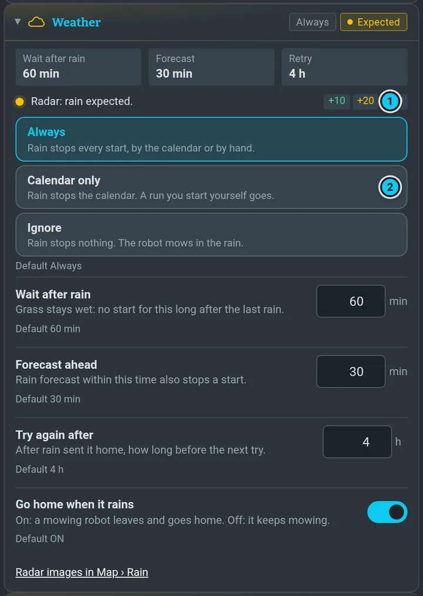

# Autonomy

**Autonomy** in the menu is the one place that says what the robot does on its own and why. The top
card says in one sentence what it does now and what comes next. Under it, each section has a head
with a colour and short tokens; open it for the numbers and the controls. What you open stays open.

 · 5 could it start now · 6 why it does not sleep")

## The two switches

- **Automatic mowing** is the master switch: calendar starts, sleeping and resuming. Off, nothing
  starts by itself and the robot does not sleep by itself ([more](programs.md#automation-on--off)).
- **Pause (Hold)** stops **new starts only**. A running mission finishes; to end it use **Stop**
  ([more](programs.md#hold)).

## Now

**Could it start now?** lists every condition of a start: green is fine, amber waits, red is
blocked. **Why isn't it sleeping?** shows only what keeps the robot awake. The › next to a line takes
you to where it is fixed.

## Plan

, starts (marks, with the time under them), expected sleep (grey) · 2 Skip next · 3 No mowing today · 4 Run next planned now")

The calendar and the [allowed mowing time](programs.md#allowed-mowing-time) are here. The timeline
shows the next 7 days: starts, the allowed time and expected sleep. **Skip next** skips one start,
**No mowing today** skips today, **Run next planned now** starts the next program at once (tap
twice). A skipped start is crossed out in the timeline, and the same button undoes it. The calendar
form, recurrence and the catch-up rules are in [Programs and calendar](programs.md#the-calendar).

## Weather

One choice decides what rain does:

| Choice | What rain does |
|---|---|
| **Always** | stops every start, by the calendar or by hand |
| **Calendar only** | stops the calendar; a run you start yourself goes |
| **Ignore** | stops nothing; the robot mows in the rain |

Under it: how long to wait after rain, how far ahead the forecast counts, when to try again, and
whether a mowing robot goes home when it starts to rain. The images stay in
[Map › Rain](waiting.md#weather-map--rain). When rain would refuse a **Run**, a dialog
offers **Ignore rain this time**: it applies to that one run only.

## Battery, Sleep, Faults

Each setting has a label, one sentence and its default, and **Reset** when it differs. A change
applies at once and the row says *Saved*. A refused value says why and the old one stays.

### Sleep

The sentence under **Sleep** is the plan: when it goes to sleep, for how long, when it wakes, or what
holds it awake. The same sentence stands at the top of the page, and **Cancel** is above the map, in
the right panel and at the top while a sleep is counting down. With the robot's timing the power goes
3 minutes after the start and the robot wakes at the stated time; the time *off* is shorter than
the time you ask for by those 3 minutes.

- **Sleep automatically** is the robot's own sleeping. **Sleep now** works either way.
- **Ignore logins** and **Ignore open UI**: off, a terminal or an open page keeps the robot awake. On,
  it goes to sleep with you connected, the power goes and the page and every terminal lose it until it
  wakes. Switching one on can start a sleep at once, so it first tells you the duration and the wake
  time and asks.
- **Cancel** holds automatic sleep off for 30 minutes and says until when, then the countdown comes
  again. For longer, use **Stay awake** (N hours).
- **Sleep now**: the box takes what the robot accepts, today from 16 minutes (a limit of 15 and a clock
  margin), and the line under it says what would happen. A start inside the sleep is a choice: wake for
  it (the sleep gets shorter) or skip it. A login on a terminal refuses Sleep now unless Ignore logins
  is on. While a sleep is counting down, cancel that one first. With this page open a 60 s countdown
  runs first. If it fails afterwards, the page says so.

Some limits are not settings yet. **Advanced** lists them with their values: the shortest sleep, the
wait before the power goes, the longest piece of sleep, the countdown and the time a Cancel holds.

### Hardware reset

**Hardware reset: everything off for N s** (also in Settings › Power) is not a sleep. Power to the
computer, motors and mower goes off for N seconds, default 60, only the power module stays on. It works
in the dock on the charger with nothing running. It says what will happen and asks, then the power
goes 20 s later, with **Cancel** until then. It is a hard cut without a clean shutdown, and this page
and Claude sessions go too; the robot is back about 2 minutes after. The scheduler does not know
about it. The page that started it reconnects, says how it went and puts the power module's times back.

### A start that does not run today

One calendar entry runs once a day. If an entry already ran today and has a later start today, Plan
says so, names the next start and offers **Run today anyway** (the same as deleting the entry and
adding it again). Moving an entry to another time needs nothing: it counts as a new start.

## Advanced

Rarely needed timing, and the **locked limits** the robot reports: firmware and safety limits such
as temperature, tilt, STOP and the blade rules. They are shown with a lock and the reason, and
cannot be changed here. No setting here relaxes a safety limit.

## History

The journal says in plain words what happened: started, finished, skipped, missed, waited, slept,
woke, settings changed. Filter it by runs, waits, sleep or settings. Problems stay on top until you
**Clear** them.

## The line above the map

One line says what the robot is doing, and what is about to happen: a sleep ahead ("Going to sleep
in 5 min for 11 h 55 min") when that is known, the countdown with **Cancel**, *Sleep cancelled*, *Leaving:
Bigger*, *Waiting for RTK*, *Mowing finished*. STOP and errors come first and stay until they are over.
The robot's routine lines wait their turn, each stays at least 2.5 seconds, and all of them stay in
the **Log**. On a phone the line is shorter; the whole sentence is in the panel.

## Outside the panel

The **Auto** row of the right panel shows the next start, or the state when the robot waits or
needs someone; open it for next start, battery and rain, › leads here. It stays quiet while all is
fine. When something needs you, it turns amber or red and the top card says what; on a phone a dot
appears in the collapsed row.
