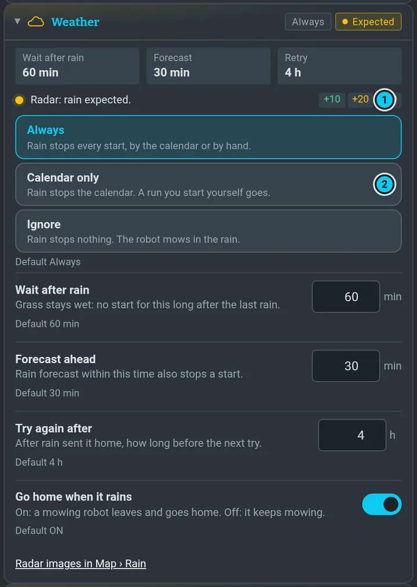
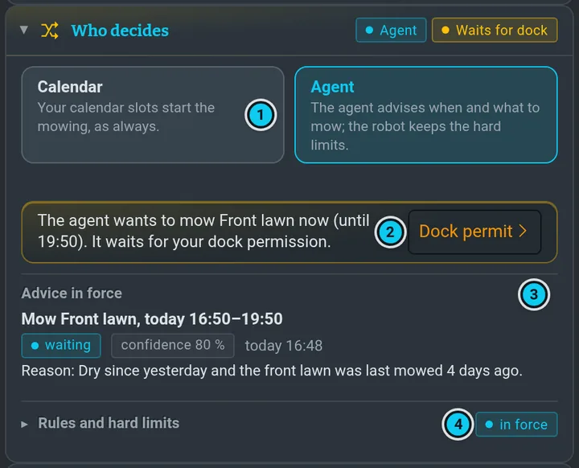

# Autonomie

**Autonomie** v menu je jedno místo, které říká, co robot dělá sám a proč. Horní karta jednou větou
řekne, co dělá teď a co přijde dál. Pod dalším startem dvě tlačítka odpoví na první pohled: **kdo
rozhoduje** (*Rozhoduje kalendář* / *Rozhoduje agent*) a **jestli by teď vyjel** (*Teď by mohl vyjet*,
jantarové *Čeká: Počasí* nebo *Tvrdý limit: zima*, červené *Teď nevyjede: Baterie +1*, šedé *Teď nevyjede: Nic v plánu* — první věc, která
ho drží, a kolik dalších; šedé, když jde o tvoji volbu nebo stav robota, třeba *Teď nevyjede: Automatika*,
*Čeká na radu agenta*, *Teď ne: Spí*, *Teď nevyjíždí*; jantarové *Usíná*, když běží odpočet spánku).
Zelené je jen tehdy, když robot hlásí, že čeká na další start, a start podle jeho pravidel nic nedrží:
žádná podmínka neblokuje ani nečeká, automatika a programy jsou zapnuté, neplatí žádný tvrdý limit a rada,
která chce vyjet, má povolený dok (kalendář v záskoku ho nepotřebuje). Každý jiný stav zelený není; jeho
věta je v tooltipu. Klepnutí otevře tu sekci; nic se neodesílá. Další start říká jen tahle karta. Pod
tlačítky jeden krátký řádek řekne spánek: *Usne na 6 h 27 min, až bude volno; drží ho: Přihlášení,
Webové UI ›* — celá věta je v tooltipu a ve **Spánku**, kam tě klepnutí na řádek vezme.

Když stránka ztratí robota (déle než 3 s), horní karta řekne *Bez spojení s robotem od 20:12: co tu vidíš,
už nemusí platit.* a zbytek stránky zešedne: je to poslední stav, který robot poslal, ne aktuální.
Jakmile robot zase odpoví, zmizí to.

Pod kartou jsou sekce, na každé obrazovce v tomhle pořadí: **Teď**, **Plán**, **Kdo rozhoduje**, pak
Počasí, Baterie, Spánek, Poruchy, Historie, Pokročilé. Každá má hlavičku s barvou a krátkými štítky; po
rozbalení jsou živá čísla (baterie teď, chyby, probuzení — ne znovu nastavení) a ovládání. Co rozbalíš, zůstane rozbalené; hlavička rozbalené sekce zůstává při posouvání nahoře, takže se dá sbalit
odtud, a když jsou rozbalené tři a víc, **Sbalit vše** dole v horní kartě je sbalí všechny. Při první návštěvě jsou rozbalené Teď
a Plán; Kdo rozhoduje zůstane sbalené, dokud rozhoduje kalendář (karta to říká), a samo se rozbalí,
když rozhoduje agent — dokud ho sám nerozbalíš nebo nesbalíš.

")

## Dva vypínače

- **Automatické sekání** je hlavní vypínač: spouštění z kalendáře, spánek a navazování. Vypnuté =
  nic se nespustí samo a robot sám neusne ([víc](programs.md#automatika-zapnutá--vypnutá)).
- **Pauza (Hold)** zastaví **jen nové starty**. Běžící mise doběhne; ukončí ji **Stop**
  ([víc](programs.md#pozdržet)).

## Teď

**Mohl by teď vyjet?** ukáže nejdřív to, co start drží: jantarová čeká, červená blokuje, šedá je
vypnutá (automatika, žádné programy). Hlavička sekce říká totéž co horní karta. Podmínky
v pořádku (zelené; *bez časového limitu* se počítá jako v pořádku) a ty, které se teď nekontrolují (šedé: GPS se kontroluje až při startu, řádek ukáže
živý fix), se sbalí do jednoho řádku, *Start nic nedrží: v pořádku 10. Teď se nekontroluje: 2.*;
**Ukázat vše** vypíše každou z nich, **Jen problémy** je zase sbalí (zapamatuje se).
Šipka › u řádku vede tam, kde se to řeší. Co robota drží vzhůru, je ve **Spánku**.

## Plán

, starty (značky, čas pod nimi), očekávaný spánek (šrafovaně šedě), teď (bílá čárka) · 2 Přeskočit další · 3 Dnes nesekat · 4 Spustit další program teď (vlastní řádek, hýbe robotem; řádek pod ním říká, co udělá, nebo proč by to robot teď odmítl)")

Tady je kalendář a [povolený čas sekání](programs.md#povolený-čas-sekání); hlavička sekce ukazuje
povolený čas, když omezuje (*Povoleno 07:00–21:00*). Časová osa ukazuje 7 dní dopředu se stupnicí hodin
nahoře: den, kdy se něco děje (start, spánek, který začíná nebo končí), má svůj pruh s povoleným časem,
starty a očekávaným spánkem (šrafovaně); dny, kdy celý den spí nebo se nic neděje, se sbalí do jednoho
řádku, třeba *út 10. 11. – pá 13. 11.: spí celou dobu*. Každá položka kalendáře je jeden řádek: vypínač,
program a pod ním čas a dny, **Upravit** a **Smazat**; vypnutá položka má štítek *Vypnuto* a ztlumené je jen
jméno a čas. Když jsou vypnuté všechny (a rozhoduje kalendář), nic se samo nespustí a stránka řekne proč:
*Nic není v plánu: položka kalendáře Bigger 23:15 je vypnutá* v **Mohl by teď vyjet?** (› otevře Plán),
*Kalendář vypnutý* v hlavičce Plánu a řádek v Plánu, ať ji zapneš. **Přeskočit další** přeskočí jeden start (druhý řádek tlačítka říká který: *Bigger · dnes 23:15*),
**Dnes nesekat** vynechá dnešek. Přeskočený start je na ose přeškrtnutý a stejné tlačítko to vrátí.

**Spustit Bigger teď** (jméno dalšího programu; *Spustit další plánovaný teď*, když nic naplánováno
není) má vlastní řádek pod nimi, protože hýbe robotem. Přesune další plánovaný start na teď: robot hned
vyjede z doku a seče a ten start se tím spotřebuje (ve svůj čas už nepojede). Je to ruční start, takže
tvrdé limity neplatí, ale všechny podmínky **Mohl by teď vyjet?** musí projít. Řádek pod tlačítkem to
řekne předem — nebo proč by to robot teď odmítl (*Teď by robot odmítl: Není v doku*, *…: Usíná*, blíží se tvrdý
restart), že už jízda běží, nebo že otevřená jízda čeká (*Bigger čeká (Baterie): nic dalšího se nespustí*). Klepni dvakrát: první klepnutí se zeptá *Klepni znovu*, po 4 s se samo vrátí. Formulář události,
opakování a pravidla dohánění jsou v [Programy a kalendář](programs.md#kalendář).

## Počasí

Jedna volba rozhoduje, co dělá déšť; hlavička sekce to řekne (*Déšť zastaví vše*, *Déšť zastaví
kalendář*, *Déšť se ignoruje*) vedle radaru teď:

| Volba | Co déšť udělá |
|---|---|
| **Vždy** | zastaví každý start, z kalendáře i ruční |
| **Jen kalendář** | zastaví kalendář; jízda, kterou spustíš sám, pojede |
| **Ignorovat** | nezastaví nic; robot seká i v dešti |

Pod tím: jak dlouho čekat po dešti, jak daleko dopředu platí předpověď, kdy zkusit znovu a jestli
sekající robot při dešti jede domů. Snímky zůstávají v [Mapa › Déšť](waiting.md#počasí-mapa--déšť). Když by déšť odmítl **Run**, dialog nabídne **Tentokrát déšť
ignorovat**: platí jen pro tuhle jízdu.

## Baterie, Spánek, Poruchy

Každé nastavení má popisek, jednu větu a výchozí hodnotu, a **Reset**, když se od ní liší. Změna
platí hned a řádek napíše *Uloženo*. Odmítnutá hodnota řekne proč a zůstane ta stará.

### Spánek

Věta pod **Spánek** je plán: kdy usne, na jak dlouho, kdy se vzbudí. Dokud neusne, dlaždice **Další
probuzení** ukazuje toto plánované probuzení (*≈ 23:01 (plán)*); když spí, to robotovo. Hned pod ní **Proč nespí?**
vypíše, co robota drží vzhůru; někdo přihlášený v terminálu nebo otevřené webové UI je modré, robota
drží vzhůru záměrně. Nahoře na stránce je totéž krátce (kdo ho drží, jménem) a **Zrušit** je nad mapou,
v pravém panelu i nahoře, dokud se spánek odpočítává. Podle časování robota se napájení vypne 3 minuty po začátku a robot se vzbudí v uvedený
čas; doba *vypnuto* je o ty 3 minuty kratší, než kolik zadáš.

- **Usínat samočinně** je spánek, o kterém rozhoduje robot. **Uspat teď** funguje vždy.
- **Ignorovat přihlášení** a **Ignorovat otevřené UI**: vypnuté znamená, že terminál nebo otevřená
  stránka drží robota vzhůru. Zapnuté znamená, že usne i s tebou připojeným, vypne napájení a stránka
  i každý terminál ho ztratí, dokud se nevzbudí. Zapnutí může spánek spustit hned, proto nejdřív řekne
  délku a čas probuzení a zeptá se.
- **Zrušit** odloží samočinný spánek o 30 minut a řekne do kdy, potom přijde odpočet znovu. Na déle
  použij **Zůstat vzhůru** (N hodin).
- **Uspat teď**: pole bere to, co robot přijme, dnes od 16 minut (mez 15 a rezerva hodin), a řádek pod
  ním řekne, co se stane. Start uvnitř spánku je volba: vstát na něj (spánek se zkrátí), nebo ho
  přeskočit. Přihlášený terminál Uspat teď odmítne, pokud není zapnuté Ignorovat přihlášení. Když se
  spánek odpočítává, nejdřív ho zruš. S otevřenou stránkou nejdřív běží 60 s odpočet. Když se to potom
  nepovede, stránka to řekne.

Některé limity zatím nejsou nastavení. **Pokročilé** je ukazuje s hodnotami: nejkratší spánek, čekání
před vypnutím napájení, nejdelší kus spánku, odpočet a dobu, na kterou Zrušit odloží spánek.

### Tvrdý restart

**Tvrdý restart: vypnout vše na N s** (i v Nastavení › Napájení) není spánek. Napájení počítače, motorů
a sečky se na N sekund vypne, výchozí je 60, zůstane jen napájecí modul. Jde to v doku na nabíječce,
když nic neběží. Řekne, co se stane, a zeptá se, napájení pak jde pryč za 20 s a do té doby je **Zrušit**.
Je to tvrdé odpojení bez čistého vypnutí a vypne se i tahle stránka a Claude sessions; robot je zpět asi
za 2 minuty. Plánovač o tom neví. Stránka, která restart spustila, se znovu připojí, řekne, jak to
dopadlo, a vrátí časy napájecího modulu.

### Deska sekačky přestane odpovídat

Při sekání robot po 3 s bez zpráv z desky sekačky zastaví. Když deska odpoví do 6 s, jede dál. Když ne,
zastaví nůž a zkusí desku obnovit (svítí to tady i v pravém panelu). Dokud deska mlčí, zůstane sekačka bez
proudu: vrátí se, až když deska odpoví. Když se to nepovede nebo mise mezitím skončí, proud zůstane
vypnutý, robot jede domů bez nože a běh čeká na svém místě. Když sekačku při sekání vypneš sám, robot
jede domů, nechá ji vypnutou a dá vědět. Běh sám nenaváže, spustíš ho, až budeš chtít.

**Mlčící desku sekačky restartovat sám** (Poruchy, výchozí je vypnuto, zapíná se pro každého robota zvlášť): když deska mlčí i v doku na nabíječce a nic
neběží, robot si udělá tvrdý restart sám: ohlásí ho 60 s předem se **Zrušit**, na minutu vypne proud
a po startu běh naváže. Udělá to jednou za běh a nejvýš dvakrát za 24 hodin, pak dá vědět a čeká. Když je
někdo připojený a **Ignorovat přihlášení** / **Ignorovat otevřené UI** jsou vypnuté, neodpojuje: dá
vědět a čeká, až odejde. Terminál použitý v posledních 10 minutách ho zastaví i se zapnutým **Ignorovat
přihlášení**. Zrušení platí pro celý běh. Mimo dok proud nikdy nevypne.

### Start, který dnes nepojede

Jedna položka kalendáře běží jednou denně. Když položka dnes už běžela a má dnes ještě pozdější start,
Plán to řekne, ukáže další start a nabídne **Přesto dnes spustit** (totéž jako položku smazat a přidat
znovu). Přesun položky na jiný čas nic nevyžaduje: počítá se jako nový start.

## Kalendář nebo agent

Kdo rozhoduje, kdy sekat: **kalendář** (tvoje sloty, jako dosud), nebo **agent**. Přepneš to v panelu,
nebo agentovi v chatu: „sekej podle sebe" / „přepni na agenta" a „zpět na kalendář". Po aktualizaci je
nastavený kalendář, nic se nemění, dokud nepřepneš.

V panelu je to sekce **Kdo rozhoduje** pod Plánem:

- **Kalendář | Agent**: zvýrazněné je to, co hlásí robot. Klepnutím přepneš, řádek pod tím napíše
  *Přepnuto na: Agent*, až to robot potvrdí (nebo proč ne). Samotné otevření stránky nic nepřepne.
  Hlavička sekce ukazuje režim a co se teď děje: *Podle plánu*, *Plán + limity*, *Zastupuje kalendář*, *Čeká na radu*,
  *Limit: déšť*, *Čeká na dok*…
- **Čeká na dok** (oranžový rámeček): agent chce sekat a dok je zamčený. Napíše program a do kdy rada
  platí; **Povolení doku ›** otevře dlaždici povolení doku v panelu Agent, kde povolíš časové okno.
  Stránka sama dok nepovoluje. Před časem rady je rámeček modrý a říká, že robot vyjede jen s tvým
  povolením. Když žádná rada nečeká, řekne povolení tichý řádek pod přepínačem (*Dok je odemčený do
  17:00*, *Dok je zamčený*, naplánované okno) s **Povolení doku ›**; když okno skončilo s robotem
  venku, rámeček řekne, že dosekne díl a vrátí se domů.
- V **Mohl by teď vyjet?** má běh z rady řádek **Povolení doku** (*Povoleno*, *Nepovoleno: rada čeká
  na tvoje povolení doku*, *Chybí soubor ownerů*, …); běhy z kalendáře ho nemají.
- **Platná rada**: co agent poradil (posekat program X mezi …, nebo nesekat do …), stav (čeká,
  provedena, zmeškaná, prošlá, zrušená), jistota a důvod v jazyce stránky (starší agent posílá jen
  vlastní slova, a ta se ukážou).
- **Poslední rozhodnutí** (v režimu Kalendář jen když nějaké je): co se rozhodlo, kdy, kdo (agent nebo kalendář) a proč — stejná věta jako
  v Historii. Rozhodnutí, jehož čas skončil (*nesekat do 19:30* ve 20:10), je šedé se štítkem *skončilo 19:30*. Dokud oranžový rámeček říká, že rada čeká na tvoje povolení doku, totéž rozhodnutí se
  pod ním neopakuje.
- **Pravidla a tvrdé limity** jdou sbalit: hlavička řekne *platí* nebo *teď neplatí*; když platí, samy
  se rozbalí, když neplatí, zůstanou sbalené — dokud je sám nerozbalíš nebo nesbalíš (zapamatuje se). Uvnitř nejdřív jeden řádek s [povoleným časem sekání](programs.md#povolený-čas-sekání),
  třeba *Povolený čas sekání 07:00–21:00 (zapnuto) — platí i pro agenta* nebo *vypnuto*. Je to tentýž
  čas jako v Plánu, zvláštní pro agenta není; **›** tě vezme ke kartě v Plánu, kde se nastavuje. Pak
  *Bez rady zastupuje kalendář*, *Tvrdé limity i pro kalendář*, *Počkat po dešti*, *Nejnižší teplota*,
  *Stejná zóna znovu za*. Tyhle limity platí jen v režimu Agent, nebo v režimu Kalendář se zapnutým
  *Tvrdé limity i pro kalendář*. Každé s výchozí hodnotou a **Reset**, ukládá se jako každé nastavení.

V režimu agent se agent dívá na počasí (déšť za poslední dny a předpověď), kdy se která zóna naposled
sekala, co poslední běh nedosekal a jak těžké bylo sečení, a robotu řekne *posekej program X mezi
těmito časy* nebo *nesekej do T*, s důvodem a jistotou. Robot radu provede stejně jako **Spustit
další**: platí všechny kontroly **Mohl by teď vyjet?**. **Výjezd z doku povoluješ dál ty:** radu
„sekej" robot provede jen v okně povolení doku, které jsi povolil ([Povolení doku](agent.md#povolení-doku));
bez něj ti agent jednou napíše do chatu „chci sekat X v …, povol dok" a robot počká. Když okno skončí
s robotem venku, dosekne díl (nejvýš 5 min) a vrátí se domů (historie: *povolení doku skončilo
s robotem venku*); nové okno od teď to zruší. Bez čerstvé rady zatím rozhoduje kalendář
(jde to vypnout: pak bez agenta nevyjede nic). Dokud rada platí, o slotech kalendáře rozhoduje agent
a později se nedohánějí. V režimu agent robot spí nejdéle do dalšího začátku povoleného času sekání,
aby se agent mohl každý den podívat.

**Tvrdé limity** drží robot, agent je nepřebije: start jen v povoleném čase sekání (výchozí
7:00–21:00, a když z něj zbývá méně než 30 minut, nic nevyjede; rozjetý běh pokračuje do jeho konce
jako u kalendáře; s vypnutým časem denní doba nedrží ani agenta), ne do 3 h po dešti, ne pod 5 °C, stejná zóna nejdřív
po 2 dnech (dosečení nedokončeného programu to nezdrží). Bez aktuálního počasí (radar i předpověď
staré) režim agent nevyjede. V režimu agent platí vždy, v režimu kalendář jen když je zapneš. Běh spuštěný
ručně ani **Spustit další** neomezují. Každé rozhodnutí — rada přijata, běh spuštěn, čekání a proč,
přeskočeno, odmítnuto limitem — je v **Historii**.

## Pokročilé

Málo potřebné časování a **zamčené limity**, které robot hlásí: limity firmwaru a bezpečnosti, třeba
teplota, náklon, STOP a pravidla nože. Jsou vidět se zámkem a důvodem a změnit tu nejdou. Žádné
nastavení tady bezpečnostní limit nepovolí.

## Historie

Deník říká lidsky, co se stalo: vyjel, dokončil, jak jízda skončila, když nedokončila (*zastaven
ručně*, *ukončen: někdo vypnul napájení sekačky*, *vzdán po opakovaných chybách*), přeskočil, zmeškal, proč
čekal (*přerušen kvůli dešti* vs. *start odmítnut kvůli dešti — nevyjel*), usnul, probudil se (včas, nebo o kolik později či dřív, než měl —
*Probudil se o 5 dní později, než měl* po výpadku proudu), co se v nastavení změnilo a kdo to změnil (*Změnil jsi:
Ignorovat otevřené UI → zapnuto*; dávka změn během minuty dvou je jeden řádek: kde které nastavení skončilo, *(×4)*), a také rady agenta a přepnutí, kdo rozhoduje. Nejnovější jsou
nahoře, pod řádkem pro každý den, u každého řádku jen čas; **Ukázat starší** přidá zbytek. Filtry:
**Sečení** (jízdy a jejich čekání), **Rozhodnutí** (kdo rozhoduje, rady agenta, nastavení),
**Problémy** (co se nepovedlo, červeně nebo oranžově, s počtem) a **Spánek**; volba se pamatuje.
Problémy, které hlásí robot, zůstanou nahoře, dokud je nesmažeš (**Smazat**).

## Řádek nad mapou

Jeden řádek říká, co robot dělá a co přijde: spánek předem („Za 5 min se uspím na 11 h 55 min"), když
je to známé, odpočet se **Zrušit**, *Spánek zrušen*, *Vyjíždím: Bigger*, *Čekám na RTK*, *Sekání
dokončeno*. STOP a chyby jdou první a drží se, dokud neskončí. Běžné hlášky robota čekají ve frontě,
každá zůstane aspoň 2,5 sekundy a všechny zůstávají v **Logu**. Na telefonu je řádek kratší, celá věta
je v panelu.

## Mimo panel

Řádek **Auto** v pravém panelu ukáže další start, nebo stav, když robot čeká nebo někoho potřebuje;
po rozbalení je další start, baterie a déšť, šipka › vede sem. Když je vše v pořádku, je tichý. Když
je potřeba člověk, zežloutne nebo zčervená a horní karta řekne co; na telefonu se objeví tečka
ve sbaleném řádku.
