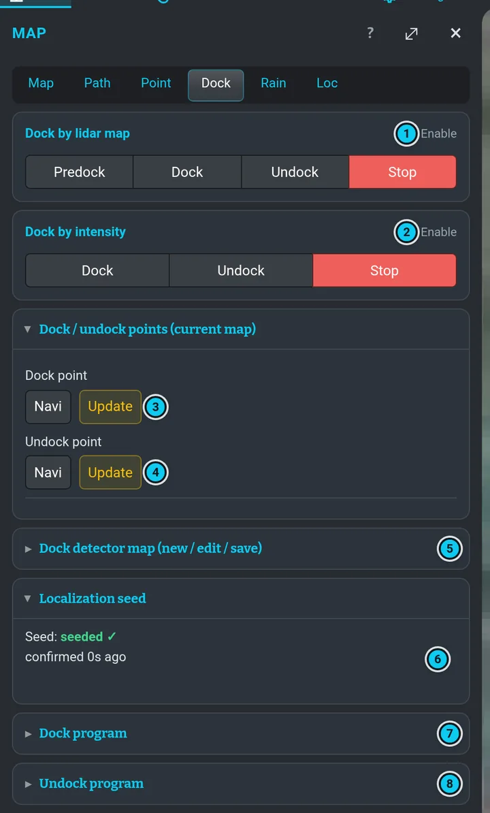

# Dok a výjezd z doku

Dok robot nabíjí. Nabíjecí kontakty má **vzadu**, takže do doku vždy **couvá**. Na doku je
odrazka, podle které lidar dok přesně najde („intenzita“, odrazivost).
Robot je **v doku, když nabíječka dodává proud** (ikona napájení zelená, *ONLINE*).

, azurová = cesta dovnitř (zajetí, couváním).")

1. **Dok** s nabíjecími kontakty na zadní stěně.
2. **Odrazka** — lidar ji vidí jako velmi jasný pruh a podle ní dok najde.
3. **docked** — poloha robota, když sedí v doku (zádí na kontaktech).
4. **DOCK** — příjezdový bod před dokem, otočený od doku; odtud robot zacouvá dovnitř.
5. **UNDOCK** — bod, na který robot vyjede.
6. **Pod okrajem střechy** je GPS špatná — proto výjezd čeká na RTK až na UNDOCK.
7. **Volné nebe** — tady se RTK vrátí.

## Výjezd z doku

")

**Pravý panel › Ovládání › Undock** spustí uložený *program výjezdu z doku*:

```flow
Motory zapnout | program zapne pojezdové motory
Vycouvat | podle odrazky vyjede 1,25 m z doku
Na UNDOCK | podle mapy místa dojede na bod UNDOCK
warn: Čekat na RTK | oba GPS přijímače RTK a ustálená GPS odometrie 5 s (10 min, po restartu až ~25 min)
ok: Hotovo | motory zůstanou zapnuté
```

- Na motory čeká nejvýš 20 s; když nenaběhnou, výjezd se přeruší.
- Když má mapa místa bod **UNDOCK**, robot na něj nejdřív dojede a na GPS čeká až tam — pod
  okrajem střechy doku bývá fix špatný.
- *Waiting for RTK fix* ve stavovém řádku znamená, že robot stojí a čeká, až obě ikony GPS
  zezelenají (a GPS odometrie se ustálí). Ztráta RTK odpočet 5 s spustí znovu. Každých 30 s
  ukáže displej průběh, např. *Waiting for RTK: main RTK, heading 3DFIX - 4:43 / 19:43*
  (čekám / aktuální limit).
- Limit je 10 minut. Když přijímače postupují (hlavní dosáhne RTK, heading přepne na RTK),
  prodlouží se o 15 minut, nejvýš ale do ~25 minut od naběhnutí GPS — po restartu potřebuje
  heading přijímač ~15–17 minut. Pak se výjezd přeruší s hláškou *RTK not ready in time*.
  V programu sekání robot potom zajede zpátky do doku a program se zkusí později (jako po jiné
  chybě); ruční Undock ho nechá stát.

## Zajetí do doku

**Pravý panel › Ovládání › Dock** spustí uložený *program zajetí do doku*:

```flow
Na DOCK | podle mapy dojede na bod DOCK před dokem
Najít dok | lidarová mapa doku a / nebo odrazka
Zacouvat | dokud nabíječka nedodává proud
ok: Usadit | 15 s dosedá, pak vypne motory
```

> [!IMPORTANT]
> Zajetí do doku motory nikdy nezapne. Když jsou vypnuté, hned selže s hláškou
> *Motors are OFF – turn motors on to dock*. Zapni je v **Nastavení › Motory** a stiskni znovu
> **Dock**.

**Stop** vedle **Dock** / **Undock** sekvenci přeruší (stav na chvíli ukáže *failed* — to je
v pořádku).

## Záložka Dock (Mapa › Dock)

Slouží k nastavení a ručním zkouškám; běžně stačí **Dock** / **Undock** v pravém panelu.



| Část | Co dělá |
|---|---|
| Dok podle lidarové mapy | přepínač zapnutí, **Před dok**, **Dock**, **Undock**, **Stop** — jen krok s lidarovou mapou doku |
| Dok podle odrazivosti | přepínač zapnutí, **Dock**, **Undock**, **Stop** — jen krok s odrazkou |
| Body doku / výjezdu | **Navi** dojede na bod DOCK nebo UNDOCK; **Aktualizovat** uloží *současnou* polohu robota jako ten bod |
| Mapa detektoru doku | **Nová mapa**, **Upravit mapu**, **Uložit mapu** — lidarový obraz doku |
| Počáteční lokalizace | poloha *docked*, podle které se robot v doku lokalizuje; když chybí, píše *CHYBÍ bod polohy v doku* |
| Program zajetí do doku / výjezdu z doku | zaškrtni kroky (bod z mapy, trasa z lidarové mapy, akce podle odrazivosti) a dej **Provést** nebo **Uložit** |

Ruční karty obcházejí stavový automat doku — používej je, jen když robot vidíš.

### Body

- **DOCK** — příjezdový bod před dokem, cíl kroku s mapou při zajíždění.
- **UNDOCK** — bod, na který robot vyjede.
- **docked** — poloha robota usazeného v doku; z ní začíná lokalizace v doku. Vznikne sama, když
  dokončíš nahrávání mapy *v doku* ([Mapy](mapping.md)).

Nastavení DOCK nebo UNDOCK: dojeď s robotem přesně na místo (i se správným kurzem) a dej
**Aktualizovat**. Nebo bod posuň v [editoru mapy](map-editor.md).

## Zámek doku (agent)

[Agent Vitulus](agent.md) nesmí sám vyjet z doku ani od něj odjet: **zámek doku** otevírá jen
majitel, v **Agent › Robot › Zámek doku**, a to pro pojmenovaný rozsah. Viz
[Zámek doku](agent.md#zámek-doku). Zámek platí jen pro agenta: program, který spustíš v
**Programy** (**Run** / **Resume**), nebo program spuštěný kalendářem vyjede z doku i bez
něj.

## Když to selže

Robot si nejdřív pomůže sám a ve stavovém řádku vždycky řekne, co se děje — nikdy jen potichu
nestojí.

```flow
Kontrola doku | než začne hledat odrazku a než se rozjede, ověří řízení dokování, filtr odrazky z lidaru a motory
Hlídá postup | při couvání do doku (i při výjezdu) hlídá, že vzdálenost ubývá
warn: Uvízl | 15 s bez postupu → zastaví a řekne proč
Znovu | restartuje řízení dokování a zkusí to znovu; s mapou nejdřív zajede zpátky na bod DOCK (nejvýš 2×)
err: Přerušeno | teprve potom: *Docking aborted: …* s důvodem
```

Co uvidíš ve stavovém řádku:

| Hláška | Co robot dělá |
|---|---|
| *Dock check: waiting for …* | část dokování ještě není připravená (pár sekund po Dock je to normální); po 15 s jednou restartuje řízení dokování |
| *Dock check failed: …* | ani po restartu nenaběhla → následuje opakování níže |
| *Docking stalled: no progress for 15 s (… m to go): …* | robot zastavil; důvod říká proč — např. *collision gate* (lidar vidí něco těsně u robota), *dock reflector not visible* (odrazka není vidět), *drive motors are off* (motory vypnuté) |
| *Docking motion held: collision gate …* (log) | něco je do ~1,5 cm od robota; čeká místo tlačení |
| *Docking retry 1/2: …* | restartuje řízení a zkusí to sám znovu |
| *Docking aborted: …* | po 2 opakováních to vzdá: detektory se vypnou, navigace se zruší, motory zůstanou, jak byly |

Když při opakování nabíječka dává proud, počítá se to jako zadokováno. *Motors are OFF* se
neopakuje — dokování motory samo nezapíná.

> [!TIP]
> - *Motors are OFF* → zapni motory a stiskni znovu **Dock**.
> - *Docking aborted: stalled … collision gate* → podívej se kolem robota: něco stojí těsně u něj
>   (hračka, hadice, sloupek). Odstraň to a stiskni **Dock**.
> - *Map has no DOCK/UNDOCK point* → nastav bod (viz výše).
> - Visí na *Waiting for RTK fix* → podívej se na ikony GPS a na
>   [stav lokalizace](localization.md); pomůže volné nebe, základnová stanice musí běžet.
> - Odrazka se nenašla → je čistá a vidět, je robot pár metrů od doku a míří k němu? Přijeď
>   joystickem blíž a zkus to znovu.
> - Víc v [Řešení problémů](troubleshooting.md#zajetí-do-doku-selže).
