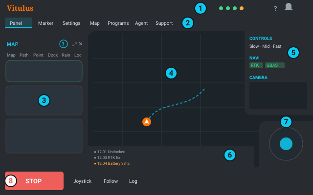

# Obrazovka

UI tvoří jeden rám ve tvaru písmene **C** kolem mapy: horní pás (navbar, lišta agenta, pás menu),
levý panel a spodní lišta jsou jedna plocha. Pravý panel, log a joystick vyrůstají ze stejného
rámu.

## Levý panel

Pás menu otevírá v levém panelu vždy jeden nástroj: **Značka**, **Nastavení**, **Mapa**,
**Programy**, **Agent**, **Podpora**. Otevřený svítí.

| Co | PC | Telefon |
|---|---|---|
| skrýt / zobrazit panel | **Panel** v pásu menu, **Alt+P**, **Esc** (skrýt), **✕** | **Panel**, **✕**, stáhnout sheet dolů |
| celá obrazovka | **⤢** v hlavičce | vytáhnout sheet nahoru / ťuknout na úchyt |
| nápověda k němu | **?** v hlavičce | **?** v hlavičce |

Skrytý panel nechá na levém okraji tenký hřbet — klikni na něj a panel se vrátí. UI si pamatuje,
který panel byl otevřený (i po načtení stránky znovu).

**PC** (šířka ≥ 1024 px): panel je sloupec, mapa se vedle něj zúží. **Tablet / telefon na
šířku**: sloupec leží přes mapu. **Telefon na výšku** (< 576 px): panel je sheet vysouvaný zdola
(60 % výšky). Na telefonu (na výšku i na šířku) má panel kompaktní hlavičku: STOP / ⤢ / ✕ jsou na
konci řádku záložek; na výšku se název přesune do řádku s úchytem.

## Spodní lišta

**STOP** · **Joystick** · **Sledovat** · **Log** (na telefonu s volnou mezerou uprostřed pro
systémové gesto). **STOP** je vždy vlevo dole, nikdy se nepřesouvá ani nezmenšuje
([Bezpečnost](safety.md#stop)). **Sledovat** nechá pohled mapy sledovat robota.

## Pravý panel

Visí z horního pásu u pravého okraje:

- **Ovládání** — rychlost Pomalu / Středně / Rychle, jízda klávesnicí, baterie a **Do doku** /
  **Vyjet** / **Stop** ([Dok a výjezd](dock.md)).
- **Navigace** — stav lokalizace ([co znamenají čipy](localization.md#jak-číst-stav-pravý-panel--navigace)).
- **Kamera** — viz níže.

Každá sekce se sbalí kliknutím na svůj název. Na telefonu (na výšku i na šířku) je pravý panel
sbalený do jednoho řádku (mapa, poloha, GNSS, baterie, kamera, ▾) — ▾ ho rozbalí.

## Kamera

Přepínač **Vyp / M / V** v hlavičce sekce Kamera: **M** = malý živý obraz v pravém panelu,
**V** = kamera vyplní plochu mapy a mapa se přesune na místo kamery v pravém panelu (kliknutím na
malou mapu se vrátíš). **Alt+C** přepíná M ↔ V. Přenos běží, jen když je kamera na obrazovce. Na
telefonu zapíná a vypíná velkou kameru tlačítko kamery ve sbaleném řádku.

### Překryvy kamery

Tlačítko vrstev v pravém horním rohu obrazu kamery (M i V) otevře překryvy. Každý je přepínač
a zapnout jde libovolná kombinace:

- **Lidar** (azurová) — sken lidaru: řada bodů tam, kde paprsek lidaru ve výšce lidaru na něco
  narazí.
- **Překážky** (červená) — co detekce překážek z hloubkové kamery vidí jako překážku (právě to
  robot objíždí).
- **Volno** (zelená) — zem, kterou stejná detekce vidí jako volnou a sjízdnou.
- **Hloubka** — obraz vzdáleností z hloubkové kamery přes obraz: červená = blízko, žlutá / zelená
  = středně, modrá = daleko (asi 5 m); bez barvy = tam hloubka není (obloha, odlesk, moc daleko).

**Průhlednost** nastaví, jak silně všechny překryvy zakrývají obraz. Body blíž k robotu jsou
větší. Volba se pamatuje v tomto prohlížeči.

Body do obrazu vkládá sám robot (node `camera_overlay` ve `vitulus_ui`): použije kalibraci kamery
a polohu každého senzoru v okamžiku měření, takže bod sedí na věci, kterou změřil, i když se robot
otáčí — jako pohled kamery v RVizu. Pracuje, jen když je zapnutá nějaká vrstva a kamera je vidět;
se všemi vrstvami vypnutými nedělá nic.

- **Vrstva je zapnutá, ale nic není vidět** — zrovna nejsou data (prázdný seznam překážek je na
  otevřeném trávníku normální; lidar je vidět jen tam, kde paprsek v záběru na něco narazí), nebo
  služba překryvů ještě neběží (startuje se softwarem robota).
- **Body jsou kousek vedle hran věcí** — pár pixelů je normální (tolerance uchycení senzorů);
  velký a stálý posun znamená, že polohy senzorů v modelu robota potřebují kalibraci. Změřeno
  18. 10. 2026 (robot v doku): body lidaru sedí asi 10 px vlevo od hran ve 3–4 m, na 1 m do pár
  pixelů — zatím málo na změnu modelu robota; rozhodne kontrola venku před zdí / sloupky (nástroj
  `tools/overlay_extrinsics.py`).
- **Barva hloubky vs. lidar na dálku** — hloubková kamera měří tím víc navíc, čím dál se dívá:
  asi +1 cm na 1 m, +5 cm na 2 m, +18 cm na 4 m (stereo kalibrace kamery, ne model robota).
  Správná je vzdálenost z lidaru; hloubku opraví kalibrace přímo v kameře (RealSense
  self-calibration / tare).

## Ruční jízda (joystick)

**Joystick** ve spodní liště ukáže páčku vpravo dole na mapě (na telefonu zůstává nad otevřeným
sheetem).

- Zatlač a jeď: dopředu / dozadu = rychlost, do stran = zatáčení. U středu jemně, na okraji plnou
  rychlostí (podle Pomalu / Středně / Rychle). **Pustíš = stop.**
- Ukazuje režim rychlosti a jestli jsou zapnuté pojezdové motory — **s vypnutými motory se nic
  nepohne** (zapni je v Nastavení › Motory).
- Klávesnice: zaškrtni políčko u ikony klávesnice v sekci **Ovládání** pravého panelu, pak
  **W A S D** nebo šipky, **Shift** = poloviční rychlost. Nikdy, když píšeš do pole.

> [!WARNING]
> Pohyb joystickem převezme řízení od softwaru: **zruší** cíl navigace, dokování i běžící
> program a po puštění robot stojí. Přednost má jen gamepad DS4
> ([Bezpečnost](safety.md#gamepad-ds4-a-joystick-mají-přednost-před-softwarem)).

## Log

**Log** ve spodní liště ukáže log jako pruh nad lištou. **▲** (rozbalit) ho roztáhne přes plochu
mapy, **▼** (sbalit) ho vrátí zpět; další **Log** ho skryje. Joystick zůstává vždy nad malým
logem.

Rozbalený log má lištu nástrojů:

- **Změny** — užitečné události robota: zelená tečka = něco se zlepšilo, oranžová = varování,
  červená = porucha; změny spojení a hlášení agenta.
- **ROS** — surová konzole robota s filtry úrovní, filtrem nodů a hledáním textu.
- **Živě** pozastaví / obnoví posouvání, **Vymazat** vyprázdní log jen v tomto prohlížeči.

## Klávesové zkratky (PC)

| Klávesa | Co dělá |
|---|---|
| **Alt+P** | zobrazit / skrýt levý panel |
| **Esc** | zavřít nápovědu; skrýt levý panel (ne při psaní, v dialogu ani s rozbaleným logem) |
| **Alt+C** | kamera malá ↔ velká |
| **W A S D**, šipky | jízda (se zaškrtnutou klávesnicí v pravém panelu), **Shift** = poloviční rychlost |
