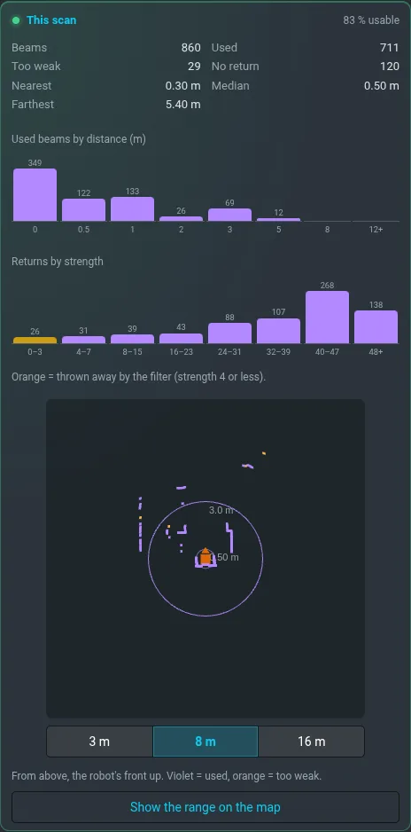

# Lidar

**Nastavení › Lidar** má všechno o 2D lidaru robota: zda běží, kam jdou jeho data, co vidí právě
teď a nastavení, která jde bezpečně měnit. Jeho dosah kolem robota ukáže **Ukázat dosah v mapě**
(vrstva [Dosah lidaru](mapping.md#dosah-lidaru-a-dosah-kamery)).

## Lidar

Model, firmware, režim skenu a dosah. Ovladač je řekne jen při startu, proto jdou z jeho logu.
**Motor** se čte z dat: skeny chodí = točí se. Zelená = aspoň 5 skenů za sekundu, oranžová = méně,
červená = skeny nechodí.

## Tok dat

Data lidaru projdou pěti stupni, každý má živou frekvenci:

| Stupeň | Co dělá |
|---|---|
| `/rplidar/scan` | ovladač: surový sken |
| `/rplidar/scan_ovr` | nastaví minimální dosah na 0,10 m |
| `/rplidar/scan_filtered` | zahodí slabé odrazy, nechá 0,10–16 m |
| `/scan` | zahozený paprsek znamená „nic tam není“ |
| `/rplidar/scan_5m` | zahozený paprsek je volný paprsek 5 m |

Pod každým stupněm jsou části robota, které ho čtou, živě z robota. **Štít** značí to, co robota
zastavuje nebo řídí: stop přímého řízení, costmapy, lidarovou odometrii a dokování.

## Tento sken

Paprsky aktuálního skenu: kolik je použitých, moc slabých a bez odrazu, nejbližší a nejvzdálenější.
Pod nimi dva histogramy — podle vzdálenosti a podle síly, kde oranžová značí, co filtr zahodí —
a pohled shora s předkem robota nahoře, měřítko 3 / 8 / 16 m.

## Lidar v mapování

Tohle je jediné místo těchto nastavení; **Mapa › Pokročilé ladění snímání** je jen ukazuje.

- **Mapovat lidarem** — vypnuto = zdi a volno dává jen kamera.
- **Dosah pro mapování** — zásahy a volné paprsky za ním do mapy nejdou. Navigace na tom nezávisí.
- **Bez odrazu = volno** — paprsek, který nic nezasáhl, se počítá jako volno do tohoto dosahu.
- **Minimální síla pro mapování** — slabší odrazy nejsou ani překážka, ani volno. Zvyšte ve vysoké
  trávě. Hodnota pod filtrem níže nic nedělá: karta to řekne.

**Při nahrávání** změna platí hned a zůstane u té mapy. **Bez nahrávání** karta ukazuje, co použije
příští nahrávání na aktivní mapě, a u každé hodnoty, odkud je: *výchozí*, *mapa …* nebo *čeká na
příští nahrávání*. Změna, kterou uděláte teď, se uloží na robotu a převezme ji příští nahrávání, na
jakékoli mapě; **Zahodit čekající změny** ji zruší.

## Filtr slabých odrazů

Tímhle filtrem projde to, co čte celý robot, proto je označený **krmí bezpečnost**.

- Zahozený odraz je v globální costmapě volný paprsek 5 m a stop přímého řízení ho nevidí. Vyšší
  hodnota může skrýt tmavou překážku.
- Meze jsou 2–10 a změna chce druhé klepnutí.
- Platí hned a drží do restartu stacku; pak je zpět hodnota z launche. **Zpět na hodnotu z launche**
  ji vrátí hned.

Motor lidaru, filtr rozsahu a režim skenu tady změnit nejdou záměrně: zastavení motoru by robota
oslepilo, ostatní chtějí restart ovladače.

## Co nevidí

Lidar vidí jednu rovinu asi 35 cm nad zemí, dokola. Cokoli nižšího vidí jen [kamera](camera.md).
