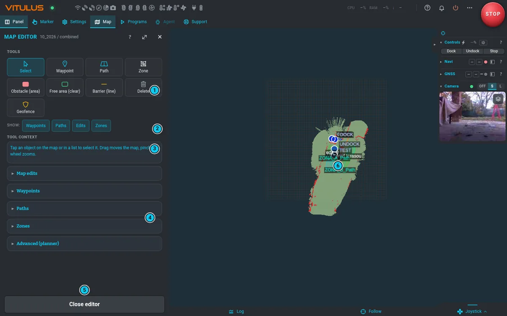

# Editor mapy

**Mapa › Mapa › Upravit mapu** (ikona vedle aktivní mapy) otevře editor: mapu shora s lištou
nástrojů nad ní a vlevo jeden seznam všeho, co na mapě je, a pod ním vlastnosti vybraného objektu.
Robotem můžeš během úprav dál jezdit joystickem. Tlačítko rozbalení panel zvětší; **Zavřít editor**
nebo **✕** tě vrátí do panelu Mapa.

## Nástroje

Na liště je **Vybrat**, tři skupiny, **Měřit**, zpět a znovu, **Vrstvy**, **Historie** a **⋯**.
Když je mapa vedle panelu na lištu úzká, slova zmizí a zůstanou jen ikony (název ukáže
myš po najetí). Na telefonu, tabletu nebo telefonu naležato je lišta jedna řada ikon nahoře
v panelu a zůstává tam, i když panelem posouváš; **Vrstvy** a **Historie** jsou pak pod **⋯**.

| Skupina | Nástroj | Jak |
|---|---|---|
| | **Vybrat** | klepni na objekt v mapě nebo v seznamu. Tažení posouvá mapu, sevření nebo kolečko přibližuje |
| **Význam** | **Místo (plocha)** | pojmenovaná plocha, třeba terasa nebo bazén: aspoň 3 body, **Dokončit** |
| | **Orientační bod** | klepni do mapy: strom, poklop |
| | **Zákaz vjezdu** | sám robot dovnitř nesmí. Viz [Pravidla](#pravidla) |
| | **Pomalá oblast** | omezení rychlosti uvnitř |
| | **Bez nože** | robot projet smí, nůž se zastaví |
| | **Koridor (čára)** | pojmenovaný průjezd: aspoň 2 body, **Dokončit** |
| **Oprava mapy** | **Překážka (plocha)** | aspoň 3 body, **Dokončit** — tam robot nepojede |
| | **Volné místo (vyčistit)** | označí plochu jako sjízdnou (odstraní falešnou překážku) |
| | **Bariéra (čára)** | virtuální čára, kterou robot nesmí přejet; šířka 0,02–2 m (výchozí 0,10) |
| **Objekty** | **Bod** | klepni, kam ho dát, napiš název a kurz (0–359,5°, oranžová šipka), **Uložit** |
| | **Trasa** | naklikej body a pak **Dokončit** |
| | **Zóna** | nová zóna sekání, viz [Zóny](#zóny-co-sekat) |
| | **Měřit** | naklikej body: délka a plocha uzavřeného tvaru. Nic se neukládá |
| **⋯** | **Geofence** | naklikej obvod a pak **Odeslat návrh** — viz níž |
| | **Smazat vše** | smaže všechny opravy mapy naráz, zpět je vrátí všechny |

**Oprava mapy** opravuje to, co mapa ukazuje. **Význam** říká, co místo je a co na něm platí.

Při kreslení lišta ukazuje délku a plochu. **Zpět** v panelu vrátí poslední bod. Vrcholy se chovají
jako v další části.

**Přichytávání** (magnet, výchozí zapnuto): nový nebo tažený vrchol sedne na blízký vrchol nebo
hranu jiného objektu. Přidrž **Alt** a položíš ho volně.

Klávesy: **Esc** zruší otevřenou změnu, nástroj nebo výběr a **zastaví robota**, jako všude
v aplikaci. **Del** smaže vybraný vrchol, a když žádný vybraný není, vybraný objekt. **Ctrl+Z**
a **Ctrl+Shift+Z** jsou zpět a znovu. Kresbu bez zastavení robota zrušíš tlačítkem **Zrušit**.

Na telefonu se editor otevře s malým panelem dole: lišta nástrojů a vlastnosti, nad nimi mapa.
Tlačítko **^ Seznamy** vpravo nahoře ve vlastnostech přidá seznam, vrstvy a podrobnosti; výběr
objektu, nástroje nebo dotyk mapy panel zase zmenší. Při kreslení řadu nástrojů nahradí délka, magnet
a tlačítko jízdy; vrátí se s **Dokončit** nebo **Zrušit**. Jeden prst mapou posouvá, dva prsty přibližují; ani
jedno nepřidá bod ani nic neuloží. Na tabletu nebo telefonu naležato výběr nástroje posune
vlastnosti s tlačítkem **Dokončit** do záběru.

## Objekty a vlastnosti

V seznamu je všechno z mapy, jeden řádek na objekt. **Hledání** projde názvy, aliasy, štítky,
poznámky a kategorie, filtr typu ho zúží. Klepni na cokoli, co vidíš: objekt se vybere v mapě
i v seznamu zároveň a výběr ze seznamu ho navíc přivede do záběru. Kde se objekty překrývají, dalším
klepnutím přejdeš na další. Seznam není nikdy vyšší než asi čtvrtina obrazovky; delší se posouvá
uvnitř a dole slábne a jeho posouvání nepřejde do panelu. Na telefonu je seznam součástí panelu
a posouvá se s ním.

Popisky v mapě nikdy nezakryjí jeden druhý a vyhýbají se tečkám bodů: název bodu se posune na volnou
stranu od tečky, název plochy kolem jejího středu, dokud zůstane uvnitř. Kde volné místo není, název
počká, až mapu přiblížíš — přednost mají pravidla a zóny, trasy jsou poslední. Název pravidla nebo
zóny kvůli bodu nikdy nezmizí: když musí, leží přes tečku.

Vlastnosti mají u každého typu stejné pořadí:

| Část | Co v ní je |
|---|---|
| hlavička | typ, název, ✎ přejmenovat |
| stav | platí nebo ne, dočasné, kdo objekt přidal, pokud ne ty, velikost |
| **Význam** | **Poznámka**, **Aliasy**, **Štítky**: slova, která pro objekt používáš ty i agent |
| **Pravidla** | co tam platí: rychlost, platnost, kategorie, šířka, výška sekání |
| **Stav** | které programy objekt používají, kdy vznikl a kdy se změnil |
| akce | **Duplikovat**, **Smazat**; u zón **Rozdělit** a **Sloučit**; u trasy **Přidat polohu robota** |

Význam a historie potřebují službu objektů mapy na robotu. Bez ní zbytek editoru funguje jako
obvykle a vlastnosti to řeknou.

## Výběr a úprava tvaru

Vrcholy vybraného objektu se objeví hned:

| Chceš | Udělej |
|---|---|
| přesunout vrchol | táhni ho |
| přidat vrchol | klepni na bílou tečku na hraně, nebo ji rovnou přetáhni, kam vrchol patří |
| smazat vrchol | klepni na vrchol (zežloutne) a dej **Smazat vrchol**. Myší i Shift+klik nebo klávesa Delete |
| přesunout bod | táhni ho a ve vlastnostech nastav **Kurz** |
| změnit šířku bariéry | **Šířka bariéry** ve vlastnostech |

K robotu nejde nic, dokud nedáš **Uložit**, které se objeví s první změnou, u tvaru i u významu.
**Zpět** vrací po krocích, **Zrušit** vrátí uložený stav. Dokud je změna otevřená, ostatní objekty
a nástroje čekají, až ji uložíš nebo zrušíš. Zavření editoru s neuloženou změnou nebo přechod do
jiného panelu chce druhé stisknutí a změnu pak zahodí.

Obrys, který se kříží sám se sebou, uložit nejde. Plocha má aspoň 3 vrcholy, čára 2.
Trasa nahraná jízdou si drží natočení: směr čáry dostanou jen změněné vrcholy a jejich sousedé.

## Zpět a historie

**Smazat** platí hned a na pár sekund se objeví zpráva se **Zpět**. Zpět na liště vrátí kteroukoli
uloženou změnu mapy, další stisk tu před ní, a znovu ji zase přinese. **Smazat vše** je jeden krok.
**Historie** v panelu ukazuje, kdo co změnil: ty, agent, robot, nebo něco mimo editor. Zpět, které
nejde provést, třeba u zóny, kterou používá běžící program, řekne proč. DOCK, UNDOCK a DOCKED
**Smazat** vůbec nemají.

## Pravidla

| Pravidlo | Co dělá |
|---|---|
| **Zákaz vjezdu** | mapa, plánování i každá samostatná jízda se mu vyhnou. Člověka s joystickem nic neblokuje: varuje ho pruh v celé aplikaci, nejen tady |
| **Pomalá oblast** | omezí rychlost uvnitř (0,05–0,40 m/s, výchozí 0,20) |
| **Bez nože** | sekací program projede s vypnutým nožem a zóny ji vynechají |

**Platí od** a **Platí do** dělají pravidlo dočasné: samo se zapne a vypne. Prázdné znamená pořád.
Každé pravidlo má v mapě vlastní šrafování; neplatné zůstává v mapě, vybledlé a s čárkovaným obrysem.
Zákaz vjezdu nesmí obsahovat DOCK, UNDOCK ani DOCKED.

## Stopa jízdou

Vyber kterýkoli nástroj pro plochu nebo čáru a pak šipku na liště. Jeď s robotem, jeho poloha se
přidává do obrysu, jeden bod na 20 cm. Dalším stiskem šipky skončíš: čára se zředí, upravíš ji jako
každou jinou a dáš **Dokončit**. **Zpět** vrátí celou stopu.

Stopa jen nahrává. Robota nerozjede, jedeš s ním sám.

## Vrstvy

**Vrstvy** jsou jeden panel. Objekty: body, trasy, opravy mapy, zóny, místa a pravidla. Skrytá
vrstva v mapě nejde vybrat. Svět, každá vrstva s legendou: **Pokrytí** (kdy se naposledy sekalo),
**Zátěž sekání** (stopa běhu, viz Sekací ústrojí), **Výška trávy** (změřená tráva proti
výšce sekání, viz [Sekací ústrojí](mowing.md#výška-trávy-před-robotem)), **Kvalita GNSS**, **Sklon (robot)** (sklon, který robot
změřil sám), **Terén**, **Podklad** (když je zapnutý, hned pod ním vybereš podkladovou mapu) a **Překryvy**
(katastr, budovy, vrstevnice, reliéf, sklon z terénního modelu ČÚZK … — tytéž přepínače jako v záložce Mapa; zapnutý
překryv má hned pod sebou posuvník krytí). [Tlačítko vrstev na mapě](mapping.md#tlačítko-vrstev-na-mapě) funguje i
v editoru a mění totéž nastavení; jeho **Další nastavení** otevře tyhle Vrstvy.
Vrstva bez dat to řekne. Stopa ukazuje i shodu GPS s lidarem a koly, korekce RTCM a tenkými čarami polohy podle plánu, GPS a lidaru, takže je vidět, kam základna
dosahuje špatně, což pomůže při kreslení zóny. Klepnutí na stopu ukáže kartu, jen když není aktivní kreslicí nástroj.

## Návrhy

Když robot opakovaně vidí novou pevnou překážku, nabídne ji v **Návrzích**. Klepnutí ji ukáže na
mapě. **Přijmout** ji přidá, **Ignorovat** nechá to místo napořád být.

## Záznam na místě robota

**Záznam na místě robota** přidá současnou polohu robota jako bod, nebo začne trasu: **Nová**
(body přidáváš za jízdy tlačítkem **Přidat polohu robota** u trasy) nebo **Nová auto** (nahrává
sama za jízdy, **Stop auto** ji ukončí).

## Názvy

Každý objekt má název. Nový objekt ho dostane sám (**Překážka 1**, **Zákaz 2**, **Bod 1**…) a před
uložením ho můžeš přepsat. Později ho změníš tužkou ✎ ve vlastnostech, u všech typů stejně.

- Název musí být v rámci typu jedinečný, nejvýš 60 znaků. Mezery a diakritika nevadí.
- Přejmenovaná zóna zůstává ve svých programech. Nejde přejmenovat, dokud běží mise, která ji používá.
- **DOCK**, **UNDOCK** a **DOCKED** své názvy nemění; přesunout je můžeš, smazat ne.
- Agent objekty zná podle těchto názvů a aliasů, takže dobrý název (*Bazén*, *Plot u sousedů*)
  pak používáš ty i agent.

## Body DOCK a UNDOCK

DOCK a UNDOCK jsou obyčejné pojmenované body — můžeš je tady přesunout jako každý jiný. Co
znamenají, popisuje [Dok a výjezd z doku](dock.md#body). Nejpřesněji je ale nastavíš tak, že
robotem dojedeš na místo a v **Mapa › Dock** stiskneš **Aktualizovat**.

Když ukončíš nahrávání mapy v doku, vznikne bod DOCKED. Pokud místo ještě nemá DOCK nebo UNDOCK,
vzniknou zároveň s ním v místě, kde končí vycouvání z doku, čelem od doku. Body, které už existují,
se nikdy nepřepíšou. UNDOCK přesuň na volné nebe, kde robot chytí RTK: na GPS čeká právě tam. DOCK
nech před dokem, v ose výjezdu a čelem od doku, aby robot mohl couvnout dovnitř.

## Zóny (co sekat)

1. Nástroj **Zóna**, naklikej polygon v mapě. První, modrý vrchol je místo, kde sekání začíná.
2. Nastav **Název**, **Výšku sekání** (mm, 20–80, výchozí 45) a **Otáčky** (600–4000, výchozí 3300).
   V **Pokročilých** jsou *Trasy kolem překážek* (2), *Úhel pokrytí* (160°), *Rozestup tras*
   (0,2 m) a *Zjednodušení* (0,1 m).
3. Už při kreslení plánovač ukazuje výsledek: plochu k posekání a nedostupnou, délku trasy, čas
   a problémy, trasy sekání v mapě.
4. **Dokončit** — plánovač spočítá trasy sekání a potvrdí to; stav ukáže, až je hotovo.

Existující zónu vybereš jako každý jiný objekt a uvidíš její trasy sekání. Nastavení je
v **Pravidlech**. Když je přebíjí program, vlastnosti ukážou hodnoty, které opravdu platí. **Stav**
říká, které programy zónu používají. **Duplikovat**, **Rozdělit** (klepni dva body čáry přes zónu)
a **Sloučit** jdou přes plánovač, který upraví programy se zónou a odmítne to, dokud takový program
běží.

Uložení nového tvaru přepočítá trasy sekání a promítne se do všech [programů](programs.md), které
zónu používají, takže dál fungují. Plánovač uložení odmítne a nechá starou zónu, když zónu používá
běžící program, když se programy mapy ještě načítají, nebo když po novém tvaru nezbude žádná trasa
sekání. Vlastnosti ukážou důvod a tvoje změna zůstane otevřená.

Zóny se po úpravách mapy přepočítají samy. Které zóny se sekají, pak určí
[program](programs.md).

## Geofence

Je pod **⋯**. Geofence (plot) je pevná hranice pro mise agenta. Editor ho jen **navrhne**: návrh se
uloží nepodepsaný a aktivním plotem se stane, až ho člověk podepíše na robotu (v příkazové řádce).
Prstenec, který vede nezmapovaným prostorem, robot odmítne; nejmenší plocha jsou 4 m². Geofence
se používá, jen když o tom rozhodne vlastník.
