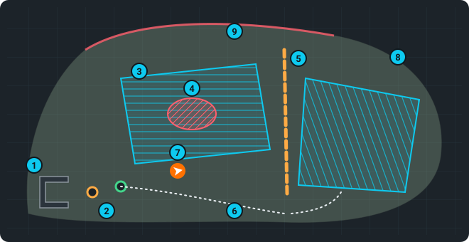

# Mapy a mapování

**Mapa** (*site*) je jedna zahrada: terén, který robot nahrál, a všechno, co do něj přidáš —
body (DOCK, UNDOCK, …), trasy, zóny, úpravy mapy a programy. Robot jezdí a seká jen na
**aktivní** mapě. Všechno se ukládá v metrech ve skutečných souřadnicích (UTM), takže mapa sedí
s GPS i s leteckým snímkem.



1. **Dok**.
2. Body **DOCK** (oranžový) a **UNDOCK** (zelený) před ním ([Dok](dock.md#body)).
3. **Zóny** — plochy k sekání; plánovač je vyplní sekacími drahami (pruhy)
   ([Editor mapy › Zóny](map-editor.md#zóny-co-sekat)).
4. **Oblast překážky** — tam robot nikdy nevjede (záhon, jezírko).
5. **Bariéra** — čára, kterou robot nesmí přejet.
6. Uložená **trasa** ([Trasy](routes.md#trasy)).
7. **Robot** (oranžově) tam, kde právě je.
8. **Terén**, který robot nahrál — kudy může jezdit (vrstva Základ).
9. **Zeď** nebo živý plot, který lidar viděl (vrstva Uložená, červená).

## Která mapa je aktivní

")

**Mapa › Mapa** ukazuje nahoře *Aktivní mapa: název* a pod tím kartu pro každou uloženou mapu
se štítky (*aktivní*, *nahrává se*, *bez relace*), plochou, počtem relací a programů. Kliknutím
na kartu mapu ukážeš ve 3D pohledu a otevřeš její vrstvy (viz níž).

- **Aktivovat** — robot se od teď lokalizuje a jezdí podle této mapy.
- **Upravit mapu** (ikona vedle aktivní mapy) — otevře [editor mapy](map-editor.md). Jde jen
  s aktivní mapou.
- **Deaktivovat** — nenechá aktivní *žádnou* mapu (test „jako z továrny“; vydrží i restart).
  Klikni dvakrát. Ukončí ho **Aktivovat** nebo **Uložit a dokončit**.
- 🗑 — smaže celou mapu se všemi relacemi a programy. Klikni dvakrát. Aktivní mapu a mapu, která
  se právě nahrává, smazat nejde.

## Nahrát novou mapu

```flow
Název | nový název = nová mapa
Nahrávat | projeď zahradu pomalu
Projeď všechno | okraje, kolem překážek, dok
ok: Uložit a dokončit | nejlíp v doku
Aktivní | nová mapa je hned aktivní
```

")

1. **Mapa › Mapa › Nahrávání mapy**: napiš **název** (písmena, číslice, `_` a `-`; s jiným znakem
   robot nahrávání nespustí).
2. Stiskni **Nahrávat** a projeď robotem celou plochu (joystick, pomalá rychlost). Jeď po
   okrajích a kolem překážek; s dobrým RTK mapa sedne na správné místo.
3. Skonči v doku a stiskni **Uložit a dokončit**. Mapa se uloží a stane se **aktivní**.

> [!TIP]
> Když nahrávání ukončíš **v doku**, vytvoří se sám bod *docked* (poloha robota v doku), od
> kterého se v doku odvíjí lokalizace. Body DOCK a UNDOCK se nastavují zvlášť v **Mapa › Dock**
> ([Dok a výjezd z doku](dock.md#body)). Když relace nikdy neměla stabilní RTK, varuje log robota
> *captured NO georef datum… remap with good GPS*.

Během nahrávání:

- **Smazat a nahrávat dál** — smaže, co se zatím nahrálo, a nahrává dál (klikni dvakrát).
- **Zahodit (neukládat)** — ukončí nahrávání a zahodí ho, nic z něj se neuloží; robot se vrátí na
  uloženou mapu (klikni dvakrát).
- **Předvolba prostředí** a *Pokročilé ladění snímání* — nastavení detekce překážek, platí hned;
  jen během nahrávání.
- *Lokalizace při nahrávání* — jak se robot během tohoto nahrávání lokalizuje.

## Rozšířit mapu

Spusť nahrávání se **stávajícím názvem** mapy (vyber ho ze seznamu pod polem pro název). Ta mapa
je během nahrávání aktivní, takže se robot lokalizuje podle toho, co už zná, a nová relace se
přidá jako nová **vrstva**. Kde se relace překrývají, vyhrává novější.

## Relace, vrstvy a souhrnná mapa

Otevři kartu mapy a uvidíš **souhrnnou mapu** (👁 náhled, **Aktivovat**, ↻ znovu sestavit) a její
**vrstvy** — jednu za každou relaci nahrávání, pojmenovanou datem, nejnovější nahoře:

- přepínač relaci zahrne do **souhrnné mapy** nebo ji z ní vyřadí,
- 👁 ji ukáže jako náhled (modře, nic nemění),
- **Aktivovat** použije jen tuto jednu relaci (pak varování řekne, že se souhrnná mapa
  nepoužívá),
- 🗑 (klikni dvakrát) ji smaže; aktivní relaci smazat nejde.

**Souhrnná mapa** spojí všechny zahrnuté relace podle jejich GPS polohy. Sestaví se znovu sama
po **Uložit a dokončit**, po smazání vrstvy nebo po přepnutí; ↻ ji sestaví ručně.

## Co vidíš na mapě (vrstvy)

Zaškrtni vrstvy pod seznamem map: **Základ** (tyrkysová, navigační mapa), **Uložená** (červená,
aktivní mapa), **Živá** (černá, právě nahrávaná mapa), **Náhled** (modrá), **Terén** (výška:
modrá nízko, červená vysoko), **Letecká** (satelitní snímek), **Déšť** (radar).

**Snímání** ukazuje, co robot právě sleduje, nakreslené naplocho na zemi kolem něj. Samo se
zapne, když začne nahrávání, a vypne, když skončí (zaškrtnout ho jde kdykoli i ručně):

- **Fialová = lidar.** Živý sken: sytější výplň až k překážce, kterou paprsek zasáhne (podél ní
  fialový obrys), slabá výplň tam, kde nic nezasáhl — to je volné místo až po dosah lidaru
  v mapovači (výchozí 8 m), označený slabým obloukem. Mezery jsou paprsky, které mapa nebere.
- **Žlutá = kamera.** Zorný kužel hloubkové kamery: asi 55° široký, až po dosah kamery
  v mapovači (výchozí 2,8 m, nikdy víc než 4 m). Když se dosah pro zem a pro překážky liší,
  kratší je tečkovaný vnitřní oblouk. Ztlumený kužel během nahrávání znamená, že kamera teď do
  mapy nic nedodává.
- **Slabá výplň = už viděno** v tomto nahrávání (jen když mapovač data přijímá). Kde chybí, tam
  robot ještě nebyl — zajeď tam a mapa se doplní. S každým nahráváním a po **Smazat a nahrávat dál** začíná
  prázdná.

Dosahy jsou ty, které mapovač opravdu používá (jeho posuvníky), ne maximum senzorů.

**Zobrazení (vrstvy)** nastaví jejich krytí, barvy značky robota, zdroj leteckého snímku
(satelit / ČÚZK / OSM), přiblížení a posun zarovnání (uložený na robotu pro každou mapu a zdroj
dlaždic), srážkový radar a ukáže stav terénu (DEM). **Vymazat costmapy** zapomene překážky,
které si robot právě pamatuje — žádnou uloženou mapu nemění.

> [!NOTE]
> Když se vrstva mapy neukáže, nemusí chybět — nejdřív obnov stránku. Víc v
> [Řešení problémů › Mapa není vidět](troubleshooting.md#mapa-není-vidět).
