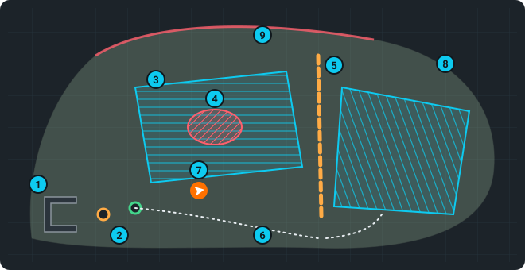

# Mapy a mapování

**Mapa** (*site*) je jedna zahrada: terén, který robot nahrál, a všechno, co do něj přidáš —
body (DOCK, UNDOCK, …), trasy, zóny, úpravy mapy a programy. Robot jezdí a seká jen na
**aktivní** mapě. Všechno se ukládá v metrech ve skutečných souřadnicích (UTM), takže mapa sedí
s GPS i s leteckým snímkem.



1. **Dok**.
2. Body **DOCK** (oranžový) a **UNDOCK** (zelený) před ním ([Dok](dock.md#body)).
3. **Zóny** — plochy k sekání; plánovač je vyplní sekacími drahami (pruhy)
   ([Editor mapy › Zóny](map-editor.md#zóny-co-sekat)).
4. **Oblast překážky** — tam robot nikdy nevjede (záhon, jezírko).
5. **Bariéra** — čára, kterou robot nesmí přejet.
6. Uložená **trasa** ([Trasy](routes.md#trasy)).
7. **Robot** (oranžově) tam, kde právě je.
8. **Terén**, který robot nahrál — kudy může jezdit (vrstva Základ).
9. **Zeď** nebo živý plot, který lidar viděl (vrstva Uložená, červená).

## Která mapa je aktivní

")

**Mapa › Mapa** ukazuje nahoře *Aktivní mapa: název* a pod tím kartu pro každou uloženou mapu
se štítky (*aktivní*, *nahrává se*, *bez relace*), plochou, počtem relací a programů. Řádek pod
aktivní mapou se ozve, jen když je co říct: běží nahrávání, aktivace selhala nebo právě probíhá,
nebo není aktivní žádná mapa. Kliknutím
na kartu mapu ukážeš ve 3D pohledu a otevřeš její vrstvy (viz níž).

- **Aktivovat** — robot se od teď lokalizuje a jezdí podle této mapy.
- **Upravit mapu** (ikona vedle aktivní mapy) — otevře [editor mapy](map-editor.md). Jde jen
  s aktivní mapou.
- **Deaktivovat** — nenechá aktivní *žádnou* mapu (test „jako z továrny“; vydrží i restart).
  Klikni dvakrát. Ukončí ho **Aktivovat** nebo **Uložit a dokončit**.
- 🗑 — smaže celou mapu se všemi relacemi a programy. Klikni dvakrát. Aktivní mapu a mapu, která
  se právě nahrává, smazat nejde.

## Nahrát novou mapu

```flow
Název | nový název = nová mapa
Nahrávat | projeď zahradu pomalu
Projeď všechno | okraje, kolem překážek, dok
ok: Uložit a dokončit | nejlíp v doku
Aktivní | nová mapa je hned aktivní
```

")

1. **Mapa › Mapa › Nahrávání mapy**: napiš **název** (písmena, číslice, `_` a `-`; s jiným znakem
   robot nahrávání nespustí).
2. Stiskni **Nahrávat** a projeď robotem celou plochu (joystick, pomalá rychlost). Jeď po
   okrajích a kolem překážek; s dobrým RTK mapa sedne na správné místo.
3. Skonči v doku a stiskni **Uložit a dokončit**. Mapa se uloží a stane se **aktivní**.

> [!TIP]
> Když nahrávání ukončíš **v doku**, vytvoří se sám bod *DOCKED* (poloha robota v doku), od
> kterého se v doku odvíjí lokalizace. Pokud místo ještě nemá DOCK nebo UNDOCK, vzniknou s ním tam,
> kde končí vycouvání; přesuneš je v **Mapa › Dock** nebo v editoru mapy
> ([Dok a výjezd z doku](dock.md#body)). Když relace nikdy neměla stabilní RTK, varuje log robota
> *captured NO georef datum… remap with good GPS*.

Během nahrávání:

- **Smazat a nahrávat dál** — smaže, co se zatím nahrálo, a nahrává dál (klikni dvakrát).
- **Zahodit (neukládat)** — ukončí nahrávání a zahodí ho, nic z něj se neuloží; robot se vrátí na
  uloženou mapu (klikni dvakrát).
- **Profil mapování** — s čím se tohle místo mapuje, viz níže.
- *Lokalizace při nahrávání* — jak se robot během tohoto nahrávání lokalizuje.

## Profil mapování

Jedna pojmenovaná sada pro mapování, vybíraná v sekci **Nahrávání** v záložce Mapa: co kamera bere
jako překážku, lidar pro mapování a jak se v mapě sčítají důkazy. Vestavěné jsou **Tráva krátká**,
**Tráva vysoká**, **Dlážděný dvůr**, **Keře / okraj** a **Výchozí**, vlastní přibudou vedle nich.

**Každé místo má svůj.** Název vpravo říká, pro které místo se profil ukazuje. Když zapneš jinou
mapu, přijde její profil, i s kamerou (do vteřiny dvou), s nahráváním i bez něj; nová mapa začne
jako kopie toho, co se právě používalo. Bez zapnuté mapy se hodnoty nechají pro další nahrávání.
Navigace na ničem z toho nezávisí.

- Panel jen vybírá a ukazuje: **Kamera**, **Lidar** a **Důkazy** říkají, co profil obsahuje,
  **Nastavit** tě vezme do [Nastavení › Kamera](camera.md#detekce-překážek) a
  [Nastavení › Lidar](lidar.md#lidar-v-mapování). Model důkazů je přímo níž v panelu.
- **Změna se uloží hned** pro tohle místo, s nahráváním i bez něj, a při nahrávání hned platí. Panel
  pak ukáže *upraveno* s počtem a tečku u části, která se liší.
- **Uložit do profilu** zapíše změny do profilu, pro všechna místa, která ho používají. **Uložit
  jako…** udělá nový. **Zpět na profil** zahodí změny tohoto místa.
- Uložení do vestavěného profilu nechá tvou verzi vedle něj (tečka v seznamu); **Vrátit výchozí**
  vrátí jeho hodnoty. **Smazat profil** odstraní vlastní; místa, která ho používala, si hodnoty nechají.
- Přepnutí profilu s rozdělanými změnami se nejdřív zeptá: zahodily by se.
- Když detekce z kamery neběží, panel to řekne a hodnoty dostane, až naběhne. Když je odmítne, panel
  řekne proč a běží dál na předchozích.

Co je v kartě kamery, to platí pro mapu: mapování body z kamery podruhé nefiltruje. Mapy z doby před
touhle změnou si nechaly, co měly: jejich nastavení se převedlo na profil a to, co se od něj liší,
se ukazuje jako *upraveno*.

## Rozšířit mapu

Spusť nahrávání se **stávajícím názvem** mapy (vyber ho ze seznamu pod polem pro název). Ta mapa
je během nahrávání aktivní, takže se robot lokalizuje podle toho, co už zná, a nová relace se
přidá jako nová **vrstva**. Kde se relace překrývají, vyhrává novější.

## Relace, vrstvy a souhrnná mapa

Otevři kartu mapy a uvidíš **souhrnnou mapu** (👁 náhled, **Aktivovat**, ↻ znovu sestavit) a její
**vrstvy** — jednu za každou relaci nahrávání, pojmenovanou datem, nejnovější nahoře:

- přepínač relaci zahrne do **souhrnné mapy** nebo ji z ní vyřadí,
- 👁 ji ukáže jako náhled (modře, nic nemění),
- **Aktivovat** použije jen tuto jednu relaci (pak varování řekne, že se souhrnná mapa
  nepoužívá),
- 🗑 (klikni dvakrát) ji smaže; aktivní relaci smazat nejde.

**Souhrnná mapa** spojí všechny zahrnuté relace podle jejich GPS polohy. Sestaví se znovu sama
po **Uložit a dokončit**, po smazání vrstvy nebo po přepnutí; ↻ ji sestaví ručně.

## Co vidíš na mapě (vrstvy)

Zaškrtni vrstvy pod seznamem map: **Základ** (tyrkysová, navigační mapa), **Uložená** (červená,
aktivní mapa), **Živá** (černá, právě nahrávaná mapa), **Náhled** (modrá), **Výšková plocha** (výška:
modrá nízko, červená vysoko), **Podklad** (podkladová mapa, viz níž), **Déšť** (radar ČHMÚ ze služby
počasí; mapa z více radarů je překryv **Srážky (mozaika)**, viz níž). Podklad a překryvy změníš
nejrychleji [tlačítkem vrstev na mapě](#tlačítko-vrstev-na-mapě).

**Snímání** ukazuje, co robot právě sleduje, nakreslené naplocho na zemi kolem něj. Samo se
zapne, když začne nahrávání, a vypne, když skončí (zaškrtnout ho jde kdykoli i ručně):

- **Fialová = lidar.** Živý sken: sytější výplň až k překážce, kterou paprsek zasáhne (podél ní
  fialový obrys), slabá výplň tam, kde nic nezasáhl — to je volné místo až po dosah lidaru
  v profilu mapování, označený slabým obloukem. Mezery jsou paprsky, které mapa nebere.
- **Žlutá = kamera.** Zorný kužel hloubkové kamery: asi 55° široký, až po dosah kamery
  v profilu mapování. Ztlumený kužel během nahrávání znamená, že kamera teď do mapy nic nedodává.
- **Slabá výplň = už viděno** v tomto nahrávání (jen když mapovač data přijímá). Kde chybí, tam
  robot ještě nebyl — zajeď tam a mapa se doplní. S každým nahráváním a po **Smazat a nahrávat dál** začíná
  prázdná.

Dosahy jsou ty, které mapa opravdu bere (profil mapování tohoto místa), ne maximum senzorů, s
nahráváním i bez něj.

### Tlačítko vrstev na mapě

Čtvercové tlačítko se zaoblenými rohy a ikonou vrstev (vypadá jako kompas) pod kompasem v levém horním rohu mapy otevře **Mapové vrstvy** — na
telefonu jako list přes spodek mapy (mapa nad ním zůstane vidět, STOP, spodní lišta a joystick zůstanou
volné), na širší obrazovce jako kartu vedle tlačítka. Jedno klepnutí ho otevře, druhé vybere mapu:

- **Podklad** — snímky a mapy ve dvou skupinách, každá dlaždice se jménem, pod ním poskytovatel
  a malý obrázek té mapy kolem středu tvého pohledu (asi 50 m; než se načte, nebo když to nejde,
  kreslená ikonka), takže snímky porovnáš dřív, než některý vybereš; **Žádný** podklad schová.
  Vybraný je orámovaný, jeho jméno je i v hlavičce karty. **Krytí** pod
  dlaždicemi je tentýž posuvník jako v Zobrazení (vrstvy). Když se podklad nenačítá, řekne to
  oranžový řádek pod nadpisem (*nenačítá se — MapProxy nedostupný nebo robot bez internetu?*, nebo
  *2 z 6 dlaždic se nenačetlo*) a tlačítko zoranžoví; mapa to zkouší znovu sama. Když je vybraná
  mapa Googlu, přepínač **Zarovnat Google na ČÚZK** pod krytím ji posune asi o 1 m na ČÚZK (viz
  Zobrazení níž).
- **Překryvy** — *Čáry a popisy* (katastr, budovy a čísla domů, vrstevnice) a *Terén* (stínovaný
  reliéf, reliéf ×10 a ×20, sklon, expozice, stromy a budovy) a pod *Počasí* **Srážkový radar**
  a **Srážky (mozaika)** (jedna mapa z více radarů; když je zapnutá, její časová osa s předpovědí,
  ▶, *Teď*, legenda a *Celé okolí* jsou přímo v jejím řádku — tentýž ovládací prvek, který jinak je
  v Mapa › Zobrazení (vrstvy), viz níž; dokud je karta otevřená, je tady, ne tam).
  Každý zapneš přepínačem; zapnutý řádek ukáže krytí, jednu větu o tom, co ukazuje, a stav dlaždic
  (*z19 · 3/12*); **Sklon** má i barevnou stupnici ve stupních od *roviny* (šedá, pod 3°) přes žlutou
  (5–10°) a oranžovou (10–20°) po *strmé* (hnědá, přes 30°),
  **Expozice** barevné kolo se S, V, J, Z (barva svahu natočeného tím směrem: sever žlutozelená,
  východ modrá, jih fialová, západ oranžová).
- Zdroje, které přibyly od chvíle, kdy jsi kartu otevřel naposledy, mají oranžový štítek **nové** a
  tlačítko oranžovou tečku, dokud kartu nezavřeš.
- **Další nastavení v Mapa › Zobrazení ›** otevře zbytek (Detail, zarovnání, oblast radaru); v editoru
  mapy otevře jeho Vrstvy.

Je to totéž nastavení jako v panelu Mapa a ve Vrstvách editoru: co změníš na jednom místě, hned se
ukáže i na ostatních, a prohlížeč si to pamatuje. Klepnutí mimo kartu, ✕ nebo Esc ji zavře.

### Průjezdnost (živě)

**Průjezdnost (živě)** (karta vrstev pod *Robot*, také zaškrtávátko v řádku vrstev v panelu Mapa;
výchozí vypnuto, pamatuje se) ukazuje, co teď vidí uzel terénu robota: okno 6 × 6 m kolem robota po
5 cm, zhruba dvakrát za sekundu, naplocho na zemi pod robotem a trasami; kam kamera ještě nedohlédla,
tam není nic. Tři pohledy, stejné jako u sečené plochy níž (volba se pamatuje; co barvy znamenají,
řekne legenda pod nimi):

- **Průjezdnost** — od volna po nesjízdné.
- **Důvod** — proč je místo obtížné nebo nesjízdné (vyšší cena, schod, příliš prudké, překážka, sráz
  viděný jen z jednoho místa, zóna doku); samotná zóna doku má bílý obrys.
- **Výška** — terén proti robotu (±15 cm); jen když ji uzel terénu posílá (jeho parametr
  `ui_elevation`), jinak je tlačítko zašedlé.

Má vlastní krytí. Data chodí jen se zapnutou vrstvou a zobrazenou stránkou (nejvýš dvakrát za sekundu,
pár kB). Dokud podrobné téma uzlu terénu `/traversability/ui` není, vrstva použije jeho obyčejnou
costmapu — jen průjezdnost, řádek to řekne. Řádek říká *živě*, *čekám…*, *stará data* (pár sekund nic
nového, kreslí se vybledle), *bez polohy v mapě* (robot neví, kde je odometrie v mapě: nekreslí se)
nebo *žádná data* — pak uzel terénu neběží nebo kamera nedává obraz.
### Terén sečené plochy

**Terén sečené plochy** (karta vrstev pod *Robot*, také zaškrtávátko v řádku vrstev v panelu Mapa;
výchozí vypnuto, pamatuje se) ukazuje terén celé plochy, kterou robot posekal, složený dodatečně z jeho
nahrávek sečení po 5 cm — totéž jako živé okno vrstvy výše, ale pro celou plochu najednou. Tři pohledy:
**Průjezdnost** (zelená volno, žlutá → červená obtížnější, tmavě červená nesjízdné), **Důvod** (stejné
barvy jako živá vrstva: schod, příliš prudké, překážka, sráz viděný jednou, zóna doku) a **Výška**
(modrá nejníž, hnědá nejvýš; legenda řekne, o kolik centimetrů). Má vlastní krytí; řádek pod ní řekne
název mapy, kolik plochy je známo a jaký podíl je nesjízdný. Stanoviště může mít
víc map: mapu jednoho sečení (pevný obraz toho dne) a trvalou mapu terénu robota, která roste, dokud ji
robot nahrává, a nová verze se hledá každou minutu (nahradí obraz bez bliknutí). Zobrazí se mapa, kterou
vybereš v seznamu nad legendou (pamatuje se); bez volby trvalá mapa robota, jinak nejnovější. *Žádná
mapa* znamená, že pro toto stanoviště zatím žádná nevznikla. Vrstva mapu z robota jen čte (pár
set kB jednou při zobrazení).

### Měřítko

V levém dolním rohu, hned nad řádkem s autory map, ukazuje malý pruh měřítko: jeho délka na zemi je
vzdálenost napsaná nad ním (kulaté číslo: 50 cm, 2 m, 20 m, 1 km …). Sleduje každé přiblížení —
kolečko, dva prsty, tlačítka zoomu, editor mapy. Měří se uprostřed pohledu; mapa je vidět skoro
přímo shora, takže platí po celém obrázku. Se zapnutým deštěm je čas radaru hned nad pruhem.

### Měření

Tlačítko s pravítkem pod tlačítkem vrstev měří v mapě. Klepni na něj a pak klepej (nebo klikej) na
body v mapě: karta vedle tlačítka ukáže délku čáry přes ně a od tří bodů i **plochu**, kterou uzavírají,
a délku **dokola** (uzavřený tvar) — třeba jak velký je kus trávníku nebo jak dlouhý je plot. Tažení
a dva prsty mapou dál hýbou (bod přidá jen klepnutí bez tažení). **Zpět** odebere poslední bod,
**Smazat** všechny, **×** nebo Esc měření ukončí. Vzdálenosti jsou na zemi ve vlastních metrech mapy.
Když je otevřený panel Značka nebo editor mapy, měření klepnutí nebere (tam klepnutí umisťuje cílovou
značku nebo upravuje) a karta to řekne. Měření robotu nic neposílá.

### Dosah lidaru a Dosah kamery

**Snímání** je to, co senzory vidí právě teď. **Dosah lidaru** a **Dosah kamery** jsou dvě vrstvy
s mezemi: jak daleko který senzor vidí a kam ho robot opravdu používá. Fungují pořád, s nahráváním
i bez něj, každá má své zaškrtnutí a prohlížeč si ho pamatuje.

 a Dosah kamery (žlutě)")

**Navigace / Mapování** nahoře v kartě vybírá, co vrstvy ukazují: co robot používá za jízdy, nebo
profil mapování tohoto místa. Změna profilu nebo posuvník v Nastavení › Kamera / Lidar se tu ukáže,
jakmile ji robot má.

- **Čárkovaně** — co vidí senzor (lidar 16 m, kamera surový záběr hloubky po řez ovladače).
- **Jasný okraj** — mez vybraného pohledu, odkud kam sahá; kamera má uprostřed svůj zorný úhel.
  Čísla stojí na okrajích; když mez dává něco jiného než nastavení toho pohledu, popisek to řekne
  (*navigace 3,0 m · costmapa*). Popisek, který by překryl jiný, se schová, karta má všechny.
- **Krátké čárky v záběru kamery** — odkud začíná vidět zem: těsně před robotem ji nevidí.
- **Červená výseč** — lidar tam má něco těsně u sebe (blíž než 0,4 m skoro v každém skenu, trvá to
  asi 30 s), třeba stěny doku.

Karta ukazuje skutečné hodnoty i výškové okno kamery. Když je hodnota menší, než je nastaveno, řekne,
kdo ji uřízl, třeba *5,0 m: ovladač (nastaveno 6,0 m)*. Nastavení lidaru je v
[Nastavení › Lidar](lidar.md), kamery v [Nastavení › Kamera](camera.md); obě mají **Ukázat dosah na
mapě**.

**Plán agenta** (jantarový ◆) ukazuje, co agent plánuje pro běžící misi — body, trasy a plochy,
které si nakreslil do mapy; objeví se a zmizí sám, viz
[Agent Vitulus › Plán agenta na mapě](agent.md#plán-agenta-na-mapě).

**Zobrazení (vrstvy)** nastaví jejich krytí, barvy značky robota, **podkladovou mapu** pod mapou,
její **Detail** a posun zarovnání (uložený na robotu pro každou mapu a zdroj dlaždic; zdroje ČÚZK sdílí
jeden, zdroje Google druhý), srážkový radar a ukáže stav terénu (DEM). Nad posunem je volba
**Zarovnat Google na ČÚZK (asi 1 m)** (výchozí vypnuto, prohlížeč si ji pamatuje): posune satelit,
hybrid i mapu Googlu o 0,73 m na západ a 0,71 m na jih — snímky Googlu leží asi 1 m severovýchodně
od ČÚZK (ČÚZK je v ETRS89, Google v dnešním WGS84; změřeno na třech místech v Praze). Mapa robota se
nehne a ruční posun zůstane, jak je uložený; karta vrstev má stejný přepínač pod krytím podkladu,
když je vybraná mapa Googlu. Podkladové mapy jsou ve dvou
skupinách: **letecké a satelitní snímky** (satelit Google, satelit Google s popisky, ortofoto
ČÚZK, Esri, Bing, tři starší vydání Esri — *Archiv Esri 2025-04, 2023-06, 2022-04 (Wayback)*, datum je
vydání, snímek nad tvým místem může být starší — a *Ortofoto 50. léta (CENIA)*, černobílé letecké snímky
z 50. let, do z18) a **mapy** (mapa Google, topografická mapa ČÚZK, OpenTopoMap, OpenStreetMap).
Každý zdroj snímků má jiné datum a jinou ostrost — když je nad zahradou starý nebo rozmazaný,
zkus jiný. **Detail** *Auto* (výchozí) načte nejjemnější úroveň, jakou zdroj má — Google i ortofoto
ČÚZK z20 (z21 Googlu víc detailu nemá, a tak se nenačítá) — a ještě blíž ji už jen plynule zvětší. Přiblížení se zastaví zhruba na 20 cm podél delší strany obrazovky; podkladová
mapa i mapy robota přitom zůstávají vidět. Na telefonu se podkladová mapa zastaví
o úroveň hruběji (Google z20, ČÚZK z19), a načte tak méně dlaždic. Na pomalém spojení vyber nižší strop (z17–z21): méně
dlaždic, měkčí obraz. Dlaždice vždy pokryjí to, co vidíš. Po posunu nebo přiblížení zůstane
předchozí obraz, dokud nové dlaždice nedorazí, a mezery mezitím vyplní hrubší obraz, takže mapa
nezmizí; pohled, který jsi viděl před chvílí, se vrátí hned. Stavový řádek to řekne slovy — zdroj, pak
*nejjemnější detail*, *oddáleno, hrubší obraz* nebo *načítám 12 z 48 dlaždic…* (úroveň zoomu
v závorce pro zvídavé) — a řekne, když se některé nenačetly — pak MapProxy na robotu
není dostupný nebo tam obraz nemá (bez internetu má jen to, co si dřív uložil; čistě bílou dlaždici, kterou pak posílá, mapa
nekreslí). Jakmile se vrátí síť, spojení s robotem nebo internet MapProxy, mapa si dlaždice sama
načte znovu: pár chybějících dlaždic zkusí jednou rychle za 3 s; potom, a po větším výpadku, za 15 s, 30 s a pak každou minutu, dokud nepřijdou všechny (dlaždice, která neodpoví, se počítá jako chybějící, až 20 s nepřijde žádná dlaždice; na pomalou MapProxy se počká). Telefon má nižší
limit dlaždic než počítač, aby šetřil paměť; se zapnutými překryvy dá podkladové mapě nejvýš
polovinu (zdálky pak ukáže hrubší úroveň a její řádek hlásí *hrubší obraz: moc dlaždic*) a překryvy kreslí
o úroveň hruběji (reliéf a sklon o dvě), aby se vešly všechny. Počítač totéž dělá s překryvy, když
je hodně oddálený (pohled vysoký zhruba od 300 m): přijdou o úroveň hruběji (reliéf a sklon o dvě),
podkladová mapa si detail nechá, takže se pohled načte za zlomek času.

**Ztlumit mapu robota nad podkladem** (pod krytím podkladové mapy, výchozí vypnuto; také
v Nastavení › Aplikace › Zobrazení): když je
podkladová mapa vidět, je volné místo v mapě robota jen lehce tónované a neznámé buňky kolem jsou
průhledné, takže vidíš samotný trávník, ne šedozelenou plachtu. Kolem každé překážky zůstane světlý
lem, takže červené (nebo černé) překážky jsou vidět na každém obrázku. Nezaškrtnutá volba nechá mapu
s plnou výplní. Bez podkladové mapy, se skoro staženým krytím podkladu nebo když se z něj nenačetla
ani jedna dlaždice, je výplň vždy plná.

**Překryvy** jsou průhledné vrstvy, každá s vlastním zaškrtnutím a krytím, s podkladovou mapou
i bez ní: **Katastr** (hranice parcel, světlé čáry), **Budovy, čísla domů** (RÚIAN ČÚZK: obrysy
budov a čísla popisná) a **Vrstevnice** se kreslí nad mapami robota. **Stínovaný
reliéf** a **Sklon terénu** (obojí z modelu terénu ČÚZK DMR 5G; sklon žlutá → oranžová → červená
= prudší, hodí se na meze a příkopy) stínují podkladovou mapu i mapu robota a nezakryjí je, i uvnitř
zahrady: rovina zůstane, jak je, svahy ztmavnou nebo se zabarví (nikdy pod zhruba třetinu jasu,
ani v hlubokém stínu při plném krytí) a překážky, čáry, zóny, trasy i robot zůstanou
nahoře. Bez podkladové mapy se přes mapu položí jako obyčejný průsvitný tón. Katastr, budovy a vrstevnice
jsou vidět jen zblízka — dokud ne, řádek ukazuje *přibliž*. Během načítání řádek překryvu počítá
dlaždice (*z19 · 3/12*); *nenačteno* nebo *chybí 2* znamená, že je MapProxy nedodal. Všechny vrstvy mají
společný limit dlaždic, podkladová mapa má přednost: překryv, který se nevejde, ukáže *limit
dlaždic*, a když se podklad kreslí hruběji, než chceš, řekne to jeho stavový řádek. Malý řádek
v levém dolním rohu mapy uvádí zdroje, které jsou právě vidět (klepnutím ukáže celý text): zdroje
ČÚZK jsou otevřená data, OpenTopoMap je pod CC-BY-SA; Google, Esri a Bing jsou vlastní snímky
těch firem. **Vymazat costmapy** zapomene překážky,
které si robot právě pamatuje — žádnou uloženou mapu nemění.

**Srážky (mozaika)** jsou jedna mapa deště složená z několika meteoradarů — českého kompozitu
ČHMÚ, evropské sítě EUMETNET OPERA a RainVieweru — kterou skládá vlastní služba srážek robota (běží
na robotu vedle MapProxy, port 8097). Po zaškrtnutí se pod řádkem otevře časová osa: čas obrázku
na mapě a co je to zač (*nejnovější radar*, *radar −25 min* nebo *předpověď +20 min*, krátkodobá
předpověď v barvě info), jak starý je nejnovější snímek radaru, posuvník přes poslední dvě hodiny
a předpověď (šrafovaná část vpravo od *teď*), **▶** pro přehrání, **Teď** pro návrat na nejnovější
snímek (vrstva pak sama sleduje nové), legenda barev v mm/h (déšť, a sníh, kde ho radar pozná),
zdroje obrázku s odkazy a **Celé okolí**, které oddálí mapu na celou oblast kolem zahrady. Čas je
napsaný i v levém dolním rohu mapy. Slabý déšť je průsvitný, silný plný; kde žádný radar neměří,
zůstane mapa prázdná (to neznamená „sucho“). *Data stará N min* znamená, že radary už chvíli
neposlaly nový snímek; *služba neodpovídá* znamená, že služba srážek na robotu neběží — vrstva
**Déšť** ze služby počasí je samostatná a funguje dál. Mapa je jen pro vlastní potřebu robota:
podmínky RainVieweru povolují jen osobní použití.

> [!NOTE]
> Když se vrstva mapy neukáže, nemusí chybět — nejdřív obnov stránku. Víc v
> [Řešení problémů › Mapa není vidět](troubleshooting.md#mapa-není-vidět).
