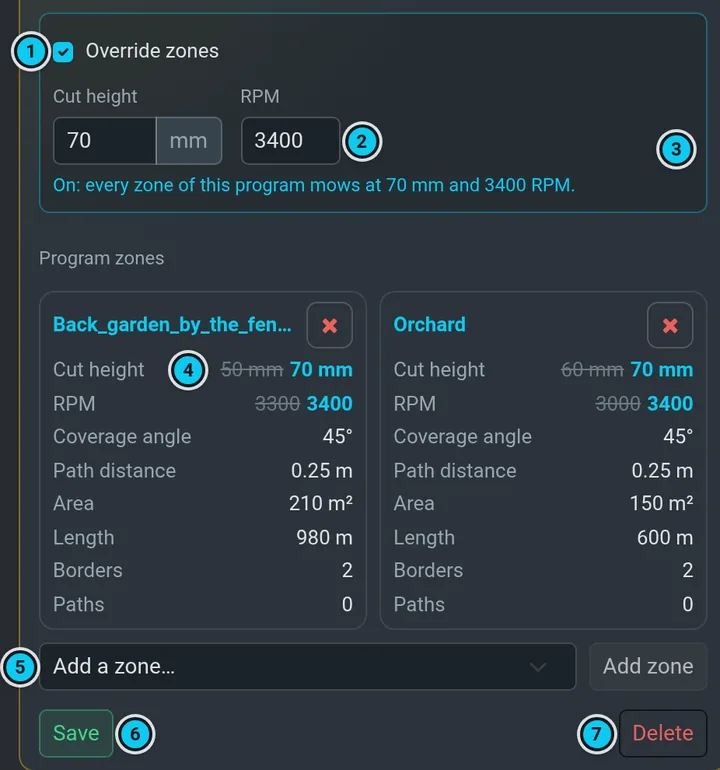
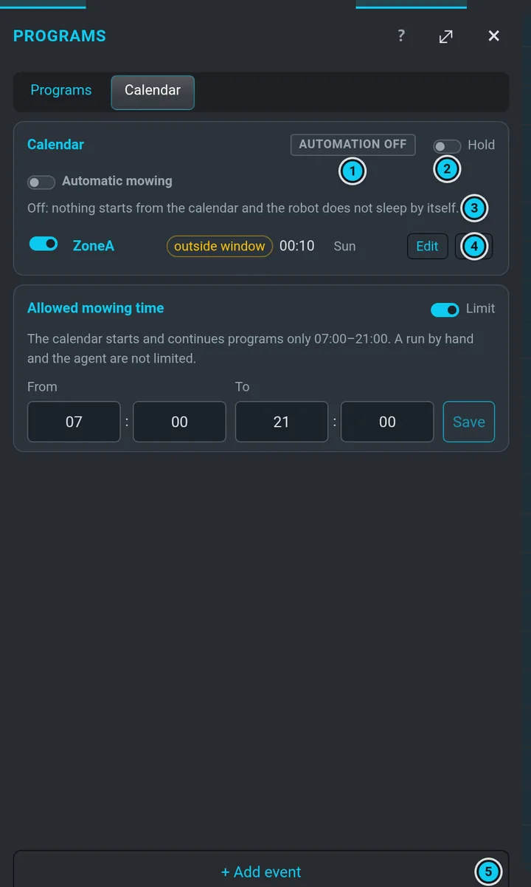
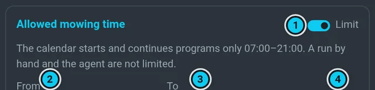

# Programy a kalendář

**Program** říká, *co* sekat: seznam zón své mapy, rychlost a volitelně jednu výšku sekání
a otáčky pro všechny zóny. **Kalendář** říká, *kdy*. Programy najdeš v **Programy**, kalendář
v [Autonomie › Plán](autonomy.md#plán) (vede tam odkaz *Kdy běží: kalendář v Autonomii › Plán* pod
seznamem programů).

 · 2 odkaz na kalendář · 3 Run · 4 Resume · 5 Ukázat / Skrýt · 6 Stop · 7 Reset")

Každá karta v seznamu říká, jak program naposledy skončil: **hotovo**, **nedokončeno · zóna**
(skončil v té zóně, **Resume** tam pokračuje), **selhal při startu** nebo **ještě neběžel**.
Původní text robota je v bublině po najetí myší.

Malý obrázek vlevo na kartě ukazuje zóny programu, každou v barvě, jakou ji kreslí mapa, nad
stejným podkladem jako záložka Mapa (výchozí je letecký snímek; mění se tlačítkem vrstev na mapě).
Když je podklad vypnutý nebo se dlaždice nenačtou (bez internetu, MapProxy neodpovídá), ukáže
obrázek jen tvar zón na jednobarevném pozadí. Klik na obrázek otevře program a ukáže ho na mapě,
stejně jako **Ukázat** — nikdy ho neskryje a robotem nepohne. Program jiné mapy má místo obrázku
značku mapy: jeho zóny jsou známé, až když je jeho mapa aktivní. Obrázky se kreslí jen u karet,
ke kterým doroluješ, a všechny dohromady načtou jen pár dlaždic.



## Vytvořit program

1. Nejdřív aktivuj mapu — program patří k mapě, na které vznikl.
2. **Programy › Programy › Nový program**: vyplň **Název** a přidej zóny: pod **Zóny programu**
   vyber zónu v **Přidat zónu…** a stiskni **Přidat zónu** (zóna, která už v programu je, je
   označená a znovu vybrat nejde).
3. **Rychlost**: **Slow** / **Mid** / **Fast**.
4. **Přepsat zóny**: vypnuté — každá zóna se seče se svou výškou a otáčkami (jsou na její kartě).
   Zaškrtnuté — **Výška sekání** (mm) a **Otáčky** pod ním nahradí hodnoty všech zón (obě musí být
   nad 0); karty zón pak ukážou svou hodnotu přeškrtnutou a vedle ni hodnotu programu a řádek pod
   rámečkem řekne, co platí. Prázdné pole znamená *nenastaveno*. Výška je v milimetrech jako všude
   v UI, třeba 50 = 5 cm.
5. **Uložit** dole na kartě — uloží název, zóny i nastavení najednou.

Program změníš tak, že otevřeš jeho kartu, upravíš ho a znovu dáš **Uložit**. Nový název ho
přejmenuje (starý záznam zmizí). Program, který robot právě jede, přejmenovat nejde — nejdřív ho
zastav.

## Smazat program

1. Otevři kartu programu v **Programy › Programy**.
2. **Smazat** (červené, dole vedle **Uložit**) a potvrď v dialogu.

Zóny programu na mapě zůstanou — zmizí jen program. Když program používají události v kalendáři,
dialog řekne kolik; v kalendáři zůstanou s označením **chybí** a přeskakují se, dokud je
neotevřeš přes **Upravit** a nevybereš jiný program. Běžící program smazat nejde — nejdřív
**Stop** (zastavený program smazat jde).

## Spuštění

| Tlačítko | Co dělá |
|---|---|
| **Run** | spustí program od začátku — robot vyjede z doku a seká |
| **Resume** | pokračuje v nedokončeném programu od zóny / trasy, kde skončil |
| **Ukázat / Skrýt** | vykreslí trasy programu na mapu; běžící program se vykreslí sám, viz [níže](#dráhy-na-mapě) |
| **Stop** | zastaví misi: cíl jízdy se zruší, nůž se zastaví, robot zůstane stát, kde je — *Zastaveno* |
| **Reset** | smaže stav *STOPPED* nebo *TERMINAL ERROR* |

**Run** je vyplněné tlačítko a stojí stranou od **Resume**. **Stop** a **Reset** jsou odděleně vpravo
(na telefonu na vlastním řádku) a jsou jen obrysové, dokud nemají co dělat; fungují ale vždycky.
**Stop** se vyplní, když mise jede, **Reset**, když na něj mise čeká.

Když program běží, nad seznamem programů je karta **Běží** s jeho názvem, stavem a tlačítkem
**Stop** — ať je dole otevřený kterýkoli program (nebo žádný). Po zastavení se z ní stane
**Zastaveno** s tlačítkem **Reset**.

Když se start liší od toho, co program říká, plánovač přidá poznámku. Ukáže se po **Run** a v kartě
**Běží** po celou jízdu: zóna vynechaná, protože ji kryje [pravidlo mapy](map-editor.md#pravidla),
nebo **Resume**, které zónu začíná znovu, protože její místo pokračování už nesedí nebo zóna zmizela.

 

### Dráhy na mapě

Když program běží, jeho dráhy jsou na mapě samy, ať ho spustil kdokoli (Run, Resume, kalendář,
agent), i v telefonu, který se připojí později. Zmizí, když program skončí: hotovo, Stop, chyba,
nebo dojezd do doku po návratu kvůli baterii či počasí.

| Na mapě | Význam |
|---|---|
| tenká čára kolem zóny | hranice zóny, každá zóna má svou barvu |
| silná čára v barvě zóny | přejezdy podél hranice, které zbývají |
| slabší čára v barvě zóny | výplň, která zbývá |
| šedá čára | už posekané (obnovuje se zhruba jednou za minutu), procenta jsou v kartě běžícího programu |

- **Skrýt** u běžícího programu platí jen pro tento běh: **Ukázat** dráhy vrátí a další běh je
  ukáže zase. Platí pro všechny, kdo se na mapu dívají.
- Program ukázaný ručně před během: stejný program zmizí s během, jiný počká a po běhu se vrátí.
- **Ukázat** jiného programu za běhu se vykreslí přes běžící.

### Víc programů za sebou

Řekni agentovi *posekej zónu A a po ní Test*: robot poseká programy jeden po druhém bez dokování
a zadokuje až po posledním. Každý program je během svého běhu na kartě Běží i na mapě a má své
místo pro Resume. Run tady v panelu i kalendář spouští vždy jeden program a po něm dokují. Víc
v [Programech sekání](agent.md#programy-sekání).

### Přerušit a pokračovat

Běžící program se zastaví při kterékoli z těchto věcí — vždy do stavu *Zastaveno*, nůž vypnutý:

- **Stop** v Programech (na kartě Běží nebo na kartě programu),
- červené **STOP** vpravo nahoře nebo **Esc** (vypne i pojezdové motory — [Bezpečnost](safety.md#stop)),
- převzetí ovládání gamepadem nebo webovým joystickem
  ([Bezpečnost](safety.md#gamepad-ds4-a-joystick-mají-přednost-před-softwarem)).

```flow
ok: Run | robot vyjede z doku a seká zóny popořadě
Běží | karta Běží ukazuje zónu / trasu
warn: Zastaveno | Stop, červené STOP nebo převzetí; nůž vypnutý
info: Reset | smaže Zastaveno — potřeba dřív než cokoli jiného
ok: Resume nebo Run | Resume = odkud skončil, Run = od začátku
```

Robot pak stojí a čeká. Jak pokračovat: **Reset**, pak **Resume** (naváže zhruba tam, kde
skončil — mise si místo ukládá každou minutu) nebo **Run** (od začátku). Mimo dok musí být
motory zapnuté — po červeném STOP je nejdřív zapni (**Nastavení › Motory › ON**), jinak se start
odmítne hláškou *Start rejected: motors are OFF*. Když chceš program místo toho ukončit, dej
**Reset** a pošli robota domů (**pravý panel › Ovládání › Dock**).

> [!IMPORTANT]
> Po zastavení nebo chybě mise čeká na **Reset** — **Run** a **Resume** se do té doby
> ignorují a UI napíše *Mise je zastavená — nejdřív stiskni Reset*.

Když plánovač něco odmítne (žádné zóny, zóna už na mapě není, program běží), důvod se ukáže pod
tlačítky na kartě programu.

## Programy jiných map

**Programy** ukazují programy **všech** map, každý se jménem své mapy, například *B1Test (BACK)*.
Program mapy, která není zapnutá, spustíš z jeho karty:

1. Otevři program a stiskni **Run** nebo **Resume**. Karta napíše *Načítám mapu …*.
2. Robot načte mapu programu **v doku**, ověří, že jsou připravené zóny, programy, navigace i jeho
   poloha na té mapě, a teprve pak vyjede z doku.
3. Mapa zůstane zapnutá i po skončení programu.

Program zapnuté mapy se spustí hned, nic se nenačítá znovu. Kalendář i agent spouštějí programy
jiných map stejně. **Stop** během načítání spuštění zruší.

Mapa se mění jen v doku a když nic neběží. Když to neplatí nebo mapa nejde načíst, robot z doku
nevyjede a karta napíše proč:

| Karta napíše | Co udělat |
|---|---|
| *jde načíst jen v doku* | dojeď do doku a stiskni **Run** znovu |
| *když běží program* / *čeká na Reset* | nejdřív **Stop** nebo **Reset** |
| *se nezapnula / nebyly připravené / nepřevzala* | mapa má problém: otevři ji v **Mapa**, podívej se, co jí chybí, a dej **Run** znovu |
| *je … m od doku té mapy* | bod `DOCKED` té mapy je špatně: zadokuj robota a ulož ho znovu |
| *nemá bod DOCK* | přidej ho, bez něj by se robot nevrátil domů |
| *nemá bod DOCKED* | zadokuj robota na té mapě a bod ulož, bez něj se robot na mapě neumístí |
| *je na více mapách* | otevři v seznamu ten správný a stiskni **Run** tam |

Když chceš program jiné mapy **upravit**, nejdřív zapni jeho mapu: tady je jeho karta jen pro čtení.

## Kalendář



**Autonomie › Plán** ukazuje události (vede tam odkaz na kalendář pod seznamem programů): program, čas a opakování (**Jednou**, **Denně**,
**Týdně** s vybranými dny, **Měsíčně**, **Ročně**), každá s vypínačem, **Upravit** a **Smazat**.
Událost se spustí do 15 minut po svém čase, jednou za den.


Štítek v hlavičce kalendáře říká, co plánovač právě dělá:

| Štítek | Význam |
|---|---|
| **Naplánováno** | plánovač bude spouštět programy (nečinný, čeká na další událost) |
| **Nic v plánu** | automatika je zapnutá, ale žádný start není naplánovaný (žádná událost nebo všechny vypnuté) |
| **Mimo okno** | čeká, až se otevře [povolený čas sekání](#povolený-čas-sekání) |
| **Nesekat** | je zapnuté *Dnes nesekat* (nebo nesekat do určitého dne) |
| **Nevyjíždí** | běh agenta skončil nebo se zrušil; čeká na další radu nebo na kalendář |
| **Usíná** / **Tvrdý restart** | odpočítává se spánek nebo tvrdý restart, se **Zrušit** |
| **Jiný stav** | stav, který tahle stránka ještě nezná; řádek pod ním a tooltip řeknou, co to je |
| **Čeká** | nedokončený program na něco čeká: nabití, sucho, další pokus; řádek pod štítkem říká na co a co přijde potom |
| **Obsazeno** | robota používá někdo jiný (běžící program, dokování, ruční jízda, agent) nebo ho drží hlídač GPS; kalendář počká a dožene to a robot neusne |
| **Chce Reset** | mise byla zastavená nebo skončila chybou; nic nepojede, dokud nestiskneš **Reset** |
| **Pozastaveno** | je zapnuté **Pozdržet** — z kalendáře se nic nespustí, dokud ho nevypneš |
| **Automatika vypnuta** | **Automatické sekání** je vypnuté, viz [níž](#automatika-zapnutá--vypnutá) — sám nic nespustí ani neusne |
| **Sekání** | právě běží program |
| **Mimo dok** | robot není v doku; červeně, když je program nedokončený: naváže, až bude robot zpátky v doku |
| **Spouštím** | plánovač sám startuje (první chvíle po startu robota) |

Řádek pod štítkem říká totéž jednou větou, s příštím spuštěním a u nedokončeného programu i s tím,
kde naváže. Po najetí na štítek uvidíš surový stav plánovače. Problémy, které už skončily, ale máš
o nich vědět (propadlá událost, vzdaný běh), zůstanou pod tím řádkem, dokud je nedáš **Smazat**.

Událost může použít program libovolné mapy: formulář je ukazuje všechny se jménem mapy a v daný čas
se mapa načte v doku, než robot vyjede ([Programy jiných map](#programy-jiných-map)). Událost,
jejíž program není na žádné mapě (smazaný, přejmenovaný), má označení **chybí**; plánovač ji chvíli
zkouší a pak ji nahlásí. Otevři ji přes **Upravit** a
vyber program. Událost mimo [povolený čas sekání](#povolený-čas-sekání) (výchozí 07:00–21:00) má
označení **mimo okno**: spustí se až po
otevření okna, pokud je to ještě v čase pro dohnání.

### Když se událost nestihne spustit

Událost, která se nemohla spustit (robot byl obsazený, spal, stack neběžel, posunul se čas), platí
ještě **4 hodiny** a spustí se, jakmile to půjde, v okně a s aspoň 30 minutami okna před sebou.
Potom se nahlásí jako propadlá. Událost nikdy neběží za den dvakrát a za proběhlou se počítá až
ve chvíli, kdy robot opravdu prošel kontrolami před startem, takže odmítnutí kvůli dešti ji neztratí.
Když je jich na řadě víc, běží jedna po druhé. Nedokončený program má přednost: nová událost na něj
počká, kvůli ní se nezahodí.

### Povolený čas sekání



Karta **Povolený čas sekání** pod kalendářem je pravidlo „v noci se neseká": kalendář i agent
spouští a navazují programy jen v tuhle denní dobu. Výchozí je **07:00–21:00** se zapnutým Omezit.
Jiný takový čas není: noční limit agenta je právě tenhle (Autonomie › Kdo rozhoduje › Pravidla
a tvrdé limity ho ukazuje jedním řádkem).

- **Omezit** pravidlo zapíná a vypíná; vypnuto znamená, že rozhodují jen časy v kalendáři, i v noci,
  a denní doba nedrží ani agenta.
- **Od** a **Do** se nastaví tlačítkem **Uložit**. Čas může jít přes půlnoc (22:00–05:00 seká
  v noci); Od a Do nemůžou být stejné a čas kratší než 30 minut by nikdy nic nespustil, karta na to
  upozorní.
- Nastavení je uložené na robotu, přežije restart a platí hned, nic se nerestartuje. **Automatické
  sekání** zůstává, jak je.

Omezuje to kalendář a to, co agent v režimu Agent rozhoduje sám. Ruční **Run** a úkol, který
agentovi zadáš, omezené nejsou.

Sama změna nic nespustí. Zavřené okno funguje jako jeho běžný konec: robot dokončí dráhu, vrátí se
a naváže, až se okno otevře. Když čas vrátíš dřív, než robot odjel, seká dál. Rozšířený čas pustí
událost na řadě nebo nedokončený program podle obvyklých pravidel (se zapnutým Automatickým sekáním,
v čase na dohnání). Připravovaný spánek se zruší a naplánuje znovu; robot, který už spí, není
dostupný a rozhodne se, až se probudí.

Skripty: `/scheduler/set_window` (`std_msgs/String`, JSON `{"enabled": true, "start": "07:00",
"end": "21:00"}`, chybějící klíč zůstává); nastavení je v `/scheduler/report` (`window_setting`).

### Pozdržet

**Pozdržet** zastaví nová spuštění z kalendáře — program, který už běží, nezastaví (na to je
**Stop**). Naplánovaný program, který běží ve chvíli, kdy Pozdržet zapneš, se dál sleduje až
do konce. Když se přerušil (baterie, déšť, teplota), robot se při zapnutém Pozdržet neuspí; po
vypnutí Pozdržet ho plánovač obnoví jako obvykle.

### Automatika zapnutá / vypnutá

**Automatické sekání** v kartě kalendáře je jediný přepínač pro všechno automatické: starty
z kalendáře, spánek, navazování. Je uložený na robotu a přežije restart; nový robot ho má
**vypnutý**.

- **zapnuto**: kalendář spouští programy sám a robot se sám uspává a navazuje (baterie, déšť,
  teplota, [povolený čas](#povolený-čas-sekání) — viz [Proč robot čeká](waiting.md)). Zapnutí zároveň ruší **Pozdržet** a
  události počítá od teď: nic z doby, kdy byl vypnutý, se nedohání;
- **vypnuto**: plánovač je pasivní — žádné automatické spuštění ani uspání; programy běží jen, když
  je spustíš ručně. Program, který je zrovna venku, zůstane běžet, ale plánovač ho přestane sledovat;
  místo pro **Resume** zůstává.

Skripty a agent můžou použít `/scheduler/set_enabled` (topic `std_msgs/Bool`, služba
`std_srvs/SetBool`); `/scheduler/enabled` říká aktuální stav.

Proč se program nespustil nebo skončil dřív: [Proč robot čeká](waiting.md).
