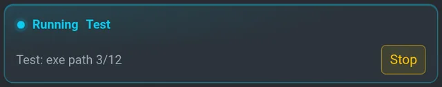
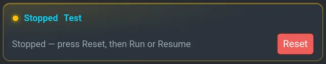
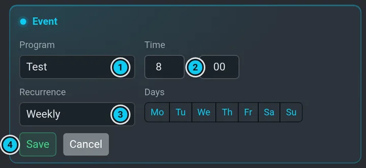

# Programy a kalendář

**Program** říká, *co* sekat: seznam zón aktivní mapy, rychlost a volitelně jednu výšku sekání
a otáčky pro všechny zóny. **Kalendář** říká, *kdy*. Obojí najdeš v **Programy**.

 · 2 Run · 3 Resume · 4 Show / Hide · 5 Stop · 6 Reset · 7 Uložit · 8 Smazat")

## Vytvořit program

1. Nejdřív aktivuj mapu — program patří k mapě, na které vznikl.
2. **Programy › Programy › Nový program**: vyplň **Název** a přidej zóny ze seznamu
   (**Přidat zónu**).
3. **Rychlost**: **Slow** / **Mid** / **Fast**.
4. **Otáčky**, **Výška sekání** (mm) a **Přepsat zóny**: když je zaškrtnuté, tyhle dvě hodnoty
   nahradí výšku sekání a otáčky každé zóny (obě musí být nad 0). Výška je v milimetrech jako
   všude v UI, třeba 50 = 5 cm.
5. **Uložit**.

Program změníš tak, že otevřeš jeho kartu, upravíš ho a znovu dáš **Uložit**. Nový název ho
přejmenuje (starý záznam zmizí). Program, který robot právě jede, přejmenovat nejde — nejdřív ho
zastav.

## Smazat program

1. Otevři kartu programu v **Programy › Programy**.
2. **Smazat** (červené, vedle **Uložit**) a potvrď v dialogu.

Zóny programu na mapě zůstanou — zmizí jen program. Když program používají události v kalendáři,
dialog řekne kolik; v kalendáři zůstanou s označením **chybí** a přeskakují se, dokud je
neotevřeš přes **Upravit** a nevybereš jiný program. Běžící program smazat nejde — nejdřív
**Stop** (zastavený program smazat jde).

## Spuštění

| Tlačítko | Co dělá |
|---|---|
| **Run** | spustí program od začátku — robot vyjede z doku a seká |
| **Resume** | pokračuje v nedokončeném programu od zóny / trasy, kde skončil |
| **Ukázat / Skrýt** | vykreslí trasy programu na mapu |
| **Stop** | zastaví misi: cíl jízdy se zruší, nůž se zastaví, robot zůstane stát, kde je — *Zastaveno* |
| **Reset** | smaže stav *STOPPED* nebo *TERMINAL ERROR* |

Když program běží, nad seznamem programů je karta **Běží** s jeho názvem, stavem a tlačítkem
**Stop** — ať je dole otevřený kterýkoli program (nebo žádný). Po zastavení se z ní stane
**Zastaveno** s tlačítkem **Reset**.

 

### Přerušit a pokračovat

Běžící program se zastaví při kterékoli z těchto věcí — vždy do stavu *Zastaveno*, nůž vypnutý:

- **Stop** v Programech (na kartě Běží nebo na kartě programu),
- červené **STOP** vlevo dole (vypne i pojezdové motory — [Bezpečnost](safety.md#stop)),
- převzetí ovládání gamepadem nebo webovým joystickem
  ([Bezpečnost](safety.md#gamepad-ds4-a-joystick-mají-přednost-před-softwarem)).

```flow
ok: Run | robot vyjede z doku a seká zóny popořadě
Běží | karta Běží ukazuje zónu / trasu
warn: Zastaveno | Stop, červené STOP nebo převzetí; nůž vypnutý
info: Reset | smaže Zastaveno — potřeba dřív než cokoli jiného
ok: Resume nebo Run | Resume = odkud skončil, Run = od začátku
```

Robot pak stojí a čeká. Jak pokračovat: **Reset**, pak **Resume** (naváže zhruba tam, kde
skončil — mise si místo ukládá každou minutu) nebo **Run** (od začátku). Mimo dok musí být
motory zapnuté — po červeném STOP je nejdřív zapni (**Nastavení › Motory › ON**), jinak se start
odmítne hláškou *Start rejected: motors are OFF*. Když chceš program místo toho ukončit, dej
**Reset** a pošli robota domů (**pravý panel › Ovládání › Dock**).

> [!IMPORTANT]
> Po zastavení nebo chybě mise čeká na **Reset** — **Run** a **Resume** se do té doby
> ignorují a UI napíše *Mise je zastavená — nejdřív stiskni Reset*.

Když plánovač něco odmítne (žádné zóny, zóna už na mapě není, žádná aktivní mapa, program běží),
důvod se ukáže pod tlačítky na kartě programu.

## Kalendář

 · 2 Pozdržet · 3 jeho stav a příští spuštění · 4 událost · 5 přidat událost")

**Programy › Kalendář** ukazuje události: program, čas a opakování (**Jednou**, **Denně**,
**Týdně** s vybranými dny, **Měsíčně**, **Ročně**), každá s vypínačem, **Upravit** a **Smazat**.
Událost se spustí do 15 minut po svém čase, jednou za den.



Štítek v hlavičce kalendáře říká, co plánovač právě dělá:

| Štítek | Význam |
|---|---|
| **Aktivní** | plánovač bude spouštět programy (nečinný, čeká na další událost) |
| **Pozastaveno** | je zapnuté **Pozdržet** — z kalendáře se nic nespustí, dokud ho nevypneš |
| **Automatika vypnuta** | plánovač je na robotu vypnutý (`automation_enabled: false`, viz [níž](#automatika-zapnutá--vypnutá)) — sám nic nespustí |
| **Sekání** | právě běží program |
| **Mimo dok** | program skončil mimo dok — plánovač čeká, až se robot vrátí (nejvýš 20 minut, pak robota uspí) |
| **Spouštím** | plánovač sám startuje (první chvíle po startu robota) |

Řádek pod štítkem je vlastní stav plánovače a příští spuštění, třeba
*Idle (Wait 12m for …)*, nebo *Mowing (Stopped - press Reset)*, když naplánovaný program čeká
na Reset.

Událost, jejíž program na aktivní mapě není (smazaný, přejmenovaný nebo vytvořený na jiné mapě),
má označení **chybí**; plánovač ji ten den přeskočí. Otevři ji přes **Upravit** a vyber program.

### Pozdržet

**Pozdržet** zastaví nová spuštění z kalendáře — program, který už běží, nezastaví (na to je
**Stop**). Naplánovaný program, který běží ve chvíli, kdy Pozdržet zapneš, se dál sleduje až
do konce. Když se přerušil (baterie, déšť, teplota), robot se při zapnutém Pozdržet neuspí; po
vypnutí Pozdržet ho plánovač obnoví jako obvykle.

### Automatika zapnutá / vypnutá

`automation_enabled` je hlavní vypínač plánovače (master controlleru):

- **zapnutá** (`true`): kalendář spouští programy sám a robot se sám uspává a probouzí
  (baterie, déšť, teplota, noční okno — viz [Proč robot čeká](waiting.md));
- **vypnutá** (`false`): plánovač je pasivní — žádné automatické spuštění ani uspání;
  programy běží jen, když je spustíš ručně.

Jak to poznáš: když je vypnutá, štítek kalendáře ukazuje **Automatika vypnuta** a řádek stavu
*Disabled*; jakýkoli jiný štítek (Aktivní, Pozastaveno, Sekání, …) znamená, že je zapnutá.

Kde se mění: `automation_enabled` ve `vitulus_planner/config/master_controller.yaml`. Controller
ho čte jen při startu, takže změna platí až po restartu stacku robota (nebo uzlu
`master_controller`). Když chceš kalendář jen na chvíli zastavit a nesahat do konfigurace,
použij **Pozdržet**.

Proč se program nespustil nebo skončil dřív: [Proč robot čeká](waiting.md).
