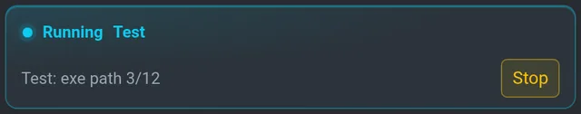
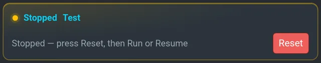
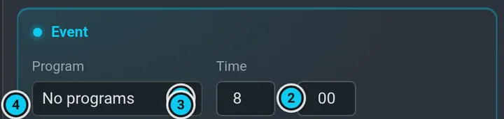

# Programy a kalendář

**Program** říká, *co* sekat: seznam zón své mapy, rychlost a volitelně jednu výšku sekání
a otáčky pro všechny zóny. **Kalendář** říká, *kdy*. Obojí najdeš v **Programy**.

 · 2 Run · 3 Resume · 4 Show / Hide · 5 Stop · 6 Reset · 7 Uložit · 8 Smazat")

## Vytvořit program

1. Nejdřív aktivuj mapu — program patří k mapě, na které vznikl.
2. **Programy › Programy › Nový program**: vyplň **Název** a přidej zóny ze seznamu
   (**Přidat zónu**).
3. **Rychlost**: **Slow** / **Mid** / **Fast**.
4. **Otáčky**, **Výška sekání** (mm) a **Přepsat zóny**: když je zaškrtnuté, tyhle dvě hodnoty
   nahradí výšku sekání a otáčky každé zóny (obě musí být nad 0). Výška je v milimetrech jako
   všude v UI, třeba 50 = 5 cm.
5. **Uložit**.

Program změníš tak, že otevřeš jeho kartu, upravíš ho a znovu dáš **Uložit**. Nový název ho
přejmenuje (starý záznam zmizí). Program, který robot právě jede, přejmenovat nejde — nejdřív ho
zastav.

## Smazat program

1. Otevři kartu programu v **Programy › Programy**.
2. **Smazat** (červené, vedle **Uložit**) a potvrď v dialogu.

Zóny programu na mapě zůstanou — zmizí jen program. Když program používají události v kalendáři,
dialog řekne kolik; v kalendáři zůstanou s označením **chybí** a přeskakují se, dokud je
neotevřeš přes **Upravit** a nevybereš jiný program. Běžící program smazat nejde — nejdřív
**Stop** (zastavený program smazat jde).

## Spuštění

| Tlačítko | Co dělá |
|---|---|
| **Run** | spustí program od začátku — robot vyjede z doku a seká |
| **Resume** | pokračuje v nedokončeném programu od zóny / trasy, kde skončil |
| **Ukázat / Skrýt** | vykreslí trasy programu na mapu; běžící program se vykreslí sám, viz [níže](#dráhy-na-mapě) |
| **Stop** | zastaví misi: cíl jízdy se zruší, nůž se zastaví, robot zůstane stát, kde je — *Zastaveno* |
| **Reset** | smaže stav *STOPPED* nebo *TERMINAL ERROR* |

Když program běží, nad seznamem programů je karta **Běží** s jeho názvem, stavem a tlačítkem
**Stop** — ať je dole otevřený kterýkoli program (nebo žádný). Po zastavení se z ní stane
**Zastaveno** s tlačítkem **Reset**.

 

### Dráhy na mapě

Když program běží, jeho dráhy jsou na mapě samy, ať ho spustil kdokoli (Run, Resume, kalendář,
agent), i v telefonu, který se připojí později. Zmizí, když program skončí: hotovo, Stop, chyba,
nebo dojezd do doku po návratu kvůli baterii či počasí.

| Na mapě | Význam |
|---|---|
| tenká čára kolem zóny | hranice zóny, každá zóna má svou barvu |
| silná čára v barvě zóny | přejezdy podél hranice, které zbývají |
| slabší čára v barvě zóny | výplň, která zbývá |
| šedá čára | už posekané (obnovuje se zhruba jednou za minutu), procenta jsou v kartě běžícího programu |

- **Skrýt** u běžícího programu platí jen pro tento běh: **Ukázat** dráhy vrátí a další běh je
  ukáže zase. Platí pro všechny, kdo se na mapu dívají.
- Program ukázaný ručně před během: stejný program zmizí s během, jiný počká a po běhu se vrátí.
- **Ukázat** jiného programu za běhu se vykreslí přes běžící.

### Přerušit a pokračovat

Běžící program se zastaví při kterékoli z těchto věcí — vždy do stavu *Zastaveno*, nůž vypnutý:

- **Stop** v Programech (na kartě Běží nebo na kartě programu),
- červené **STOP** vpravo nahoře nebo **Esc** (vypne i pojezdové motory — [Bezpečnost](safety.md#stop)),
- převzetí ovládání gamepadem nebo webovým joystickem
  ([Bezpečnost](safety.md#gamepad-ds4-a-joystick-mají-přednost-před-softwarem)).

```flow
ok: Run | robot vyjede z doku a seká zóny popořadě
Běží | karta Běží ukazuje zónu / trasu
warn: Zastaveno | Stop, červené STOP nebo převzetí; nůž vypnutý
info: Reset | smaže Zastaveno — potřeba dřív než cokoli jiného
ok: Resume nebo Run | Resume = odkud skončil, Run = od začátku
```

Robot pak stojí a čeká. Jak pokračovat: **Reset**, pak **Resume** (naváže zhruba tam, kde
skončil — mise si místo ukládá každou minutu) nebo **Run** (od začátku). Mimo dok musí být
motory zapnuté — po červeném STOP je nejdřív zapni (**Nastavení › Motory › ON**), jinak se start
odmítne hláškou *Start rejected: motors are OFF*. Když chceš program místo toho ukončit, dej
**Reset** a pošli robota domů (**pravý panel › Ovládání › Dock**).

> [!IMPORTANT]
> Po zastavení nebo chybě mise čeká na **Reset** — **Run** a **Resume** se do té doby
> ignorují a UI napíše *Mise je zastavená — nejdřív stiskni Reset*.

Když plánovač něco odmítne (žádné zóny, zóna už na mapě není, program běží), důvod se ukáže pod
tlačítky na kartě programu.

## Programy jiných map

**Programy** ukazují programy **všech** map, každý se jménem své mapy, například *B1Test (BACK)*.
Program mapy, která není zapnutá, spustíš z jeho karty:

1. Otevři program a stiskni **Run** nebo **Resume**. Karta napíše *Načítám mapu …*.
2. Robot načte mapu programu **v doku**, ověří, že jsou připravené zóny, programy, navigace i jeho
   poloha na té mapě, a teprve pak vyjede z doku.
3. Mapa zůstane zapnutá i po skončení programu.

Program zapnuté mapy se spustí hned, nic se nenačítá znovu. Kalendář i agent spouštějí programy
jiných map stejně. **Stop** během načítání spuštění zruší.

Mapa se mění jen v doku a když nic neběží. Když to neplatí nebo mapa nejde načíst, robot z doku
nevyjede a karta napíše proč:

| Karta napíše | Co udělat |
|---|---|
| *jde načíst jen v doku* | dojeď do doku a stiskni **Run** znovu |
| *když běží program* / *čeká na Reset* | nejdřív **Stop** nebo **Reset** |
| *se nezapnula / nebyly připravené / nepřevzala* | mapa má problém: otevři ji v **Mapa**, podívej se, co jí chybí, a dej **Run** znovu |
| *je … m od doku té mapy* | bod `docked` té mapy je špatně: zadokuj robota a ulož ho znovu |
| *nemá bod DOCK* | přidej ho, bez něj by se robot nevrátil domů |
| *je na více mapách* | otevři v seznamu ten správný a stiskni **Run** tam |

Když chceš program jiné mapy **upravit**, nejdřív zapni jeho mapu: tady je jeho karta jen pro čtení.

## Kalendář

 · 2 Pozdržet · 3 jeho stav a příští spuštění · 4 událost · 5 přidat událost")

**Programy › Kalendář** ukazuje události: program, čas a opakování (**Jednou**, **Denně**,
**Týdně** s vybranými dny, **Měsíčně**, **Ročně**), každá s vypínačem, **Upravit** a **Smazat**.
Událost se spustí do 15 minut po svém čase, jednou za den.



Štítek v hlavičce kalendáře říká, co plánovač právě dělá:

| Štítek | Význam |
|---|---|
| **Aktivní** | plánovač bude spouštět programy (nečinný, čeká na další událost) |
| **Čeká** | nedokončený program na něco čeká: nabití, sucho, další pokus; řádek pod štítkem říká na co a co přijde potom |
| **Obsazeno** | robota používá někdo jiný (běžící program, dokování, ruční jízda, agent) nebo ho drží hlídač GPS; kalendář počká a dožene to a robot neusne |
| **Chce Reset** | mise byla zastavená nebo skončila chybou; nic nepojede, dokud nestiskneš **Reset** |
| **Pozastaveno** | je zapnuté **Pozdržet** — z kalendáře se nic nespustí, dokud ho nevypneš |
| **Automatika vypnuta** | **Automatické sekání** je vypnuté, viz [níž](#automatika-zapnutá--vypnutá) — sám nic nespustí ani neusne |
| **Sekání** | právě běží program |
| **Mimo dok** | robot není v doku; červeně, když je program nedokončený: naváže, až bude robot zpátky v doku |
| **Spouštím** | plánovač sám startuje (první chvíle po startu robota) |

Řádek pod štítkem říká totéž jednou větou, s příštím spuštěním a u nedokončeného programu i s tím,
kde naváže. Po najetí na štítek uvidíš surový stav plánovače. Problémy, které už skončily, ale máš
o nich vědět (propadlá událost, vzdaný běh), zůstanou pod tím řádkem, dokud je nedáš **Smazat**.

Událost může použít program libovolné mapy: formulář je ukazuje všechny se jménem mapy a v daný čas
se mapa načte v doku, než robot vyjede ([Programy jiných map](#programy-jiných-map)). Událost,
jejíž program není na žádné mapě (smazaný, přejmenovaný), má označení **chybí**; plánovač ji chvíli
zkouší a pak ji nahlásí. Otevři ji přes **Upravit** a
vyber program. Událost mimo povolené okno (07:00–21:00) má označení **mimo okno**: spustí se až po
otevření okna, pokud je to ještě v čase pro dohnání.

### Když se událost nestihne spustit

Událost, která se nemohla spustit (robot byl obsazený, spal, stack neběžel, posunul se čas), platí
ještě **4 hodiny** a spustí se, jakmile to půjde, v okně a s aspoň 30 minutami okna před sebou.
Potom se nahlásí jako propadlá. Událost nikdy neběží za den dvakrát a za proběhlou se počítá až
ve chvíli, kdy robot opravdu prošel kontrolami před startem, takže odmítnutí kvůli dešti ji neztratí.
Když je jich na řadě víc, běží jedna po druhé. Nedokončený program má přednost: nová událost na něj
počká, kvůli ní se nezahodí.

### Pozdržet

**Pozdržet** zastaví nová spuštění z kalendáře — program, který už běží, nezastaví (na to je
**Stop**). Naplánovaný program, který běží ve chvíli, kdy Pozdržet zapneš, se dál sleduje až
do konce. Když se přerušil (baterie, déšť, teplota), robot se při zapnutém Pozdržet neuspí; po
vypnutí Pozdržet ho plánovač obnoví jako obvykle.

### Automatika zapnutá / vypnutá

**Automatické sekání** v kartě kalendáře je jediný přepínač pro všechno automatické: starty
z kalendáře, spánek, navazování. Je uložený na robotu a přežije restart; nový robot ho má
**vypnutý**.

- **zapnuto**: kalendář spouští programy sám a robot se sám uspává a navazuje (baterie, déšť,
  teplota, noční okno — viz [Proč robot čeká](waiting.md)). Zapnutí zároveň ruší **Pozdržet** a
  události počítá od teď: nic z doby, kdy byl vypnutý, se nedohání;
- **vypnuto**: plánovač je pasivní — žádné automatické spuštění ani uspání; programy běží jen, když
  je spustíš ručně. Program, který je zrovna venku, zůstane běžet, ale plánovač ho přestane sledovat;
  místo pro **Resume** zůstává.

Skripty a agent můžou použít `/scheduler/set_enabled` (topic `std_msgs/Bool`, služba
`std_srvs/SetBool`); `/scheduler/enabled` říká aktuální stav.

Proč se program nespustil nebo skončil dřív: [Proč robot čeká](waiting.md).
