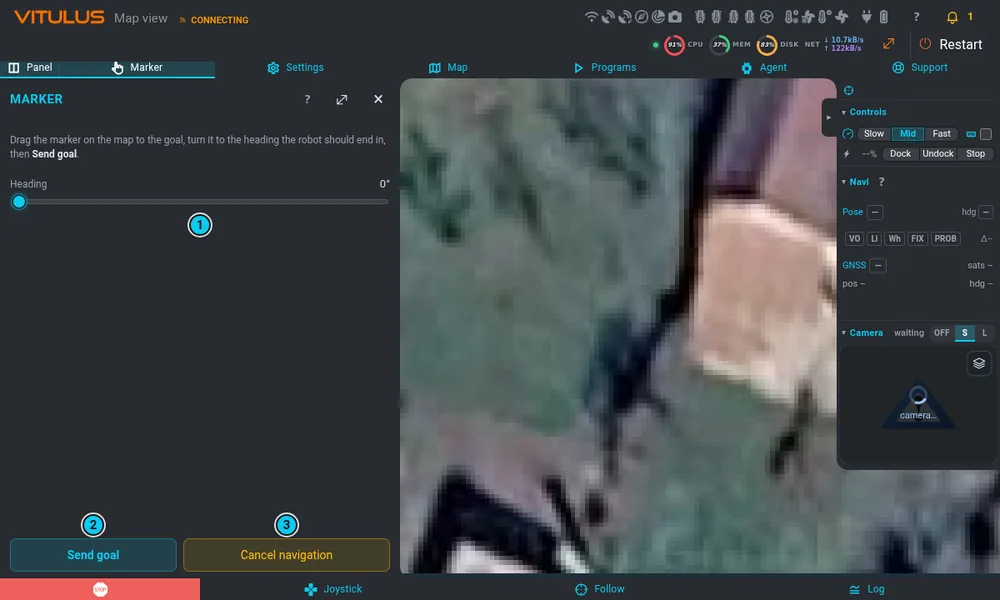
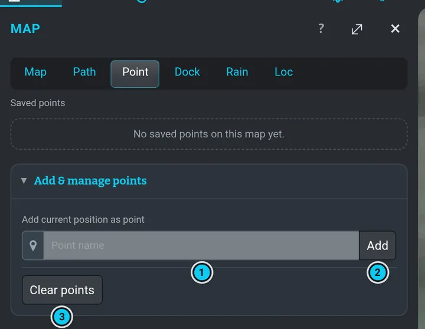
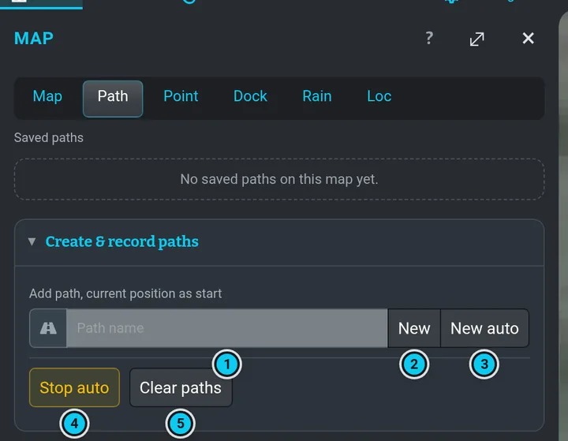

# Trasy, body a značka

Ve všech těchto případech jede robot sám po aktivní mapě — pojezdové motory musí být zapnuté
a robota nebo obraz z kamery bys měl vidět. **Zrušit navigaci** nebo **STOP** jízdu ukončí.

## Cíl pomocí značky

1. V pásu menu otevři **Značka**. Na mapě se objeví značka cíle.
2. Klikni nebo ťukni do mapy tam, kam má robot jet (nebo značku přetáhni).
3. Posuvníkem **Kurz** ji natoč tím směrem, kterým má robot nakonec stát.
4. Stiskni **Odeslat cíl**.

Když plánovač nenajde cestu, zkusí to až třikrát; když selže samotná jízda, smaže si paměť
překážek a naplánuje znovu, než to vzdá.
**Zrušit navigaci** jízdu zastaví (v logu je *Goal canceled*; motory zůstanou zapnuté).

## Rychlost

")

**Panel jízdy › Rychlost › Slow / Mid / Fast** (Joystick ve spodní liště) nastaví rychlost navigace
i joysticku; rozsvícené tlačítko je to, co hlásí robot.
Robot si ji pamatuje i přes restart. Navigace:

| | vpřed | vzad | otáčení |
|---|---|---|---|
| Slow | 0,25 m/s | 0,25 m/s | 0,9 rad/s |
| Mid | 0,4 m/s | 0,25 m/s | 0,9 rad/s |
| Fast | 0,75 m/s | 0,5 m/s | 1,5 rad/s |

Joystick jede stejnou rychlostí vpřed (i vzad) a otáčí se 0,6 / 1,3 / 1,5 rad/s.

## Body

 

**Mapa › Bod** ukazuje uložené body: tlačítko se značkou na začátku řádku na bod dojede,
**Ukázat** ho ukáže na mapě, **✕** ho odebere. Napiš název a stiskni **Přidat** — uloží se
současná poloha robota jako nový bod; **Smazat body** smaže všechny body mapy. **Zrušit navigaci**
jízdu zastaví.

## Trasy

**Mapa › Trasa** ukazuje uložené trasy: tlačítko se šipkou na začátku řádku trasu projede,
**Přidat** k ní přidá současnou polohu robota jako další bod, **Ukázat** ji ukáže, **✕** ji odebere.
Nahrání nové: napiš název a pak **Nová** (začne v současné poloze, body přidáváš za jízdy) nebo
**Nová auto** (nahrává sama za jízdy; **Stop auto** ji ukončí). **Smazat trasy** smaže všechny
trasy mapy. **Zrušit navigaci** jízdu zastaví.

Trasy a body jde nakreslit i v [editoru mapy](map-editor.md).
