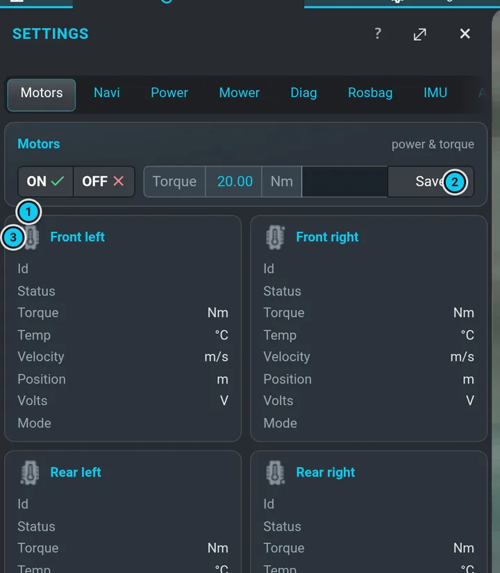
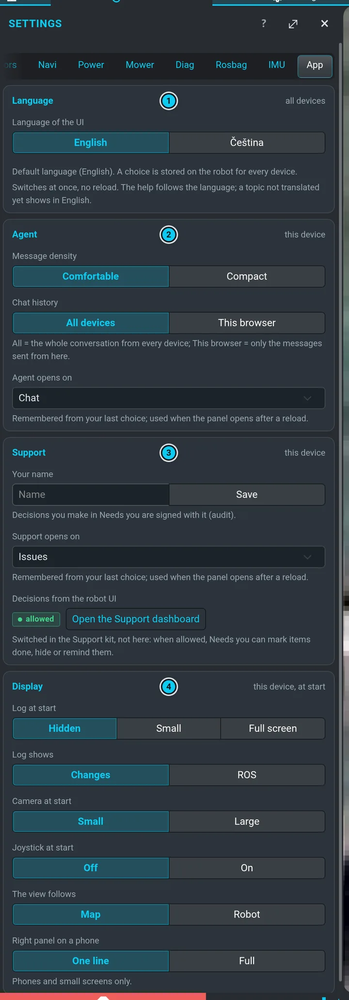

# Nastavení

**Nastavení** (⚙ v pásu menu) má jednu záložku pro každou část robota a **Aplikace** pro tuhle
aplikaci samotnou. **?** v hlavičce panelu skočí na záložku, kterou máš otevřenou.

## Motory

- **ON / OFF** — napájení čtyř pojezdových motorů. **Po každém startu jsou vypnuté**
  ([Bezpečnost](safety.md#po-každém-startu-jsou-motory-vypnuté)); zapni je tady, než budeš jezdit
  ručně nebo dokovat. Barva tlačítka sleduje skutečný stav motorů.
- **Moment** (0–24 Nm) a **Uložit** — omezení momentu motorů. Prázdné číselné pole ukazuje
  povolený rozsah (tady i v Napájení).
- Jedna karta na kolo (**Přední levý**, **Přední pravý**, **Zadní levý**, **Zadní pravý**): id,
  stav, moment, teplota, rychlost, poloha, napětí, režim (– = od motoru zatím nepřišla data). Ikony kol v navbaru ukazují jejich
  stav: zelená OK, oranžová teplé, červená horké, šedá vypnuto.

## Navi

Záložka navigace:

- **Rychlost** **SLOW / MODERATE / FAST** — totéž nastavení jako **Slow / Mid /
  Fast** v pravém panelu ([rychlosti](routes.md#rychlost)).
- **Lidar** **ON / OFF**.
- **RtabMap** — **Zdroj senzorů** (**Kamera** / **Lidar** / **Obojí**) a **Dosah senzorů** —
  pro starší lokalizaci RTAB-Map; běžně se nemění.

## Napájení

- **Zdroj** — **Vstup** z nabíječky (V, A), **Baterie** (V, A, stav nabíjení, %), **Kapacita**,
  **Výstup NUC** (počítač) a jestli jsou zapnuté **Výstup motorů** a **Výstup sekačky**.
- **Teplota** — teplota desky a venkovní teplota a otáčky ventilátorů.
- **Výstupy a limity** — výstup motorů a sekačky **ON / OFF**, nabíjecí a vypínací proudy pro
  běh a pohotovost, limit teploty desky (PCB) a vnější teploty. Měň jen, když víš proč.
- **Řízení spánku** — **Doba spánku**, **Uspat teď** (**Na čas** / **Do nabití**), **Prodleva
  pohotovosti**, **Posun po nabití**, **Limit vybíjení**. Plánovač spánek používá, když čeká
  ([Proč robot čeká](waiting.md)).

## Sekačka

Napájení sekačky, nůž, výška sekání a otáčky — viz [Sekací ústrojí](mowing.md).

## Diag

Živý seznam diagnostiky robota (ROS `/diagnostics`): nahoře souhrn, pod ním skupiny řádků
*tečka · název · zpráva* ve stálém pořadí. Zelená OK, oranžová varování, červená chyba, šedá
zastaralé. Hodí se, když v navbaru něco svítí červeně a chceš vědět, která část to je.

## Rosbag

Nahrávání dat senzorů pro rozbor:

- **Kamera D435 RGB-D** — **REC** / **STOP** a snímková frekvence (FPS, **Nastavit**).
- **Forenzní záznam GNSS** — nahrává kurz z GPS, fix a to, kdo právě určuje polohu (pro problémy
  s lokalizací).
- **Uložené bagy** — seznam, u každého bagu **Stáhnout** (⬇) a **Smazat** (✕); ↻ seznam obnoví.

Bagy zabírají hodně místa na disku; mazej, co už nepotřebuješ.

## IMU

Kalibrace inerciálního senzoru: **Odstranit DCD**, **Reset IMU**, **Run**, **Uložit** a
kurz podle IMU, navigace, magnetometru, RTK a fúze. Malá páčka nechá robota během kalibrace jen
otáčet na místě. Určeno pro servis.

## Kamera

Všechno o hloubkové kameře (D435): jestli běží, jak přesnou má hloubku (**Zkontrolovat**
ji porovná s lidarem), **Kalibrovat…** — průvodce, který kameru zkalibruje proti stěně bez
pohybu robota — nastavení snímače a vrstvy v obraze. Podrobnosti:
[Kamera (D435)](camera.md).

## Aplikace

Nastavení téhle aplikace (UI), ne robota. Nic tady s robotem nehne a nic na něm nemění kromě
uloženého jazyka.

- **Jazyk** — **English** nebo **Čeština**. Přepne se hned, bez načtení stránky, a ukládá se
  **na robota**, takže každý telefon i PC ukáže stejný jazyk (řádek pod tlačítky napíše
  *Uloženo na robotu*). Když ho robot uložit nemůže (restartuje se, nebo stránka běží jako
  `?mock`), zůstane jen v tomto zařízení a řádek to řekne. Nápověda jde s jazykem; téma, které
  ještě není přeložené, se ukáže anglicky s poznámkou. Výchozí je angličtina.
- **Agent** — **Hustota zpráv** (**Vzdušně** / **Úsporně**, totéž co ▤ v panelu agenta),
  **Historie chatu** (**Všechna zařízení** / **Tento prohlížeč**, totéž co přepínač nad chatem)
  a **Agent se otevře na** (záložka panelu agenta).
- **Podpora** — **Tvoje jméno**, kterým se podepisují rozhodnutí v **Čeká na tebe** (audit),
  **Podpora se otevře na** (záložka panelu Podpora) a jestli jsou povolená **Rozhodnutí z UI
  robota**. To poslední se tady jen ukazuje; zapíná se v Support kitu (**Otevřít dashboard
  podpory**).
- **Zobrazení** — co toto zařízení ukáže při příštím startu: **Log při startu** (**Skrytý** /
  **Malý** / **Celá obrazovka**) a **Log ukazuje** (**Změny** / **ROS**), **Kamera při startu**
  (**Malá** / **Velká**), **Joystick při startu**, **Pohled sleduje** (**Mapu** / **Robota**) a
  **Pravý panel na telefonu** (**Jeden řádek** / **Celý**).

Agent, Podpora a Zobrazení se pamatují **v tomto prohlížeči** (každý telefon a PC má svoje)
a sledují, co děláš jinde v UI — tady nastavíš, jak má vypadat příští start.
