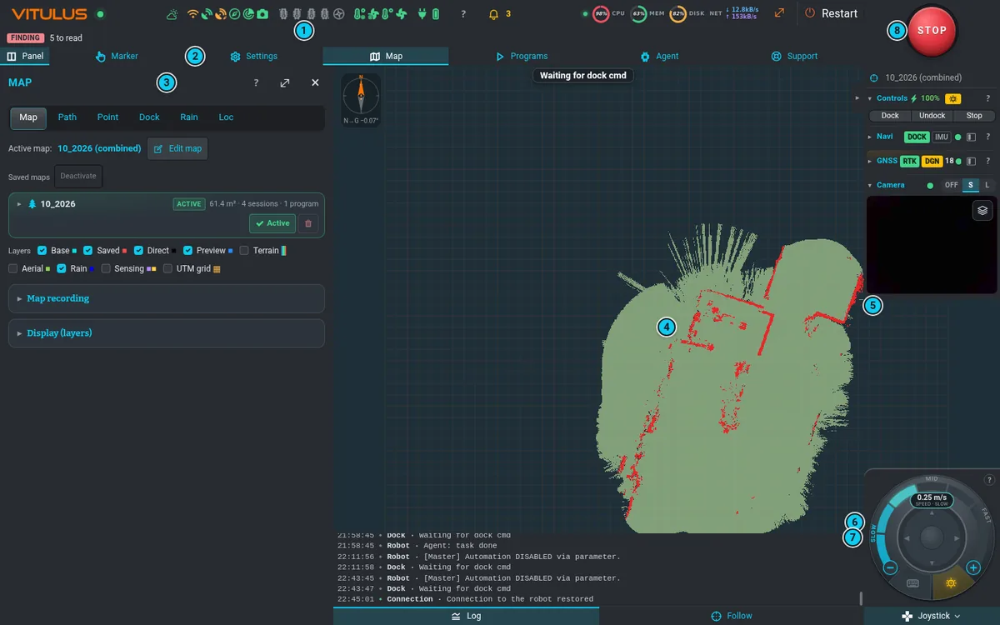
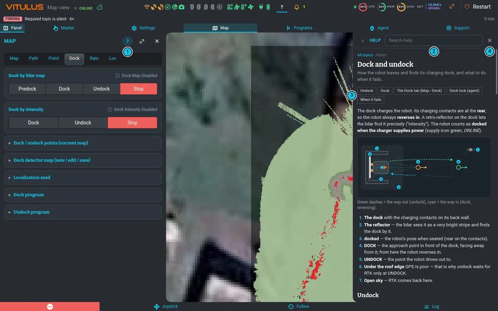

# Vitulus za pět minut

Vitulus je autonomní sekačka trávy. Bydlí v **doku** (nabíjecí stanici, do které zajíždí couváním),
svou polohu zjišťuje pomocí **RTK GPS**, lidaru a kol, jezdí po **mapě** tvé zahrady a seká **zóny**
této mapy podle **programů**, které spouští **kalendář**. Tahle obrazovka je jeho webové UI —
stejná stránka na PC, tabletu i telefonu.



1. **Navbar** — ikony stavu (zelená = OK, oranžová = varování, červená = porucha, šedá = bez dat,
   viz [Ikony stavu](status-icons.md)), **?** = tato nápověda, zvonek = **Čeká na tebe**.
2. **Pás menu** — v levém panelu otevírá vždy jeden nástroj: Panel (zobrazit / skrýt), Značka,
   Nastavení, Mapa, Programy, Agent, Podpora.
3. **Levý panel** — otevřený nástroj. V jeho hlavičce je malé **?**, které otevře nápovědu k tomuto
   panelu a záložce, na které jsi.
4. **Mapa** — robot (oranžově), jeho trasa a vrstvy mapy.
5. **Pravý panel** — baterie, **Dock** / **Undock**, stav lokalizace a kamera.
6. **Log** — co robot dělal a hlásil ([víc](frame.md#log)).
7. **Joystick** — panel jízdy: páčka, rychlost, motory, klávesy — na velkém STOP ([víc](frame.md#ruční-jízda-joystick)).
8. **STOP** — vždy vlevo dole. Zastaví veškerý pohyb ([Bezpečnost](safety.md)).

## Robot

 a shora (vpravo); předek je vpravo, jak ukazují šipky.")

1. **Lidar** nahoře — laser, který měří vzdálenost všude kolem; najde odrazku doku a porovnává
   zdi a sloupky zahrady s mapou (funguje i potmě).
2. **Kamera** (Intel RealSense D435) vpředu — obraz a hloubka, ze kterých vychází detekce
   překážek ([překryvy kamery](frame.md#překryvy-kamery)).
3. **Dvě GPS antény** vzadu vlevo a vpravo — poloha (RTK) a z přímky mezi nimi i kurz
   ([Lokalizace](localization.md)).
4. **Nůž** pod tělem — seká; jeho výšku a otáčky nastavují programy nebo
   [Nastavení › Sekačka](mowing.md).
5. **Čtyři kola**, každé s vlastním pojezdovým motorem — po každém startu VYPNUTÉ
   ([Bezpečnost](safety.md#po-každém-startu-jsou-motory-vypnuté)).
6. **Nabíjecí kontakty** vzadu — proto robot do doku vždy **couvá** ([Dok](dock.md)).

## Běžný den

```flow
ok: V doku | nabíjí se, motory vypnuté
Výjezd | vyjede z doku, čeká na RTK
Sekání | program projede zóny
Dock | zpět podle mapy, pak zacouvá dovnitř
ok: Nabíjení | do dalšího běhu
```

Programy spouští kalendář sám (když je zapnutá automatika a není zapnuté **Pozdržet**) — viz
[Programy a kalendář](programs.md). Když se robot nerozjede, obvykle na něco *záměrně čeká*:
[Proč robot čeká](waiting.md).

## První kroky

1. Podívej se na ikony stavu: baterie, GPS a motory. Šedé ikony znamenají, že software robota
   ještě startuje nebo není připojený.
2. Otevři **Mapa** a zkontroluj, že je nějaká mapa **aktivní** (na její kartě je *aktivní*). Bez
   aktivní mapy robot nemůže navigovat ani sekat — [Mapy a mapování](mapping.md).
3. Vyjeď s robotem z doku tlačítkem **Undock** v pravém panelu — [Dok a výjezd](dock.md).
4. Zkus krátkou jízdu se [Značkou](routes.md#cíl-pomocí-značky) nebo joystickem.
5. Když si nejsi jistý, zeptej se normální řečí [agenta Vitulus](agent.md).

## Jak používat tuto nápovědu



- **?** v hlavičce kteréhokoli panelu otevře téma k tomu panelu (a k jeho otevřené záložce).
- **?** v navbaru na PC dělá totéž; na telefonu použij **?** v hlavičce panelu nebo
  **Podpora › Nápověda**.
- Piš do **Hledat v nápovědě** — hledá ve všech tématech, s diakritikou i bez ní.
- Odkazy jako [Řešení problémů](troubleshooting.md) přeskakují mezi tématy, **‹** jde zpět,
  **Esc** nebo **✕** nápovědu zavře. Mapa i panel jdou používat i s otevřenou nápovědou.
- **Klikni na obrázek** a zvětší se; kliknutí nebo **Esc** ho zase zavře. Čísla v obrázku
  odpovídají očíslovanému seznamu vedle něj.

> [!NOTE]
> Tahle nápověda je zároveň dokumentace robota: každé téma je soubor Markdown ve
> `vitulus_ui/docs/help/` (česky v `docs/help/cs/`) a UI ukazuje přesně ten soubor. Změna UI nebo
> robota upraví soubor ve stejném commitu.
