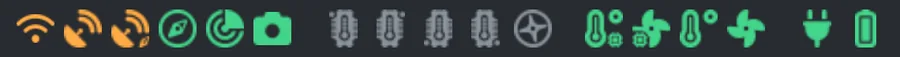

# Ikony stavu a barvy

## Čtyři barvy

Celé UI používá stejné čtyři tóny — na ikonách, čipech, kartách i tečkách v logu:

| Barva | Znamená |
|---|---|
| green | OK |
| orange | varování — funguje, ale podívej se na to |
| red | porucha — něco je špatně |
| grey | bez dat nebo vypnuto |

Barva akcentu (azurová) není stav: označuje odkazy, aktivní záložku a to, co je vybrané.

## Ikony v navbaru

")

Na PC jsou v navbaru ve čtyřech skupinách (připojení a senzory · pojezd a sekačka · teploty ·
napájení); na úzké obrazovce v pruhu pod menu. Když na ikonu najedeš myší, ukáže svůj název.

| Ikona | Co | Zelená | Oranžová | Červená | Šedá |
|---|---|---|---|---|---|
|  | Wi-Fi | dobrá | střední | špatná | odpojeno |
|  | GPS (přijímač polohy) | RTK | 3D fix bez RTK | špatný | bez dat |
|  | GPS navigace (přijímač kurzu) | RTK | 3D fix bez RTK | špatný | bez dat |
|  | IMU | zapnuto | — | — | vypnuto |
|  | Lidar | zapnuto | — | — | vypnuto |
|  | Kamera (D435) | zapnuto | — | — | vypnuto |
|  | Sekačka | zapnuto / pracuje | — | chyba | vypnuto |
|  | Pojezdový motor (jeden na kolo) | OK | teplý | horký | vypnuto |
|  | Teplota desky | OK | teplá | horká | bez dat |
|  | Ventilátor desky | běží | — | — | stojí |
|  | Okolní teplota | OK | teplá | horká | bez dat |
|  | Vnější ventilátor | běží | — | — | stojí |
|  | Napájecí vstup (nabíječka) | připojeno (= v doku) | — | porucha | nic |
|  | Baterie | plná · ¾ · ½ · ¼ · prázdná; při nabíjení s bleskem | | | bez dat |

Ikona **mráčku** vedle loga je upozornění na déšť ([Počasí](waiting.md#počasí-mapa--déšť)),
text **spojení** vlevo od něj (**SPOJENO** / **PŘIPOJUJI** / **ODPOJENO**) říká, jestli je stránka
připojená k robotu — kliknutím se hned připojí znovu.

> [!TIP]
> Všechny ikony šedé? Stránka není připojená, nebo software robota (znovu) startuje — počkej
> minutu, pak viz [Řešení problémů](troubleshooting.md#ui-nereaguje).

## Monitor počítače

Na začátku pravé skupiny navbaru (na úzké obrazovce pod tlačítkem menu **☰**) ukazují čtyři malé
budíky počítač robota (NUC): **CPU**, **RAM** (paměť), **DISK** a **SÍŤ** (stahování ↓ / odesílání
↑). Budík je zelený pod 75 %, oranžový od 75 % a červený od 90 %; šedý, když data počítače nejsou
dostupná. Po najetí myší ukáže podrobnosti.
