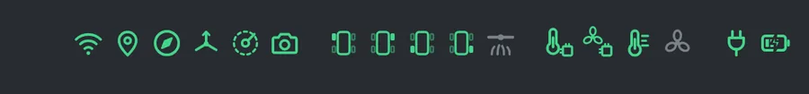
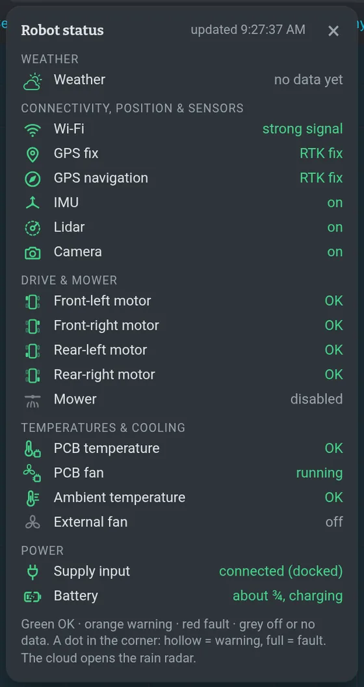
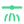
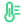

# Ikony stavu a barvy

## Čtyři barvy

Celé UI používá stejné čtyři tóny — na ikonách, čipech, kartách i tečkách v logu:

| Barva | Znamená |
|---|---|
| green | OK |
| orange | varování — funguje, ale podívej se na to |
| red | porucha — něco je špatně |
| grey | bez dat nebo vypnuto |

Barva akcentu (azurová) není stav: označuje odkazy, aktivní záložku a to, co je vybrané.

## Ikony v navbaru

 · 3 počítač (CPU · RAM · ↓ ↑) · 4 ? nápověda · 5 Čeká na tebe (zvonek) · 6 Restart · 7 ⋯ další · 8 STOP")

Jsou v navbaru hned za logem, vždy na stejném místě, ve skupinách (počasí · připojení a senzory ·
pojezd a sekačka · teploty · napájení). Každá je čárový piktogram v barvě svého stavu; **varování**
nebo **porucha** navíc přidá malou **tečku do rohu** (prázdná = varování, plná = porucha), takže je
vidět, i když se barvy špatně rozlišují. Když na ikonu najedeš myší, řekne svůj název a stav slovy
(*GPS fix: RTK fix*).

**Klikni na ikony** (kamkoli kromě mráčku) a otevře se **karta stavu**: každá ikona se svým názvem
a stavem slovy, ve stejných skupinách, a čas dat. Zavřeš ji kliknutím vedle nebo na **×**. Karta jen
ukazuje — nic z ní robotu neposílá.

V užším okně (pod 1100 px) a na telefonu na šířku ukazuje každá skupina **jednu ikonu — tu
nejhorší ze skupiny** (červená před oranžovou před zelenou před šedou); v širším okně se vrátí celá
řada. Na **telefonu na výšku** je řádek pod menu **souhrn**: jedna ikona za skupinu (ta nejhorší)
a stav slovy — *Vše OK*, *2 varování*, *1 porucha* — klepnutím otevřeš kartu stavu.

**Bez živých dat.** Když stránka ztratí robota (tečka je červená nebo oranžová) nebo robot 10 s
nepošle stav ikon, ukazují ikony jen **poslední známý** stav: zešednou a přes ně je *bez živých
dat* (na telefonu souhrn napíše *Bez živých dat*); tooltipy a karta řeknou, od kdy. S dalšími daty
se barvy vrátí.

| Ikona | Co | Zelená | Oranžová | Červená | Šedá |
|---|---|---|---|---|---|
|  | Wi-Fi | dobrá | střední | špatná | odpojeno |
|  | GPS (přijímač polohy) | RTK | 3D fix bez RTK | špatný | bez dat |
|  | GPS navigace (přijímač kurzu) | RTK | 3D fix bez RTK | špatný | bez dat |
|  | IMU | zapnuto | — | — | vypnuto |
|  | Lidar | zapnuto | — | — | vypnuto |
|  | Kamera (D435) | zapnuto | — | — | vypnuto |
|  | Sekačka | zapnutá | pracuje | chyba | vypnutá |
|  | Pojezdový motor (jeden na kolo — vyplněné kolo je to jeho) | OK | teplý | horký | vypnuto |
|  | Teplota desky | OK | teplá | horká | bez dat |
|  | Ventilátor desky | běží | — | — | stojí |
|  | Okolní teplota | OK | teplá | horká | bez dat |
|  | Vnější ventilátor | běží | — | — | stojí |
|  | Napájecí vstup (nabíječka) | připojeno (= v doku) | — | porucha | nic |
|   | Baterie | plná · ¾ · ½ (dílky) | ¼ | prázdná | bez dat |

Baterie ukazuje stav nabití **dílky** (4 = plná … žádný = prázdná) a při nabíjení **blesk**.

**Mráček** — první ikona stavu — je počasí ([Počasí](waiting.md#počasí-mapa--déšť)): zelený =
déšť se nečeká, oranžový = čeká se déšť, červený = právě prší; žádná ikona = zatím bez dat
o počasí. Kliknutím uvidíš radar deště (**Mapa › Déšť**).

**Tečka** vedle loga je spojení této stránky s robotem: zelená spojeno, oranžová (pulzuje)
připojuje se, červená bez spojení — po najetí myší ukáže slova, kliknutím se hned připojí znovu.
Když spojení spadne, napíše to i pás hlášek pod menu (*Bez spojení s robotem · připojuji
znovu…*), dokud se neobnoví.

> [!TIP]
> Všechny ikony šedé a přes ně *bez živých dat*? Stránka není připojená, nebo software robota
> (znovu) startuje — počkej minutu, pak viz [Řešení problémů](troubleshooting.md#ui-nereaguje).

## Monitor počítače

Vpravo v navbaru je počítač robota (NUC) na pevných místech: **CPU** a **RAM** v %, pak síť —
**↓** stahování a **↑** odesílání s jednotkou (B/s, kB/s, MB/s). Čísla jsou vyhlazená přes pár
sekund, takže blok je klidný a nikdy nemění šířku. Číslo **zoranžoví**, jen když je potřeba se
podívat: CPU, když je jeho **průměr za 30 s** 90 % a víc (červená od 97 %), RAM od 90 % (červená
97 %) — krátká špička nic nezabarví. Klik na blok otevře **kartu** s kruhy CPU · RAM · DISK, sítí,
průměrem za 30 s a zátěží a s odkazem do **Settings › Diag**.

Méně místa: když se celý blok do navbaru nevejde (užší okno), zmizí nejdřív odesílání ↑, pak je
blok jeden **čip** (ikona v barvě nejhoršího z CPU, RAM a disku) — klik otevře stejnou kartu. Řídí
se místem v liště, ne pevnou šířkou okna. Na telefonu je počítač v **⋯** (když je potřeba se
podívat, má ⋯ malou tečku). Šedá = data počítače nejsou dostupná.
