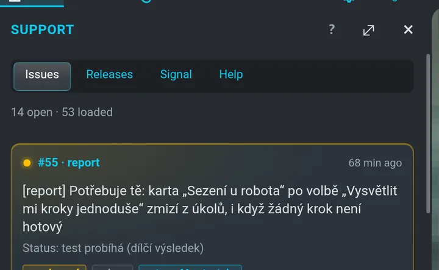

# Podpora v terénu

**Field support kit** propojuje tohoto robota s robotem vlastníka: problémy se v jedné smyčce
nahlásí, opraví, vydají a znovu otestují. Jeho plný dashboard běží na robotu na
`https://<robot>:8790` (*dashboard Podpory*); panel **Podpora** v tomhle UI ukazuje to hlavní
a odkazuje tam.

```flow
Nahlášeno | popíšeš problém
Posouzeno | strana vlastníka odpoví
Opraveno | vznikne změna
warn: Vydáno | robot dostane aktualizaci
Otestováno | zkusíš to znovu
ok: Zavřeno | hotovo
```

## Panel Podpora

Otevři **Podpora** (tlačítko vedle **Agent** v pásu menu). Co čeká na tebe, je ve zvonku
([Čeká na tebe](agent.md#čeká-na-tebe)); tenhle panel je přehled smyčky. Má záložky **Hlášení**, **Vydání**, **Signál** a **Nápověda** (témata této
nápovědy).



### Hlášení

Otevřená hlášení s fází smyčky, závažností a s tím, **kdo je na tahu**. Každá karta má
**Detail**, **Otevřít v Podpoře**, **Zeptat se agenta** (otevře chat agenta robota s návrhem
zprávy o hlášení — odešleš ji ty) a **Časová osa** (Agent › Aktivita jen pro toto hlášení).

**Detail** ukáže hlášení pro lidi, stejně jako stránka issue na dashboardu:

- název a **Kde to stojí** — jedna věta, fáze a **kdo je na tahu**;
- **kdo a kdy to nahlásil** (a na které issue navazuje);
- **fáze** — Nahlášeno → Příčina → Oprava vydaná → Ověření → Hotovo — u každé **kdo** ji udělal
  a **kdy**; ta aktuální je oranžová;
- **karta otázky**, když se tě issue na něco ptá — stejná karta Rozhodnutí / Schválení / Úkol
  s kroky jako v [Čeká na tebe](agent.md#čeká-na-tebe);
- **Problém · Příčina · Oprava**, každé jednou větou;
- **Co udělat** — kdo je na tahu, věta pro tvého agenta, kroky nebo varianty a **Začít s
  agentem** (dvě kliknutí: věta odejde tvému agentovi do vlákna issue);
- **Kdo co dělal** — historie, nejnovější nahoře.

Technický protokol pro agenty zůstává na dashboardu (tlačítko na konci). **← Hlášení** nebo
záložka **Hlášení** vrátí seznam.

### Vydání

- Nahoře jedna věta: *Nejnovější vydání field-… odešlo před 2 h.* a kolik vydaných oprav čeká na
  test u druhé strany. Verze kitu a poslední kontrola hlídače jsou sbalené v *Podrobnosti pro
  agenty*.
- **Odesláno pro ⟨Maca⟩** — tři nejnovější vydání: co druhá strana dostane, jednou větou (*Mac
  dostane 13 změn (vitulus_ui) sám, bez kliknutí. Pak build a restart stacku – hlídač to udělá
  sám, až bude robot v klidu.*) a sbaleně **Co se mění**: za každé repo větev, kdo a kdy a předměty
  commitů od nejnovějšího. Starší vydání pod **Starší (N)**.
- **Vydáno, čeká na test** — issues, jejichž oprava odešla a čeká na nový test.

### Signál

Oba roboti (puls, verze kitu, připravenost) a upozornění na telefon (zpoždění, odesláno,
přijato).

## Co dělá hlídač

Hlídač na robotu se spustí, kdykoli signál přinese novinku, a k tomu podle časovače (každých
10 minut, nebo 30, dokud signál funguje). Stáhne novinky, zjistí další krok smyčky (nasadit
vydání, znovu otestovat, odpovědět, zavřít) a buď ho udělá sám, nebo se jedním klikem zeptá
člověka (zvonek, [Čeká na tebe](agent.md#čeká-na-tebe)). **S robotem nikdy nehne** — cokoli
s pohybem dělá člověk s rukou na STOP.

## Restarty stacku

Když přijde nový kód, kit restartuje stack robota sám — ale jen když je to bezpečné: robot
v doku, žádný program, žádná mise agenta, zamčený zámek doku, vypnuté motory i nůž, žádné
mapování, 2 minuty bez pohybu, baterie aspoň 15 %. Jinak krok čeká na dashboardu v části
**Blokuje** s tlačítkem **Zkusit znovu**. Po restartu dostaneš upozornění.

> [!IMPORTANT]
> Po restartu jsou **pojezdové motory vypnuté** a kit je nikdy nezapíná. Mapa a stavové ikony
> jsou minutu šedé, než se stack rozběhne.

## Nahlásit problém

1. Otevři dashboard Podpory › **Problémy** › **Nové hlášení**.
2. Popiš problém vlastními slovy. Field agent se doptá, co chybí, ověří to na robotu (jen
   čtením), zkontroluje duplicity a napíše koncept.
3. Když je koncept hotový, **Podat hlášení** (dvě kliknutí: druhé potvrzuje).

Z tohoto UI předvyplní chat agenta tlačítko **Zeptat se agenta** u hlášení. Dashboard má vlastní
nápovědu (`#/help`); otevře ji **Podpora › Nápověda › Nápověda Support kitu**.
