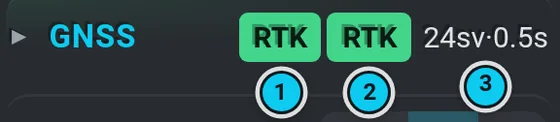
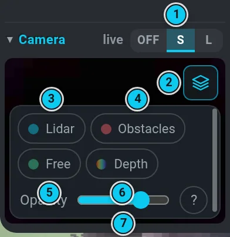
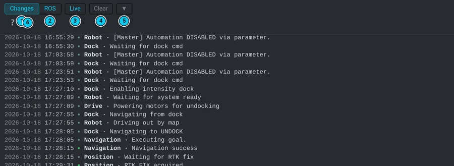

# The screen

The UI is one frame in the shape of a **C** around the map: the top band (navbar, agent strip,
menu band), the left panel and the bottom bar are one surface. The right panel, the log and the
joystick grow out of the same frame.

## The top bar

Left to right: the **VITULUS** logo with a small **connection dot** — green = the page is
connected to the robot, orange (pulsing) = connecting, red = no connection; hover it for the
words, click it to reconnect right away. When the connection drops, a line in the notice band
under the menu says so until it is back. Then the **status icons**, the first one is the
**weather** (click = rain radar) — see [Status icons](status-icons.md). On the right **?** help,
the bell (**Needs you**) and the computer monitor. On a narrow screen the status icons hang under
the menu band; on a phone on its side the navbar is hidden (the menu band stays) and a lost
connection shows only in the notice band.

## The left panel

The menu band opens one tool at a time in the left panel: **Marker**, **Settings**, **Map**,
**Programs**, **Agent**, **Support**. The open one is lit. A red number on the Agent icon counts
the agent's messages you have not seen yet.

| Do | PC | Phone |
|---|---|---|
| hide / show the panel | **Panel** in the menu band, **Alt+P**, **✕** | **Panel**, **✕**, drag the sheet down |
| full screen | **⤢** in the head | drag the sheet up / tap its grip |
| help for it | **?** in the head | **?** in the head |

A hidden panel leaves a thin spine on the left edge — click it to bring the panel back. The UI
remembers which panel was open (also across a reload). On a PC, tablet or phone on its side the
panel (or the spine) runs **all the way down to the bottom edge**; the bottom bar starts right
after it.

**PC** (≥ 1024 px wide): the panel is a column, the map narrows next to it. **Tablet / phone on
its side**: the column lies over the map. **Phone upright** (< 576 px): the panel is a sheet from
the bottom (60 % of the height). On a phone (upright or on its side) a compact head puts
**?** / ⤢ / ✕ (in the Agent panel also its STOP) at the end of the tab row; upright the title moves into the grip row.

**Tabs that do not fit** (a narrow panel, a phone, longer Czech labels) stay in one row that
scrolls sideways: a **‹** / **›** at the edge shows there are more — click it, turn the mouse wheel
over the row or swipe it with a finger. The tab you pick (and the open one, whenever the panel
opens) slides fully into view; with the keyboard **←** / **→** move between tabs.

 · 6 STOP · 7 Log, Follow, Joystick")  · 2 tabs · 3 ? help · 4 ⤢ full screen · 5 ✕ close")

## The bottom bar

**Log** · **Follow** · **Joystick** (on a phone with a free gap in the middle for the
system gesture). On a PC, tablet or phone on its side the bar **starts after the left panel**
(after the thin spine when the panel is hidden): **Log** is right beside the panel, the panel runs
down past the bar to the bottom edge. A full-screen panel and the phone's sheet (upright) stand on
the bar, which then spans the whole width. **Joystick** sits at the right end, right under the
drive panel it opens — see [Drive by hand](#drive-by-hand-joystick). The bar has no STOP: the one
big **STOP** is in the top-right corner (below), so the bottom bar, the drive band and the left
panel's foot stay free. **Follow** makes the map view follow the robot.

## STOP in the top-right corner

The big red **STOP** is a round **mushroom** — a red cap in a dark bezel set into the frame — and
it heads the **right column**: on a PC, tablet or landscape phone it stands in the top-right
corner above the middle of the right panel (68 px; on a low window 54 px), the right panel starts
under it, the top bar's icons and menu end before its corner. On a phone held upright it sits at
the right end of the top bar, as big as the top bar allows (58 px), so the bottom bar and the
drive band stay free for the thumbs. It is on screen in every state (a panel open or full screen, the log, the large camera,
the map editor, the help, the agent) and never covers anything. **Esc** does the same. It is the
one full stop ([Safety](safety.md#stop)); the agent panel's own STOP is a different thing (it
stops the agent's mission).

## The right panel

Hangs from the top band on the right edge. It is a **dashboard**: at a glance (colour) you see
whether everything is fine, the current numbers are one click away, and the full detail with
explanations lives in the left panel. **Mower**, **Navi** and **GNSS** therefore have three levels:

1. **Title row** — colour and a few tokens. Hover (or long-press on a phone) any token: it says
   what it is and gives its one important number.
2. **▸ expand in place** — click the title: the quick current numbers open right there, under
   it. Folded by default; each section remembers how you left it.
3. **Detail icon** (a small panel symbol in the title row, right before the **?**): the left
   panel opens on **Map › Loc › Localization detail**, scrolled to that part (Navi or GNSS).

**One colour code everywhere:** green = fine · orange (amber) = working on it / not exact yet ·
red = a fault or no data where there should be some · grey = off, paused or nothing to show.

- **Controls** — title row: ⚡ (green = in the dock / charging), the battery %, `MOT` (motors:
  green on, orange off, grey unknown). Below: **Dock / Undock / Stop** ([Dock and undock](dock.md)).
- **Mower** — only while the mower is switched on. Title row: the status chip (`READY`, `RUN`,
  `HEIGHT`, `ERR`…), a blade dot (green = spinning) with the RPM (`3.2k`), the temperature only
  when it is hot, and the blade buttons **▶ Start** / **■ Stop** — the same as Settings › Mower ›
  START MOTOR / STOP MOTOR. ▶ is green only while the mower is `READY` and the blade stands; it
  needs **two taps** (the first one arms it for 3 s, the button fills green). ■ turns red while
  the blade spins and stops it at once. Expand: three cells **Blade** (on · RPM / off),
  **Height** (mm) and **Temp** (°C, always: green, orange from 50 °C, red from 60 °C), plus the
  running program and its state ([Mowing](mowing.md)). With the mower off the section is not there.
- **Navi** — title row: who owns the pose (`DOCK`, `RTK`, `TRACKER`…), the heading source
  (`SAT` / `IMU`) and one **odometry dot** for VO / Li / Wh together (green = they run, orange =
  one is degraded, red = one is lost, grey = paused in the dock; hover = each source). Expand:
  the row of chips `VO Li Wh FIX PROB ANC` — hover a chip:
  e.g. *Li — lidar odometry: live, tracking · cov 0.010*, *FIX — RTK fix usable: not usable ·
  correction age 0.5 s*, *ANC — position anchor: anchor fresh, last advanced 12 s ago* — and
  one tracker line (`STANDBY` / `ACTIVE` + the last correction); the detail icon in the title
  row opens the rest ([what the chips mean](localization.md#read-the-state-right-panel--navi)).
- **GNSS** — title row: the Position fix, the Heading fix (`RTK`, `FLT` = float, `DGN` = DGNSS,
  `3D`, `NO`), the satellites used (green from 12) and a dot for the age of the corrections
  (green < 2 s, orange < 10 s, red older or none). Expand: two small tiles **Position | Heading**
  with the quick numbers only — fix, satellites used / visible, accuracy (`acc` in cm, `hdg` in °)
  and correction age; the detail icon in the title row opens the full card of both receivers
  ([GNSS receivers](localization.md#gnss-receivers-right-panel--gnss)).
- **Camera** — a dot in the title row (green = live picture, orange = starting / waiting, grey =
  off) and the switch Off / S / L; see below.

Every section folds by its title (▾ / ▸) and stays as you left it. A section with a state
(Mower, GNSS) is softly tinted by it. With Mower, Navi and GNSS folded everything above the camera
fits on one screen, so the small camera picture is in view without scrolling (opened, the panel
may scroll). On a phone (upright or on its side) the right panel is a collapsed row (map, pose,
GNSS, a mower dot while the mower is on, battery, camera, ▾) — ▾ unfolds it.

 · 3 Dock · 4 Undock · 5 Stop (of the dock sequence). Speed, motors and keyboard driving are in the drive ring.")  · 6 tracker line")

, expanded: 1 status · 2 blade dot and RPM · 3 ▶ Start / ■ Stop of the blade · 4 Blade / Height / Temp") 

## Camera

The switch **Off / S / L** in the head of the Camera section: **S** = a small live picture in the
right panel, **L** = the camera fills the map area and the map moves into the right panel's slot
(click the small map to go back). **Alt+C** switches S ↔ L. The stream runs only while the camera
is on screen. On a phone the camera button in the collapsed row switches the large camera on and
off.

### Camera overlays

The layers button in the top right corner of the camera picture (S and L) opens the overlays.
Each one is a switch; any mix can be on:

- **Lidar** (azure) — the lidar scan: a line of points where the lidar beam hits something at
  the lidar's height.
- **Obstacles** (red) — what the depth camera's obstacle detection sees as an obstacle (this is
  what the robot plans around).
- **Free** (green) — ground the same detection sees as free and drivable.
- **Depth** — the depth camera's distance picture over the image: red = near, yellow / green =
  middle, blue = far (about 5 m); no colour = no depth there (sky, glare, too far).

 · 3 free ground · 4 depth: red near → yellow → green → blue far · 5 no colour = no depth (sky)")

**Opacity** sets how strongly all overlays cover the picture. Points nearer to the robot are drawn
bigger. The choice is remembered in this browser.

The robot itself puts the points into the picture (node `camera_overlay` in `vitulus_ui`): it uses
the camera's calibration and the position of each sensor at the moment it measured, so a point
sits on the thing it measured even while the robot turns — like the camera view in RViz. It works
only while a layer is on and the camera is shown; with every layer off it does nothing.

- **A layer is on but nothing shows** — no data right now (an empty obstacle list is normal on an
  open lawn; the lidar shows only where the beam hits something within the picture), or the
  overlay service is not running yet (it starts with the robot's software).
- **Points slightly off the edges of things** — a few pixels is normal (sensor mounting
  tolerance); a large, constant shift means the sensor positions in the robot model need a
  calibration. Measured 18. 10. 2026 (robot in the dock): lidar points sit about 10 px left of
  edges 3–4 m away, within a few pixels at 1 m — not yet enough to change the robot model; a
  check outdoors in front of a wall / posts decides it (tool `tools/overlay_extrinsics.py`).
- **Depth colour vs lidar at distance** — the depth camera reads a little too far the farther it
  looks: about +1 cm at 1 m, +5 cm at 2 m, +18 cm at 4 m (stereo calibration of the camera, not
  the robot model). The lidar distance is the right one; the camera's on-chip calibration
  (RealSense self-calibration / tare) fixes the depth.

## Drive by hand (joystick)

**Joystick** at the right end of the bottom bar is the **tab of the drive panel**: it sits right
under it, as wide as the right column. Closed, the tab rises a little out of the bar with a grip
and an **▴** — it opens the panel above it; open, the panel stands on the tab as one piece
(the tab lit, **▾** closes it). The panel is the **drive ring**: one round control at the foot of
the right column (as wide as the right panel, 184 px), standing on the bottom bar. On a phone held
upright it is a band across the screen on the bottom bar — a short text on the left, the ring
(150 px) on the right under the thumb, the Joystick tab right below it; on a landscape phone the
ring is 150 px too.

 · 6 Motors (icon) · 7 ? how it works · 8 − / +")

1. **The capsule** above the stick — the joystick's top speed right now in m/s (at the rim of the
   stick the robot goes this fast, forward and back) and the robot's speed mode.
2. **The speed segments** — the upper two thirds of the ring: 7 steps from 0.10 to 0.75 m/s,
   lit up to the current one (cool cyan = slow → warm orange = fast), the current one glows. Click
   or tap a segment, drag along the ring (the step is taken when you let go), the mouse wheel over
   it, the arrows when it has the focus, or **+ / −** on the keyboard while **Keys** is on.
3. **Slow / Mid / Fast** along the segments — the robot's speed modes (`/navi_manager/speed`);
   navigation drives by them too ([Speed](routes.md#speed)). The lit one is the mode the **robot
   reports**; a click = that mode at its own speed. A step **inside** the current mode changes only
   the joystick (at once, nothing is sent). A step of **another** mode first asks the robot for
   that mode: the segment and the mode blink until the robot confirms it (and then navigation
   drives at that mode's speed too). The step is remembered in this browser; when the robot
   switches the mode itself (a program, another browser) the ring follows it.
4. **The stick** in the middle — forward / back = speed, sideways = turn. Its edge is the state:
   green = free, orange = someone else holds the robot (a program, docking, the agent or the
   gamepad; **Take over** appears), grey = motors off or unknown.
5. **Keys** (keyboard icon, bottom left) — keyboard driving: **cyan = on**, grey = off (**W A S D**
   or the arrows, **Shift** = half speed, **+ / −** = speed; never while typing in a field). Not
   shown on touch screens — the motor icon then takes the whole bottom.
6. **Motors** (gear icon, bottom right) — the drive motors, the same as Settings › Motors:
   **orange = off**, **green = on**, grey = unknown, as the robot reports; a click switches them and
   blinks until confirmed. The page never switches the motors on by itself (they are off after
   every start).
7. **?** — a short card "Driving by hand" (it also explains the icons). It shows by itself the
   first time the ring opens in a browser; **Got it** hides it.
8. **− / +** on the seams beside the segments — one step slower / faster.

The icons have no words: hover (or a screen reader) says what they are. Under the ring a line
appears only when something blocks driving that the ring does not show (another owner holds the
robot, the DS4 pad drives, the data is stale).

How the stick behaves:

- A small **dead zone** in the middle (10 % of the radius), then a soft curve: small pushes are
  fine and slow, the rim is full speed of the step.
- Pushed almost straight (within ±9°) it drives **exactly straight**; pushed almost sideways it
  **turns on the spot** — the locked axis lights up in the direction's colour.
- The command is drawn: the knob follows the finger (or the keys); the **outer arc** is the speed
  (top = forward, cyan → green the harder you push; bottom = back, orange), the **inner arc** the
  turn (violet, to the turning side) — longer and thicker the stronger the command, with a glow;
  a coloured light under the knob points the way, a halo rings the knob, the arrows ▲▼◀▶ light
  up, a press makes a ripple. With the motors not on the colours are dimmed.
- **Amber edge** = a mowing program, docking / undocking, a navigation goal, the agent or the DS4
  gamepad has the robot — the stick is locked (hover says who) and **Take over** in the stick
  unlocks it on purpose (moving it then cancels that task); **grey** = motors off (locked) or
  unknown.
- **Let go = stop.** The robot gets one softened command and then zero within 50 ms; the knob
  springs back. Losing the touch, switching tab or window, or a dropped connection stops it at
  once. It sends 20 commands a second while you hold it and nothing while you don't; when the
  page stalls (a command more than 250 ms late) it stops by itself.
- One finger drives; a second finger on the stick is ignored.
- Clicking or tapping a control leaves no frame around it; moving with **Tab** shows a thin cyan
  outline in the control's shape. With *reduce motion* set in the system the ring does not animate.

**The big round STOP** — top right, heading the right column (on a phone held upright at the right end
of the top bar), or **Esc** — is always visible, with or without the joystick, and never covered
by a panel. It is the full stop ([Safety](safety.md#stop)); it also lets go of the stick at once.

> [!WARNING]
> Pushing the joystick takes over from the software: it **cancels** the navigation goal, docking
> and a running program, and after you let go the robot stays. Only the DS4 gamepad ranks higher
> ([Safety](safety.md#the-gamepad-ds4-and-the-joystick-beat-the-software)).

## Log

**Log** at the left of the bottom bar (right beside the left panel) shows the log as a strip above the bar, beside the panel. **▲** (expand) makes it fill
the map area, **▼** (collapse) shrinks it back; **Log** again hides it. With the drive panel open,
the small log ends beside it.

The full log has a toolbar:

- **Changes** — the useful robot events: a green dot = something got better, orange = a warning,
  red = a fault; connection changes and agent reports.
- **ROS** — the raw robot console with level filters, a node filter and text search.
- **Live** pauses / resumes autoscroll, **Clear** empties the log in this browser only.

## Keyboard shortcuts (PC)

| Key | Does |
|---|---|
| **Alt+P** | show / hide the left panel |
| **Esc** | **STOP** — always, also while typing or with a dialog open (it still closes the help / a picture too) |
| **Alt+C** | camera small ↔ large |
| **W A S D**, arrows | drive (with **Keys** switched on in the drive ring), **Shift** = half speed, **+ / −** = speed |
