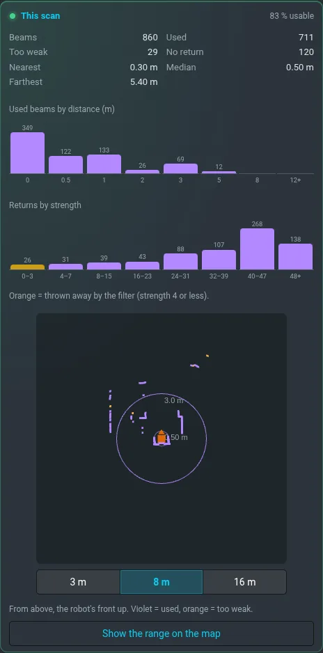

# Lidar

**Settings › Lidar** has everything about the robot's 2D lidar: whether it runs, where its data go,
what it sees right now and the settings that are safe to change. To see its range around the
robot, press **Show the range on the map** (the layer [Lidar range](mapping.md#lidar-range-and-camera-range)).

## Lidar

Model, firmware, scan mode and reach. The driver tells them only when it starts, so they come from
its log. **Motor** is read from the data: scans arrive = it turns. Green = at least 5 scans a
second, orange = fewer, red = no scans.

## Data flow

The lidar's data pass five stages, each with its live rate:

| Stage | What it does |
|---|---|
| `/rplidar/scan` | the driver: the raw scan |
| `/rplidar/scan_ovr` | sets the minimum range to 0.10 m |
| `/rplidar/scan_filtered` | drops weak returns, keeps 0.10–16 m |
| `/scan` | a dropped beam means "nothing there" |
| `/rplidar/scan_5m` | a dropped beam is a free ray of 5 m |

Under each stage are the parts of the robot that read it, live from the robot. The **shield** marks
what stops or steers the robot: the stop of direct driving, the costmaps, the lidar odometry and
docking.

## This scan

The beams of the current scan: how many are used, too weak, or without a return, the nearest and
the farthest. Below them two histograms — by distance, and by strength, where orange marks what the
filter throws away — and a view from above with the robot's front up, scale 3 / 8 / 16 m.

## Lidar in mapping

This is the only place of these settings; **Map › Advanced sensing tuning** just shows them.

- **Map with the lidar** — off = walls and free space come from the camera only.
- **Range for mapping** — hits and free rays beyond it do not go into the map. Navigation does not
  depend on it.
- **No return = free** — a beam that hit nothing counts as free up to that range.
- **Minimum strength for mapping** — weaker returns are neither an obstacle nor free. Raise it in
  tall grass. A value under the filter below does nothing: the card says so.

**During a recording** a change applies at once and stays with that map. **Without a recording**
the card shows what the next recording on the active map will use, and next to each value where it
comes from: *default*, *map …*, or *waits for the next recording*. A change you make now is kept on
the robot and the next recording takes it over, on any map; **Drop waiting changes** cancels it.

## Weak-return filter

What the whole robot reads passes this filter, so it is marked **feeds safety**.

- A dropped return is a free ray of 5 m in the global costmap, and the stop of direct driving does
  not see it. A higher value can hide a dark obstacle.
- The limits are 2–10, and a change needs a second tap.
- It applies live and lasts until the stack restarts; then the value from the launch file is back.
  **Back to launch value** returns it at once.

The motor of the lidar, the range filter and the scan mode cannot be changed here on purpose:
stopping the motor would blind the robot, the others need a restart of the driver.

## What it does not see

The lidar sees one plane about 35 cm above the ground, all around. Anything lower only the
[camera](camera.md) sees.
