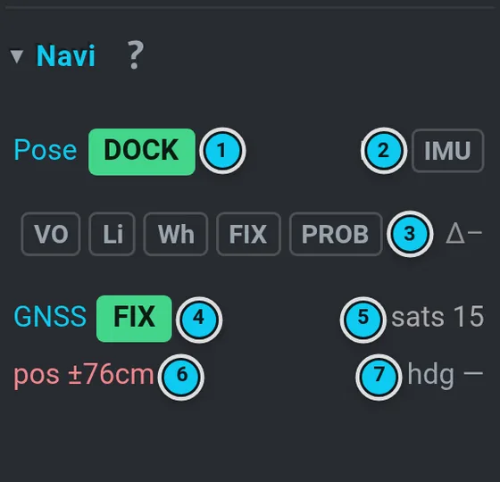

# Localization and GPS

The robot combines several sources into one position (the *pose*):

- **RTK GPS** — two receivers on the robot plus a base station give centimetre accuracy and the
  heading. Best on open sky.
- **The dock** — while seated in the dock the robot knows exactly where it is.
- **The lidar tracker** — matches the lidar scan against the site map; works at night and under
  trees.
- **Odometry** — wheels, lidar (Li) and camera (VO) measure how the robot moves; alone it drifts.

 · 2 the dock · 3 the lidar tracker (scan against the map) · 4 odometry (wheels, IMU) · 5 one pose · 6 the Pose chip: green = anchored, orange = map-matched, red = drifting")

## Read the state (right panel › Navi)

The Navi title row carries the two most important chips — who owns the pose (1) and the heading
source (2) — and one odometry dot (3): green = VO / Li / Wh run, orange = one is degraded, red =
one is lost, grey = paused in the dock. Click the title to expand the odometry chips (5) and one
tracker line (6). Colour is the message (green fine, orange
not exact yet, red bad, grey off); hover or long-press a chip for what it is and its number (the
covariance of an odometry, the correction age behind `FIX`, the age of the anchor). The small
detail icon in the title row (4, right before **?**) opens the left panel **Map › Loc ›
Localization detail**: pose & odometry (every chip in words, the drift budget, the last
changes of who held the pose), the lidar tracker lines, RtabMap and both GNSS receivers.

The first chip (1) says **who owns the pose now**:

| Chip | Colour | Meaning |
|---|---|---|
| `RTK` | green | GPS owns the pose. A fix must first prove itself: about 1 m of driving, or about 10 s standing still with a steady fix and a good heading. |
| `DOCK` | green | Anchored by the dock. |
| `TRACKER` | orange | The lidar scan matched against the site map. |
| `RTABMAP` | orange | Camera / lidar map localization (older maps). |
| `EXT` | orange | An external or legacy source. |
| `DEAD-RECKON` / `DR (…)` | red | No absolute anchor — the position drifts (the bracket says which odometry carries it, e.g. `DR (LICP)`). Drive with care, stop longer missions. |

The small chips next to it:

| Chip | Meaning |
|---|---|
| `VO` / `Li` / `Wh` | camera, lidar and wheel odometry — what the navigation filter fuses. Green = live and tracking; orange (`Li`) = running but lost; grey = paused in the dock (they wake up the moment undocking starts) — and for `VO` also "no visual tracking", which is normal in the dark; red (`Li`, `Wh`) = no message for more than ~2 s. Hover / long-press for the reason. |
| `FIX` | a usable raw RTK fix (whoever owns the pose) |
| `PROB` | the GPS fix has proven itself (see `RTK` above) |
| `ANC` | the position anchor: green = fresh, orange = frozen (the pose runs on wheel odometry from the last anchor; also when the heading anchor freezes); the tooltip gives the ages |
| `SAT / IMU` (2) | heading from the two GPS antennas or from the IMU fallback; orange `SAT` = the antennas report a heading the robot does not trust yet |

### The lidar tracker line (`Trk`, left panel › Map › Loc)

The lidar tracker matches every scan against the site map. It **stands by while GPS owns the
pose** and takes over only when the fix has been unusable for about 5 s (so a short RTK flicker
does not hand over the pose).

| Shown | Meaning |
|---|---|
| `STANDBY` · *GPS owns · takes over after 5 s without fix* | the normal state on open sky |
| `STANDBY` · *fix lost · takes over in N s* (orange) | the fix just dropped; the tracker waits out the anti-flicker delay |
| `STANDBY` · *dock owns the pose* / *RTAB-Map owns the pose* | another anchor has priority |
| `ACTIVE` (green) · *correcting* / *aligned* / *standing still* | the tracker keeps the pose on the map; *match N cm* = how well the scan fits |
| `ACTIVE` (orange) · a reason | the tracker is on but holds its correction back, e.g. *the map no longer matches here*, *poor match*, *one-sided geometry (corridor/wall)* |
| `ACTIVE` (red) · *lost N s* | no good match for a while — it will try a full relocalisation |

The second line is the **last correction**: *sent 0.07 m / 1.2° · 12 s ago*, *rejected — dock owns
the pose* (the robot ignores tracker corrections while the dock anchors it), or *held back: reason
(×N ticks)*; *N sent* counts all corrections since the tracker started. While GPS owns the pose
the line also shows *map offset N cm* — how far the tracker would move the robot right now; a
few centimetres means the map still fits.

The two GPS icons in the navbar ([Status icons](status-icons.md)) say the same in one colour:
green = RTK, orange = a 3D fix without RTK (or float), red = bad, grey = no data. **Undocking
waits for both to be green** (docking only when it first has to load the outdoor dock map).

## GNSS receivers (right panel › GNSS)

The robot has **two** GPS receivers. The right panel's **GNSS** row says it in tokens: the
Position fix, the Heading fix (`RTK` / `FLT` float / `DGN` DGNSS / `3D` / `NO`, coloured like
below), the satellites the position receiver uses (green from 12) and a dot for the age of its
corrections — green < 2 s, orange < 10 s, red older or none; the tooltips have the numbers and
the row is tinted by the worse receiver. Click the title to expand the two tiles **Position |
Heading** with the quick numbers (fix, satellites used / visible, accuracy, correction age);
the detail icon in the title row (before **?**) opens the full card — both receivers side by side — in the left panel,
**Map › Loc › Localization detail › GNSS receivers**:

- **Position** — the RTK rover. It gets its corrections (RTCM) from the **base station**.
- **Heading** — the second antenna. It gets its corrections from the **position receiver**
  (the *moving base*) and measures the direction of the line between the two antennas.

Each column is tinted by its state: green = `RTK`, orange = `FLOAT` / `DGNSS` / `3D` (a fix, not
centimetre-exact yet), red = no fix, grey = no data (`OFF`). For the heading receiver `RTK` means
a fixed heading solution with a valid heading.

| Row | Meaning |
|---|---|
| `SV` | satellites used / visible; orange below 12 |
| `acc` (Position) | horizontal accuracy the receiver reports: green ≤ 3 cm, orange ≤ 50 cm |
| `hdg` (Heading) | heading accuracy: green ≤ 0.5°, orange ≤ 2° |
| `corr` | age of the last correction message: green ≤ 3 s, orange older or not used, red > 10 s or `none` |
| `up` | time since the receiver started |
| `RTK` | how long after its start it reached RTK; `… 11:32` = still waiting (so far); `yes` = it was RTK before the robot started watching |

When a receiver is **not RTK**, a line under the columns says how long it has waited and the
**likely reason**:

| Reason | What to do |
|---|---|
| *no corrections from the base station* | check the base (power, radio link) |
| *no moving-base stream* / *moving-base stream incomplete* | the position receiver does not feed the heading receiver — usually after a reboot it comes by itself; if it stays, restart the GNSS |
| *corrections stale* / *not used* | the link is dropping messages — check the radio |
| *few satellites* | drive into open sky |
| *float — position receiver not RTK yet* | wait for Position to turn green first |
| *float — corrections OK, resolving ambiguities* | the normal warm-up; just wait |

*after a start usually ~N min* is the median time to RTK from earlier starts of that receiver
(after a reboot the heading receiver often needs ~15 min).

**Tap the card** for details: satellites per system (G = GPS, E = Galileo, C = BeiDou,
R = GLONASS), satellites with carrier corrections, every RTCM message type with its rate (`!` =
some were not used), the distance to the base or the antenna baseline, and when the receiver got
its first fix, float and RTK after start. Tap again to hide them.

## When GPS does not fix

1. Is the robot under a roof, trees or next to a wall? Drive it a few metres into open sky.
2. Wait — after a start RTK can take a few minutes.
3. Check the base station (power, its own link) — without it there is no RTK.
4. With `FIX` but no `GBAS`, the corrections are missing or poor.
5. The robot can still navigate on the map with the lidar tracker (`TRACKER`), just less
   precisely; long missions should wait for RTK.

See also [Troubleshooting › GPS](troubleshooting.md#gps-does-not-fix).

## The UTM frame and map vs GPS (Map › Loc › UTM frame)

GPS gives positions in the **UTM grid** (zone, easting, northing in metres). The site map is
anchored in that grid by its **datum**: the map's 0,0 in UTM and the map's rotation in the grid.
The map itself (and odometry) points at **true north**; the UTM grid is turned against true north
by the **meridian convergence** — almost nothing near the zone's central meridian (15° E in zone
33: −0.07° at 14.9° E), about 2° at its edge. The card **UTM frame** in **Map › Loc** (right
below Localization detail) shows:

| Row | Meaning |
|---|---|
| Zone | UTM zone + latitude band, e.g. `33U (33N)` |
| Map origin | the map's 0,0 in UTM (E / N, metres) |
| Map rotation in the grid | the datum's rotation of the map against the UTM grid |
| Meridian convergence | how much the grid itself is turned against true north at the map origin |
| Map vs true north | rotation minus convergence — should be ~0; orange when it is not (re-check the map's datum) |

The sentence below says it in words, with what the rotation would cost without the correction
(the robot converts GPS through it since field-2026.10.25): a start 20 m from the dock would
shift the map by `2 · sin(|rotation| / 2) · 20 m` (2.6 cm at −0.07°, 0.7 m at 2°).

**Map vs GPS** is the live deviation between the robot's GPS antenna on the map and the GPS
position converted into the map through the datum: green ≤ 5 cm, orange ≤ 15 cm, red above. It is
measured only while GPS holds the pose (RTK fixed and proven); otherwise the card says why —
*in the dock* (the dock holds the pose, normal), *no GPS fix*, *GPS without RTK fix*, *GPS does
not hold the pose yet*. The same number is the **Map–GPS** line in the right panel › Navi expand
(click it to open the card).

On the map:

- **Compass** (top-left corner of the map, only with a map that has a datum): the orange arrow
  is true north, the dashed **G** the UTM grid north; the number is the angle between them. It
  turns with the view.
- Layer **UTM grid** (Map › Layers): UTM lines every 10 m (every 100 m stronger) drawn in the
  map — the rotation of the map in the grid is visible on the lines. Remembered per device.
- When the deviation is above the orange limit, the GPS position shows as a ring next to the
  robot with a dashed line to the antenna.

## The Loc tab (lidar global localization)

**Map › Loc** asks: *where does the current lidar scan fit best on the loaded map?* Use it when
the robot is lost (`DEAD-RECKON`, or the robot on the map is obviously in the wrong place).

 · 6 the lidar tracker line")

1. **Localize** (or tick **auto 5 s**) — computes candidates. Computing never moves the robot.
2. Read the result: best pose and score, and the **margin**:
   *✓ unambiguous*, *⚠ AMBIGUOUS* or *⚠ YAW MISMATCH (mirror alias?)*. The heatmap shows the
   match (yellow = better, blue cross = best, red cross = where the robot thinks it is).
3. **Apply → robot** sends the best pose to the localization. It is enabled only for an
   unambiguous result; near the dock the robot may still refuse it (the dock wins).
4. **Force** applies it anyway — only for recovery, when you are sure.

> [!TIP]
> A pose that jumps right after undocking usually settles once RTK proves itself (about 1 m of
> driving, or a short stop, in open sky). If the robot is far off, stop, use Loc, then continue.
