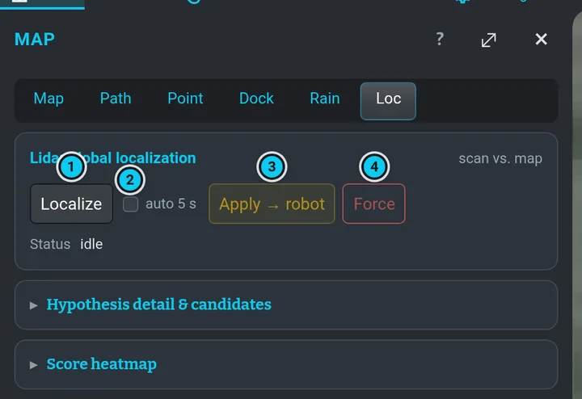

# Localization and GPS

The robot combines several sources into one position (the *pose*):

- **RTK GPS** — two receivers on the robot plus a base station give centimetre accuracy and the
  heading. Best on open sky.
- **The dock** — while seated in the dock the robot knows exactly where it is.
- **The lidar tracker** — matches the lidar scan against the site map; works at night and under
  trees.
- **Odometry** — wheels, lidar (Li) and camera (VO) measure how the robot moves; alone it drifts.

 · 2 the dock · 3 the lidar tracker (scan against the map) · 4 odometry (wheels, IMU) · 5 one pose · 6 the Pose chip: green = anchored, orange = map-matched, red = drifting")

## Read the state (right panel › Navi)

 · 3 odometry chips VO / Li / Wh / FIX / PROB / ANC · 4 the lidar tracker line (Trk)")

The first chip (1) says **who owns the pose now**:

| Chip | Colour | Meaning |
|---|---|---|
| `RTK` | green | GPS owns the pose. A fix must first prove itself: about 1 m of driving, or about 10 s standing still with a steady fix and a good heading. |
| `DOCK` | green | Anchored by the dock. |
| `TRACKER` | orange | The lidar scan matched against the site map. |
| `RTABMAP` | orange | Camera / lidar map localization (older maps). |
| `EXT` | orange | An external or legacy source. |
| `DEAD-RECKON` / `DR (…)` | red | No absolute anchor — the position drifts (the bracket says which odometry carries it, e.g. `DR (LICP)`). Drive with care, stop longer missions. |

The small chips next to it:

| Chip | Meaning |
|---|---|
| `VO` / `Li` / `Wh` | camera, lidar and wheel odometry — what the navigation filter fuses. Green = live and tracking; orange (`Li`) = running but lost; grey = paused in the dock (they wake up the moment undocking starts) — and for `VO` also "no visual tracking", which is normal in the dark; red (`Li`, `Wh`) = no message for more than ~2 s. Hover / long-press for the reason. |
| `FIX` | a usable raw RTK fix (whoever owns the pose) |
| `PROB` | the GPS fix has proven itself (see `RTK` above) |
| `ANC` | the position anchor: green = fresh, orange = frozen (the pose runs on wheel odometry from the last anchor; also when the heading anchor freezes); the tooltip gives the ages |
| `hdg SAT / IMU` | heading from the two GPS antennas or from the IMU fallback; orange `SAT` = the antennas report a heading the robot does not trust yet |

### The lidar tracker line (`Trk`)

The lidar tracker matches every scan against the site map. It **stands by while GPS owns the
pose** and takes over only when the fix has been unusable for about 5 s (so a short RTK flicker
does not hand over the pose).

| Shown | Meaning |
|---|---|
| `STANDBY` · *GPS owns · takes over after 5 s without fix* | the normal state on open sky |
| `STANDBY` · *fix lost · takes over in N s* (orange) | the fix just dropped; the tracker waits out the anti-flicker delay |
| `STANDBY` · *dock owns the pose* / *RTAB-Map owns the pose* | another anchor has priority |
| `ACTIVE` (green) · *correcting* / *aligned* / *standing still* | the tracker keeps the pose on the map; *match N cm* = how well the scan fits |
| `ACTIVE` (orange) · a reason | the tracker is on but holds its correction back, e.g. *the map no longer matches here*, *poor match*, *one-sided geometry (corridor/wall)* |
| `ACTIVE` (red) · *lost N s* | no good match for a while — it will try a full relocalisation |

The second line is the **last correction**: *sent 0.07 m / 1.2° · 12 s ago*, *rejected — dock owns
the pose* (the robot ignores tracker corrections while the dock anchors it), or *held back: reason
(×N ticks)*; *N sent* counts all corrections since the tracker started. While GPS owns the pose
the line also shows *map offset N cm* — how far the tracker would move the robot right now; a
few centimetres means the map still fits.

**GNSS** line:

| Shown | Meaning |
|---|---|
| `GBAS` | RTK fixed — the good state |
| `FIX` | a standard fix (also RTK float) — not centimetre-exact |
| `SBAS` | satellite-augmented fix |
| `NO FIX` | no position from GPS |
| `fix —` | no data |
| `sats N` | satellites used |
| `pos ±cm` | position accuracy: green ≤ 5 cm, orange ≤ 50 cm, red above |
| `hdg ±°` | heading accuracy: green ≤ 2°, orange ≤ 6°, red above; `—` = no RTK heading |

The two GPS icons in the navbar ([Status icons](status-icons.md)) say the same in one colour:
green = RTK, orange = a 3D fix without RTK (or float), red = bad, grey = no data. **Undocking
waits for both to be green** (docking only when it first has to load the outdoor dock map).

## GNSS receivers (right panel › GNSS)

The robot has **two** GPS receivers and the **GNSS** section shows both side by side. It is the
one place for GNSS in the right panel (the old GNSS rows under Navi are gone). **Folded** — the
default — its title row says it in one line: the Position fix, the Heading fix, the satellites the
position receiver uses and the age of its corrections, e.g. `RTK RTK 24sv·0.5s` (hover for
used / visible); the section is tinted by the worse of the two. Unfold it by its title for the card:

- **Position** — the RTK rover. It gets its corrections (RTCM) from the **base station**.
- **Heading** — the second antenna. It gets its corrections from the **position receiver**
  (the *moving base*) and measures the direction of the line between the two antennas.

Each column is tinted by its state: green = `RTK`, orange = `FLOAT` / `DGNSS` / `3D` (a fix, not
centimetre-exact yet), red = no fix, grey = no data (`OFF`). For the heading receiver `RTK` means
a fixed heading solution with a valid heading.

| Row | Meaning |
|---|---|
| `SV` | satellites used / visible; orange below 12 |
| `acc` (Position) | horizontal accuracy the receiver reports: green ≤ 3 cm, orange ≤ 50 cm |
| `hdg` (Heading) | heading accuracy: green ≤ 0.5°, orange ≤ 2° |
| `corr` | age of the last correction message: green ≤ 3 s, orange older or not used, red > 10 s or `none` |
| `up` | time since the receiver started |
| `RTK` | how long after its start it reached RTK; `… 11:32` = still waiting (so far); `yes` = it was RTK before the robot started watching |

When a receiver is **not RTK**, a line under the columns says how long it has waited and the
**likely reason**:

| Reason | What to do |
|---|---|
| *no corrections from the base station* | check the base (power, radio link) |
| *no moving-base stream* / *moving-base stream incomplete* | the position receiver does not feed the heading receiver — usually after a reboot it comes by itself; if it stays, restart the GNSS |
| *corrections stale* / *not used* | the link is dropping messages — check the radio |
| *few satellites* | drive into open sky |
| *float — position receiver not RTK yet* | wait for Position to turn green first |
| *float — corrections OK, resolving ambiguities* | the normal warm-up; just wait |

*after a start usually ~N min* is the median time to RTK from earlier starts of that receiver
(after a reboot the heading receiver often needs ~15 min).

**Tap the card** for details: satellites per system (G = GPS, E = Galileo, C = BeiDou,
R = GLONASS), satellites with carrier corrections, every RTCM message type with its rate (`!` =
some were not used), the distance to the base or the antenna baseline, and when the receiver got
its first fix, float and RTK after start. Tap again to hide them.

## When GPS does not fix

1. Is the robot under a roof, trees or next to a wall? Drive it a few metres into open sky.
2. Wait — after a start RTK can take a few minutes.
3. Check the base station (power, its own link) — without it there is no RTK.
4. With `FIX` but no `GBAS`, the corrections are missing or poor.
5. The robot can still navigate on the map with the lidar tracker (`TRACKER`), just less
   precisely; long missions should wait for RTK.

See also [Troubleshooting › GPS](troubleshooting.md#gps-does-not-fix).

## The Loc tab (lidar global localization)

**Map › Loc** asks: *where does the current lidar scan fit best on the loaded map?* Use it when
the robot is lost (`DEAD-RECKON`, or the robot on the map is obviously in the wrong place).

1. **Localize** (or tick **auto 5 s**) — computes candidates. Computing never moves the robot.
2. Read the result: best pose and score, and the **margin**:
   *✓ unambiguous*, *⚠ AMBIGUOUS* or *⚠ YAW MISMATCH (mirror alias?)*. The heatmap shows the
   match (yellow = better, blue cross = best, red cross = where the robot thinks it is).
3. **Apply → robot** sends the best pose to the localization. It is enabled only for an
   unambiguous result; near the dock the robot may still refuse it (the dock wins).
4. **Force** applies it anyway — only for recovery, when you are sure.

> [!TIP]
> A pose that jumps right after undocking usually settles once RTK proves itself (about 1 m of
> driving, or a short stop, in open sky). If the robot is far off, stop, use Loc, then continue.
