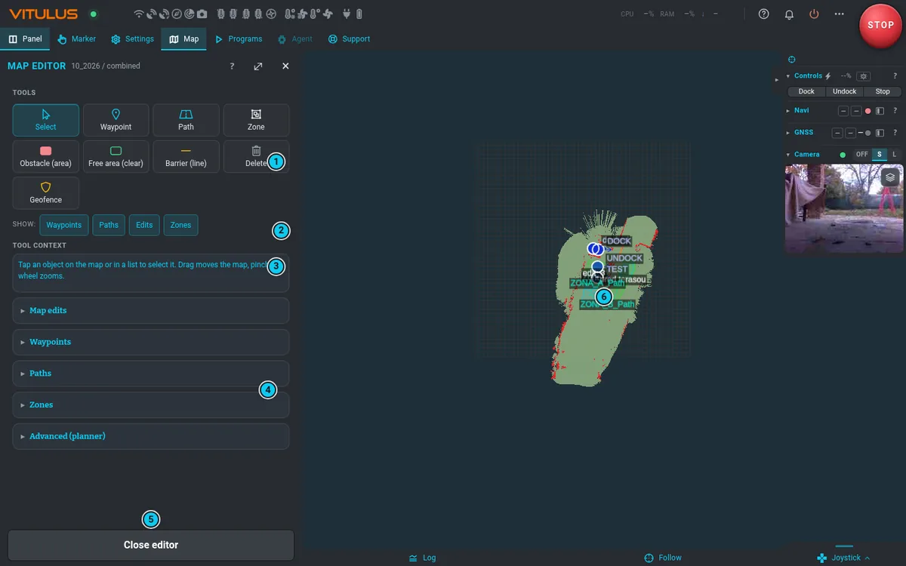

# Map editor

**Map › Map › Edit map** (✎ next to the active map) opens the editor: the map from above with a
tool bar over it, and on the left one list of everything on the map and the inspector of the
selected object. The robot stays drivable with the joystick while you edit. The expand button
widens the panel; **Close editor** or **✕** returns to the Map panel.

## Tools

The bar holds **Select**, three groups, **Measure**, undo and redo, **Layers**, **History** and
**⋯**. Where the map beside the panel is too narrow for it, the words go and only the icons stay
(with a mouse, point at one for its name). On a phone, a tablet or a phone on its side the bar is
one row of icons at the top of the panel, which stays there while the panel scrolls; **Layers**
and **History** are then under **⋯**.

| Group | Tool | How |
|---|---|---|
| | **Select** | tap an object on the map or in the list. Drag moves the map, pinch or the wheel zooms |
| **Meaning** | **Place (area)** | a named area, such as a terrace or a pool: at least 3 points, **Finish** |
| | **Landmark (point)** | tap the map: a tree, a manhole |
| | **No-go area** | the robot must not drive in by itself. See [Rules](#rules) |
| | **Slow area** | a speed limit inside |
| | **No-blade area** | the robot may pass, the blade stops |
| | **Corridor (line)** | a named passage: at least 2 points, **Finish** |
| **Map fixes** | **Obstacle (area)** | at least 3 points, **Finish** — the robot will not drive there |
| | **Free area (clear)** | marks an area as drivable (removes a false obstacle) |
| | **Barrier (line)** | a virtual line the robot must not cross; width 0.02–2 m (default 0.10) |
| **Objects** | **Waypoint** | tap to place, type a name and a heading (0–359.5°, an orange arrow), **Save** |
| | **Path** | tap points, then **Finish** |
| | **Zone** | a new mowing zone, see [Zones](#zones-what-to-mow) |
| | **Measure** | tap points: length, and the area of the closed shape. Nothing is saved |
| **⋯** | **Geofence** | click the perimeter, then **Send proposal** — see below |
| | **Clear all** | deletes all map fixes at once, undo brings them all back |

**Map fixes** correct what the map shows. **Meaning** says what a place is and what holds there.

While you draw, the bar shows the length and the area. **Undo** in the panel takes back the last
point. The points behave as described below.

**Snap** (the magnet, on by default): a new or dragged point lands on a nearby vertex or edge of
another object. Hold **Alt** to place it freely.

Keys: **Esc** cancels the open change, the tool or the selection, and **stops the robot**, as it
does everywhere in the app. **Del** removes the selected point, or the selected object when no
point is selected. **Ctrl+Z** and **Ctrl+Shift+Z** undo and redo. To cancel a drawing without
stopping the robot, use the **Cancel** button.

On a phone the editor opens on a small panel at the bottom: the tool bar and the inspector, the map
above it. The **^** button at the inspector's top right brings the list, the layers and the details;
picking an object, a tool or touching the map makes the panel small again. One finger moves the
map, two fingers zoom; neither adds a point or saves anything. On a tablet or a phone on its side,
choosing a tool brings the inspector with **Finish** into view.

## Objects and the inspector

The list holds everything of the map, one row per object. **Search** looks through names, aliases,
tags, notes and categories; the type filter narrows it down. Tap anything you can see: it is
selected on the map and in the list at the same time, and a pick from the list also brings it into
view. Where objects overlap, tap again to go to the next one. The list is never taller than about
a quarter of the screen; a longer one scrolls inside and fades at the bottom, and its scroll does not
carry on into the panel. On a phone the list is part of the panel and scrolls with it.

Names on the map never cover each other or the dot of a point: the name of a point moves to a free
side of its dot, the name of an area just above or below its middle. Where there is no free place,
the name waits until you zoom in — rules and zones keep theirs first, paths last.

The inspector has the same order for every type:

| Part | What is in it |
|---|---|
| head | type, name, ✎ rename |
| status | active or not, temporary, who added it when it was not you, size |
| **Meaning** | **Note**, **Aliases**, **Tags**: words you and the agent use for it |
| **Rules** | what holds there: speed, validity, category, width, cut height |
| **Status** | which programs use it, when it was created and changed |
| actions | **Duplicate**, **Delete**; zones **Split** and **Merge**; a path **Add robot position** |

Meaning and history need the map objects service of the robot. Without it the rest of the editor
works as usual and the inspector says so.

## Select and reshape

The points of the selected object appear at once:

| To | Do |
|---|---|
| move a point | drag it |
| add a point | tap a white dot on an edge, or drag it to where the point belongs |
| delete a point | tap the point (it turns yellow), then **Delete point**. With a mouse also Shift+click or the Delete key |
| move a waypoint | drag it, and set the **Heading** in the inspector |
| change the width of a barrier | **Barrier width** in the inspector |

Nothing reaches the robot until you press **Save**, which appears with the first change, for the
shape and for the meaning alike. **Undo** goes back step by step, **Cancel** returns to the saved
state. While a change is open, other objects and tools wait until you save or cancel. Closing the
editor with a change, or leaving for another panel, asks for a second press and then discards it.

An outline that crosses itself cannot be saved. A polygon keeps at least 3 points, a line 2.
A path recorded by driving keeps its headings: only the points you changed and their neighbours
take the direction of the line.

## Undo and history

**Delete** works at once, and a message with **Undo** appears for a few seconds. Undo in the bar
takes back any saved change of the map, the next one before it after that, and redo brings it
forward again. **Clear all** is one step. **History** in the panel shows who changed what: you, the
agent, the robot, or something outside the editor. An undo that cannot apply, for example a zone
that a running program uses, says why. DOCK, UNDOCK and DOCKED have no Delete at all.

## Rules

| Rule | What it does |
|---|---|
| **No-go area** | maps, planning and every autonomous drive avoid it. A person with the joystick is never blocked: a banner warns, in the whole app, not only here |
| **Slow area** | caps the speed inside (0.05–0.40 m/s, default 0.20) |
| **No-blade area** | the mower program passes through with the blade stopped, and zones leave it out |

**Valid from** and **Valid until** make a rule temporary: it turns on and off by itself. Empty means
always. On the map each rule has its own hatch; an inactive rule stays on the map, faded and with
a dashed outline. A no-go area cannot contain DOCK, UNDOCK or DOCKED.

## Trace by driving

Pick any area or line tool, then the arrow in the bar. Drive the robot; its position is added to
the outline, one point every 20 cm. Press the arrow again to stop: the line is thinned out and you
can adjust it like any other, then **Finish**. **Undo** takes the whole trace back.

Tracing only records. It does not move the robot, you drive it yourself.

## Layers

**Layers** is one panel. Objects: waypoints, paths, map fixes, zones, places and rules. A hidden
layer cannot be selected on the map. World, each with its legend: **Coverage** (when it was last
mowed), **Mow load** (the trail of a run, see Mowing unit), **Grass height** (measured grass
against the cut height, see [Mowing unit](mowing.md#grass-height-ahead)), **GNSS quality**, **Slope**, **Terrain**,
**Aerial** (with it on, pick the background map right below it) and **Overlays** (cadastre,
buildings, contour lines, relief, slope — the same switches as in the Map tab). A layer without data says so. The trail also shows how GPS agrees with lidar and wheels, the RTCM corrections and, with thin lines, the plan, GPS and lidar positions, so
it tells where the base reaches badly, which helps when you place a zone. A tap on the trail shows its card only when no drawing tool
is active.

## Suggestions

When the robot keeps seeing a new fixed obstacle, it offers it under **Suggestions**. A tap shows it
on the map. **Accept** adds it, **Ignore** leaves that place alone for good.

## Record at the robot

**Record at the robot** adds the robot's current position as a waypoint, or starts a path: **New**
(add points as you drive, with **Add robot position** on the path) or **New auto** (records as you
drive, **Stop auto** ends it).

## Names

Every object has a name. A new object gets one automatically (**Obstacle 1**, **No-go 2**,
**Waypoint 1**…), and you can type your own before saving. The ✎ pencil in the inspector renames it
later, the same way for every type.

- A name must be unique within its type, up to 60 characters. Spaces and accents are fine.
- A renamed zone stays in its programs. It cannot be renamed while a mission that uses it is running.
- **DOCK**, **UNDOCK** and **DOCKED** keep their names; you can move them but not delete them.
- The agent knows objects by these names and aliases, so a good name (*Pool*, *Fence by the
  neighbours*) is what you and the agent will both use.

## Waypoints DOCK and UNDOCK

DOCK and UNDOCK are ordinary named waypoints — you can move them here like any other. Their
meaning is described in [Dock and undock](dock.md#the-points). The easiest exact way to set them
is still to drive the robot there and press **Update** in **Map › Dock**.

Ending a map recording in the dock creates DOCKED. If the site has no DOCK or UNDOCK yet, both are
created at the same time at the point where the undock back-out ends, facing away from the dock.
Points that already exist are never overwritten. Move UNDOCK out to open sky where the robot gets
RTK: the robot waits for GPS there. DOCK stays in front of the dock, on the line out of it, facing
away from the dock, so the robot can reverse in.

## Zones (what to mow)

1. The **Zone** tool, tap the polygon on the map. The first, blue point is where mowing starts.
2. Set **Name**, **Cut height** (mm, 20–80, default 45) and **RPM** (600–4000, default 3300).
   **Advanced** holds *Paths around obstacles* (2), *Coverage angle* (160°), *Path spacing* (0.2 m)
   and *Simplify* (0.1 m).
3. As you draw, the planner previews the result: mowable and unreachable area, path length, time
   and problems, with the mowing paths on the map.
4. **Finish** — the planner computes the mowing paths and confirms; the status shows when it is
   done.

An existing zone is selected like any other object, and its mowing paths are shown. Its settings are
under **Rules**. When a program overrides them, the inspector shows the values that really apply.
**Status** says which programs use the zone. **Duplicate**, **Split** (tap two points of a line
across the zone) and **Merge** go through the planner, which updates the programs that use the zone
and refuses while such a program runs.

Saving a new shape recomputes the mowing paths and updates every [program](programs.md) that uses
the zone, so the programs keep working. The planner refuses the save, and keeps the old zone, when
a running program uses the zone, when the programs of the map are still loading, or when the new
shape leaves no mowing path. The inspector shows the reason and your change stays open.

Zones regenerate automatically after map edits. A [program](programs.md) then lists which zones
to mow.

## Geofence

Under **⋯**. A geofence is a hard boundary for the agent's missions. The editor only **proposes**
one: the proposal is saved unsigned, and a person must sign it on the robot (command line) before it
becomes the active fence. A ring that crosses unmapped space is rejected; the minimum area is
4 m². A geofence is used only when the owner decides so.
