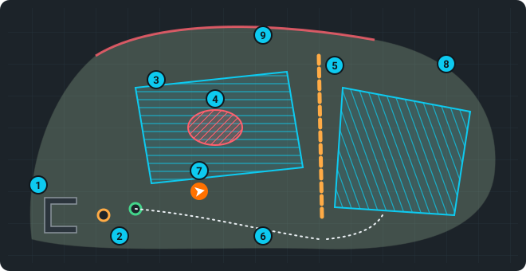

# Maps and mapping

A **map** (a *site*) is one garden: the terrain the robot recorded, plus everything you add to
it — waypoints (DOCK, UNDOCK, …), paths, zones, map edits and the programs. The robot navigates
and mows only on the **active** map. Everything is stored in metres in real-world (UTM)
coordinates, so a map stays aligned with GPS and the aerial photo.



1. **The dock**.
2. The **DOCK** (orange) and **UNDOCK** (green) points in front of it
   ([Dock](dock.md#the-points)).
3. **Zones** — the areas to mow; the planner fills them with mowing paths (the stripes)
   ([Map editor › Zones](map-editor.md#zones-what-to-mow)).
4. An **obstacle area** — the robot never drives there (a flower bed, a pond).
5. A **barrier** — a line the robot must not cross.
6. A saved **path** ([Paths](routes.md#paths)).
7. **The robot** (orange) where it is now.
8. **The terrain** the robot recorded — where it can drive (Base layer).
9. A **wall** or a hedge the lidar saw (Saved layer, red).

## Which map is active

")

**Map › Map** shows *Active map: name* at the top, and one card per saved map with chips
(*active*, *recording*, *no session*), its area, the number of sessions and programs. A line
under the active map speaks only when there is something to say: a recording that runs, an
activation that failed or is under way, or no active map at all.

Click a card to show that map in the 3D view and open its layers (below).

- **Activate** — the robot localizes and navigates on this map from now on.
- **Edit map** (next to the active map) — opens the [map editor](map-editor.md). Only with an
  active map.
- **Deactivate** — leaves *no* map active (a "factory-fresh" test; survives restarts). Click
  twice. Activate or Save & finish ends it.
- 🗑 — deletes the whole map with all its sessions and programs. Click twice. The active map
  and a map being recorded cannot be deleted.

## Record a new map

```flow
Name | a new name = a new map
Start recording | drive the garden slowly
Cover it | edges, around obstacles, the dock
ok: Save & finish | best while docked
Active | the new map is active at once
```

")

1. **Map › Map › Map recording**: type a **name** (letters, digits, `_` and `-`; with any other
   character the robot does not start the recording).
2. Press **Start recording** and drive the robot over the whole area (joystick, slow speed).
   Drive along the edges and around obstacles; good RTK makes the map land in the right place.
3. Finish in the dock and press **Save & finish**. The map is saved and becomes **active**.

> [!TIP]
> Ending the recording **while docked** automatically creates the *DOCKED* point (the robot's pose
> in the dock), which seeds the localization in the dock. If the site has no DOCK or UNDOCK yet,
> they are created with it where the back-out ends; move them in **Map › Dock** or the map editor
> ([Dock and undock](dock.md#the-points)). If the session never had
> stable RTK, the robot's log warns *captured NO georef datum… remap with good GPS*.

While recording:

- **Erase & keep recording** — wipes what was recorded so far, keeps recording (click twice).
- **Discard (no save)** — ends the recording and throws it away, nothing of it is saved; the
  robot goes back to a saved map (click twice).
- **Mapping profile** — what this place is mapped with, see below.
- *Localization while recording* — how the robot localizes during this recording.

## Mapping profile

One named set for mapping, chosen in the **Recording** section of the Map tab: what the camera counts
as an obstacle, the lidar for mapping, and how evidence adds up in the map. **Lawn short**, **Lawn
tall**, **Paved yard**, **Bushes / edge** and **Default** are built in, your own go next to them.

**Every place keeps its own.** The name on the right says for which place the profile is shown.
Serve another map and its profile comes with it, the camera too (within a second or so), with or
without a recording; a new map starts as a copy of what was in use. Without a served map the
values are kept for the next recording. Navigation does not depend on any of it.

- The panel only chooses and shows: **Camera**, **Lidar** and **Evidence** say what the profile
  holds, **Set** takes you to [Settings › Camera](camera.md#obstacle-detection) and
  [Settings › Lidar](lidar.md#lidar-in-mapping). The evidence model is right below in the panel.
- **A change is kept at once** for this place, recording or not, and applies at once during a
  recording. The panel then shows *edited* with their number and a dot at the part that differs.
- **Save to profile** writes the changes into the profile, for every place that uses it. **Save
  as…** makes a new one. **Back to profile** drops the changes of this place.
- Saving into a built-in profile keeps your version next to it (a dot in the list); **Restore
  default** brings its values back. **Delete profile** removes your own; places that used it keep
  their values.
- Switching the profile with changes open asks first: they would be dropped.
- If the camera detection does not run, the panel says so and it gets the values when it starts.
  If it refuses them, the panel says why and it keeps running on the previous ones.

What the camera card says is what lands in the map: the mapper does not filter the camera's points
a second time. Maps made before this keep what they had: their settings were converted into a
profile, and what differs from it shows as *edited*.

## Extend a map

Start a recording with the **existing name** of the map (pick it from the list under the name
field). That map becomes active while you record, so the robot localizes on what it already knows,
and the new session is added as a new **layer**. Where sessions overlap, the newer one wins.

## Sessions, layers and the combined map

Open a map's card to see the **combined map** (👁 preview, **Activate**, ↻ rebuild) and its
**layers** — one per recording session, named by its date, newest first:

- the switch includes / excludes the session from the **combined map**,
- 👁 previews it (blue, changes nothing),
- **Activate** uses this one session alone (a warning then says the combined map is not used),
- 🗑 (click twice) removes it; the session that is active cannot be deleted.

The **combined map** merges all included sessions by their GPS positions. It is rebuilt
automatically after Save & finish, a layer delete or a switch; ↻ rebuilds it by hand.

## What you see on the map (layers)

Tick the layers under the map list: **Base** (cyan, the navigation map), **Saved** (red, the
active map), **Direct** (black, the live recording), **Preview** (blue), **Terrain** (height: blue low,
red high), **Aerial** (the background map, see below), **Rain** (radar).

Zone borders, mowing stripes, the planned path and the robot have a thin edge in the opposite tone
(dark on a light line, light on a dark one), so they read on a photo, on a light map and on the
plain map alike; zoomed far out the stripes drop the edge so a zone does not turn dark. The robot is
its outline with an arrow pointing where it faces.

**Sensing** shows what the robot is observing right now, drawn flat on the ground around it.
It switches on by itself when a recording starts and off when it ends (tick it by hand any time):

- **Violet = lidar.** The live scan: stronger fill up to the obstacle each beam hits (with a
  violet outline along it), a faint fill where nothing was hit — that is free space up to the
  lidar range of the mapping profile, marked by a faint arc. Gaps are beams the map ignores.
- **Yellow = camera.** The view cone of the depth camera: about 55° wide, up to the mapper's
  camera range of the mapping profile. During a recording a dimmed cone means the camera
  delivers nothing to the map right now.
- **Faint fill = already observed** in this recording (only while the mapper takes data in).
  Places without it have not been seen yet — drive there to fill the map. It starts empty with
  each recording and after **Erase & keep recording**.

The ranges are the ones the map really takes in (the mapping profile of this place), not the
sensors' maximum, recording or not.

### Lidar range and Camera range

**Sensing** is what the sensors see now. **Lidar range** and **Camera range** are two layers with
the limits: how far each sensor sees and how far the robot really uses it. They work all the time,
with or without a recording, each has its own tick and the browser remembers it.

 and Camera range (yellow)")

**Navigation / Mapping** at the top of the card chooses what the layers show: what the robot uses
while driving, or the mapping profile of this place. A profile change or a slider in Settings ›
Camera / Lidar shows here as soon as the robot has it.

- **Dashed** — what the sensor sees (lidar 16 m, camera the raw depth view up to the driver's cut).
- **Bright edge** — the limit of the chosen view, from where it starts to where it ends; the camera
  has its view angle in the middle. The numbers stand on the edges; when something else than the
  setting of that view limits it, the label names it (*navigation 3.0 m · the costmap*). A label
  that would cover another one hides, the card has them all.
- **Short dashes in the camera's view** — where it starts to see the ground: it does not see the
  ground right in front of the robot.
- **Red sector** — the lidar has something right next to it there (closer than 0.4 m in almost
  every scan, it needs about 30 s), for example the walls of the dock.

The card shows the real values with the camera's height window. When a value is lower than what is
set, it says who cut it, for example *5.0 m: the driver (set 6.0 m)*. The lidar's settings are in
[Settings › Lidar](lidar.md), the camera's in [Settings › Camera](camera.md); both have **Show the
range on the map**.

**Agent's plan** (amber ◆) shows what the agent plans for its running mission — points, routes and
areas it drew into the map; it appears and disappears by itself, see
[Vitulus agent › The agent's plan on the map](agent.md#the-agents-plan-on-the-map).

**Display (layers)** sets their opacity, the robot marker colours, the **background map** under
the map, its **Detail** and an alignment nudge (saved on the robot for each map and tile source; the ČÚZK
sources share one, the Google ones another), the rain radar, and shows the terrain (DEM) status.
The background maps come in two groups: **aerial and satellite photos** (Google satellite, Google
satellite with names, ČÚZK orthophoto, Esri, Bing) and **maps** (Google map, ČÚZK topographic map,
OpenTopoMap, OpenStreetMap). Each photo source has its own date and its own sharpness — when one is
old or blurry over the garden, try another. **Detail** *Auto* (the default) loads the finest level
each source has — Google up to z21, the ČÚZK orthophoto z20 — and closer up only magnifies it
smoothly. On a phone the background map stops one level coarser (Google z20, ČÚZK z19) and so
loads fewer tiles. On a slow connection
pick a lower cap (z17–z21): fewer tiles, a softer picture. The tiles always cover what you see.
After a move or a zoom the previous picture stays until the new tiles are in, and a coarser one
fills the gaps meanwhile, so the map does not go blank; a view you saw a moment ago comes back at
once. The status line counts the tiles as they come (*loading tiles 12/48*) and says when some did
not load — then MapProxy on the robot is not reachable or has no picture there (without internet
it has only what it stored before; the plain white tile it sends then is not drawn). Once the
network, the connection to the robot or MapProxy's internet is back, the map loads its tiles again
by itself. A phone uses a lower tile limit than a computer to spare its
memory; with overlays on it gives the background map at most half of it (far out the map then
shows a coarser level and its line says *tile limit*) and draws the overlays a level coarser
(relief and slope two), so all of them fit.

**Dim the robot's map over the background** (under the background map's opacity, on by default):
while a background map is shown, the free space of the robot's map is only a light tint and the
unknown cells around it are transparent, so you see the lawn itself, not a grey-green sheet. A light
ring stays around every obstacle, so the red (or black) obstacles read on any picture. Untick it for
the full fill as before. Without a background map, with its opacity turned almost down, or when no
tile of it loaded, the fill is always full.

**Overlays** are transparent layers, each with its own tick box and opacity, with or without the
background map: **Cadastre** (parcel boundaries, light lines), **Buildings, house numbers** (ČÚZK
RÚIAN: building outlines and house numbers, drawn light blue so they do not look like the robot's
red obstacles) and **Contour lines** are drawn on top of the robot's maps, with a thin dark edge
that keeps them visible on a light map too. **Shaded relief** and **Slope** (both from the ČÚZK
terrain model DMR 5G; slope yellow → orange → red = steeper, handy for banks and ditches) shade the
background map and the robot's map without covering them, inside the garden too: flat ground stays
as it is, slopes get darker or tinted, and the lines, zones, paths and the robot stay on top.
Cadastre, buildings and contour lines show only close up — the row says *zoom in* until they do.
While an overlay loads its row counts the tiles (*z19 · 3/12*); *not loaded* or *2 missing* means
MapProxy did not deliver them. All layers share one tile limit, the background map first: an overlay that does not fit
says *tile limit*, a background map drawn coarser than asked says so in its status line. The small
line in the bottom-left corner of the map credits the sources on screen (tap it for the whole
text): ČÚZK sources are open data, OpenTopoMap is CC-BY-SA; Google, Esri and Bing are the
companies' own imagery. **Clear costmaps** forgets the obstacles the robot currently remembers — it does not
change any saved map.

> [!NOTE]
> A map layer that does not show is not necessarily missing — reload the page first. More in
> [Troubleshooting › The map is not visible](troubleshooting.md#the-map-is-not-visible).
