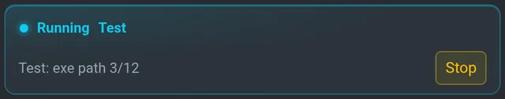
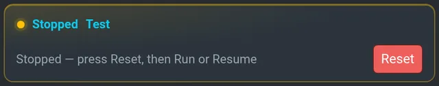
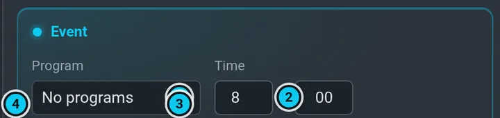

# Programs and calendar

A **program** says *what* to mow: a list of zones of its map, the speed, and optionally one
cut height and RPM for all of them. The **calendar** says *when*. Both are in **Programs**.

 · 2 Run · 3 Resume · 4 Show / Hide · 5 Stop · 6 Reset · 7 Save · 8 Delete")

## Make a program

1. Activate the map first — a program belongs to the map it is made on.
2. **Programs › Programs › New program**: a **name**, add zones from the list (**Add zone**).
3. **Speed**: Slow / Mid / Fast.
4. **RPM** and **Cut height** (mm), and **Override zone**: with it ticked, these two values
   replace each zone's own cut height and RPM (both must be above 0). The height is in
   millimetres like everywhere in the UI, e.g. 50 = 5 cm.
5. **Save**.

To change a program, open its card, edit and **Save** again. A new name renames it (the old
entry goes away). A program the robot is running cannot be renamed — Stop it first.

## Delete a program

1. Open the program's card in **Programs › Programs**.
2. **Delete** (red, next to **Save**) and confirm in the dialog.

The program's zones stay on the map — only the program goes. If calendar events use the program,
the dialog says how many; they stay in the calendar marked **missing** and are skipped until you
**Edit** them and pick another program. A program that is running cannot be deleted — **Stop**
it first (a stopped program can be deleted).

## Run it

| Button | What it does |
|---|---|
| **Run** | starts the program from the beginning — the robot undocks and mows |
| **Resume** | continues an unfinished program from the zone / path where it stopped |
| **Show / Hide** | draws the program's paths on the map; a running program is drawn by itself, see [below](#paths-on-the-map) |
| **Stop** | stops the mission: the drive goal is cancelled, the blade stops, the robot stands where it is — *Stopped* |
| **Reset** | clears a *STOPPED* or *TERMINAL ERROR* state |

While a program runs, a **Running** card on top of the program list shows its name and state with
a **Stop** button — whichever program (or none) is open below. After a Stop it turns into
**Stopped** with **Reset**.

 

### Paths on the map

While a program runs, its paths are on the map by themselves, however it was started (Run,
Resume, the calendar, the agent), also on a phone that connects later. They go away when the
program ends: done, Stop, an error, or the dock after a return for battery or weather.

| On the map | Meaning |
|---|---|
| thin line around the zone | the zone border; each zone has its own colour |
| thick line in the zone colour | passes along the border still to do |
| thinner line in the zone colour | the fill still to do |
| grey line | already mowed (updates about once a minute); the running card shows the percentage |

- **Hide** on a running program holds for this run only: **Show** brings it back and the next
  run shows it again. It applies to everyone looking at the map.
- A program shown by hand before the run: if it is the same program, it goes away with the run;
  another program waits and comes back after the run.
- **Show** of another program during a run is drawn on top of the running one.

### Interrupt and continue

A running program stops on any of these — always into *Stopped*, the blade off:

- **Stop** in Programs (the Running card or the program's card),
- the red **STOP** top right or **Esc** (it also switches the drive motors off — [Safety](safety.md#stop)),
- taking over with the gamepad or the web joystick ([Safety](safety.md#the-gamepad-ds4-and-the-joystick-beat-the-software)).

```flow
ok: Run | the robot undocks and mows the zones in order
Running | the Running card shows the zone / path
warn: Stopped | Stop, the red STOP or a takeover; blade off
info: Reset | clears Stopped — needed before anything else
ok: Resume or Run | Resume = from where it stopped, Run = from the beginning
```

The robot then stands and waits. To go on: **Reset**, then **Resume** (continues from about where it
stopped — the mission saves its place every minute) or **Run** (from the beginning). Off the dock the motors must be on —
after the red STOP switch them on first (**Settings › Motors › ON**), otherwise the start is
refused with *Start rejected: motors are OFF*. To end the program instead, **Reset** and drive the robot home
(**Right panel › Controls › Dock**).

> [!IMPORTANT]
> After a Stop or an error the mission waits for **Reset** — Run and Resume are ignored until
> then, and the UI says *…press Reset first*.

If the planner refuses something (no zones, a zone no longer on the map, the program is
running), the reason appears under the buttons of the program's card.

## Programs of other maps

**Programs** lists the programs of **all** maps, each with the name of its map, for example
*B1Test (BACK)*. Programs of a map that is not on are run from their card:

1. Open the program and press **Run** or **Resume**. The card says *Loading map …*.
2. The robot loads the program's map **in the dock**, checks that the zones, the programs, the
   navigation and its position on that map are ready, and only then leaves the dock.
3. The map stays on after the program ends.

A program of the map that is on starts straight away, nothing is reloaded. The calendar and the
agent start programs of other maps the same way. **Stop** during the loading cancels the start.

The map only changes in the dock with nothing running. If that is not the case, or the map cannot
be loaded, the robot does not leave the dock and the card says why:

| The card says | What to do |
|---|---|
| *can only be loaded in the dock* | bring the robot to the dock and press **Run** again |
| *while a program is running* / *waits for Reset* | **Stop** or **Reset** first |
| *did not become active / were not ready / did not take over* | the map has a problem: open it in **Map** and look at what it is missing, then **Run** again |
| *is … m from that map's dock* | the map's `docked` point is wrong: dock the robot and save it again |
| *has no DOCK point* | add the point, the robot could not get home without it |
| *is on several maps* | open the right one in the list and press **Run** there |

To **edit** a program of another map, activate that map first: its card here is read-only.

## The calendar

 · 2 Hold · 3 its status and the next run · 4 an event · 5 add an event")

**Programs › Calendar** lists events: program, time and recurrence (Once, Daily, Weekly with days,
Monthly, Yearly), each with an on / off switch, **Edit** and **Del**. An event starts within 15
minutes after its time, once a day.



The tag in the calendar's head says what the scheduler does now:

| Tag | Meaning |
|---|---|
| **Active** | the scheduler will start programs (idle, waiting for the next event) |
| **Waiting** | an unfinished program waits for something it can name: charge, dry weather, a retry; the line under the tag says what, and what comes after it |
| **Busy** | someone else uses the robot (a running program, docking, a person driving, the agent) or the GPS watchdog holds it; the calendar waits and catches up, and the robot does not go to sleep |
| **Needs Reset** | the mission was stopped or ended with an error; nothing runs until **Reset** |
| **Held** | **Hold** is on — nothing starts from the calendar until you switch Hold off |
| **Automation off** | **Automatic mowing** is off, see [below](#automation-on--off) — nothing starts by itself and the robot does not sleep by itself |
| **Mowing** | a program runs now |
| **Off dock** | the robot is away from the dock; red when a program is unfinished: it continues when the robot is back in the dock |
| **Starting** | the scheduler itself is starting (the first seconds after the robot stack starts) |

The line under the tag says the same in one sentence, with the next run and, for an unfinished
program, where it continues. Hold the pointer over the tag for the scheduler's raw status.
Problems that are over but you should know about (a missed event, a run given up) stay listed
under that line until you **Clear** them.

An event can use a program of any map: the form lists them all with the map name, and at its time
the map loads in the dock before the robot leaves ([Programs of other maps](#programs-of-other-maps)).
An event whose program is on no map (deleted, renamed) shows **missing**; the scheduler retries it
for a while and then reports it. **Edit** it and pick a
program. An event outside the allowed window (07:00–21:00) shows **outside window**: it can start
only when the window opens, within the catch-up time below.

### When an event cannot start on time

An event that could not start (the robot was busy, asleep, the stack was down, the clock moved)
stays due for **4 hours** and starts as soon as it can, in the window and with at least 30 minutes
of the window left. After that it is reported as missed. An event never runs twice in a day, and
it counts as run only when the robot really got past the start checks, so one refused for rain is
not lost. When several are due they run one after another. An unfinished program goes first: a new
event waits for it, it is not dropped for the new one.

### Hold

**Hold** stops new starts from the calendar — it does not stop a program that already runs (use
**Stop** for that). A scheduled program that runs when you switch Hold on is still followed to its
end. If it was interrupted (battery, rain, temperature) the robot does not go to sleep while Hold is
on; when you switch Hold off, the scheduler resumes it as usual.

### Automation on / off

**Automatic mowing** in the calendar card is the one switch for everything automatic: calendar
starts, sleeping, resuming. It is stored on the robot and survives a restart; a new robot has it
**off**.

- **on**: the calendar starts programs by itself and the robot sleeps / resumes on its own
  (battery, rain, temperature, the night window — see [Why the robot waits](waiting.md)).
  Switching it on also releases **Hold**, and it counts events from now: nothing from the time it
  was off is caught up;
- **off**: the scheduler is passive — no automatic start and no automatic sleep; programs run only
  when you start them by hand. A program that is out at that moment is left alone and is not
  followed any more; its checkpoint stays for **Resume**.

Scripts and the agent can use `/scheduler/set_enabled` (`std_msgs/Bool` topic, `std_srvs/SetBool`
service); `/scheduler/enabled` says the current state.

Why a program does not start or stopped early: [Why the robot waits](waiting.md).
