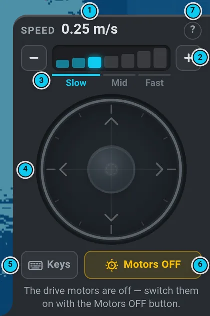

# Paths, points and the marker

All of these drive the robot by itself on the active map — the drive motors must be on, and you
should be able to see the robot or the camera. **Cancel navigation** or **STOP** ends the drive.

## Send a goal with the marker

1. Open **Marker** in the menu band. A goal marker appears on the map.
2. Click or tap the map where the robot should go (or drag the marker).
3. Turn it with the **Heading** slider to the direction the robot should end in.
4. Press **Send goal**.

On a phone held upright the Marker sheet is only as tall as its content, so most of the screen
stays map to tap and drag on.

When it finds no path the planner tries up to three times; when the drive itself fails it clears
its obstacle memory and plans again before it gives up.
**Cancel navigation** stops the drive (the log says *Goal canceled*; the motors stay on).

## Speed

The robot has three **speed modes** — Slow, Mid, Fast (`/navi_manager/speed`). The mode sets the
speed of navigation (routes, points, programs) and is remembered on the robot across restarts.
You switch it in the **drive ring** (Joystick in the bottom bar): **Slow / Mid / Fast** along the
speed segments — the lit one is the mode the robot reports, a click switches it. Navigation:

| | forward | reverse | turn |
|---|---|---|---|
| Slow | 0.25 m/s | 0.25 m/s | 0.9 rad/s |
| Mid | 0.4 m/s | 0.25 m/s | 0.9 rad/s |
| Fast | 0.75 m/s | 0.5 m/s | 1.5 rad/s |

The joystick has 7 finer steps inside the modes (the segments of the ring; the capsule above the stick shows the step in m/s):

| step | 1 | 2 | 3 | 4 | 5 | 6 | 7 |
|---|---|---|---|---|---|---|---|
| top speed (m/s, also in reverse) | 0.10 | 0.18 | **0.25** | 0.32 | **0.40** | 0.55 | **0.75** |
| turn (rad/s) | 0.4 | 0.5 | 0.6 | 1.0 | 1.3 | 1.4 | 1.5 |
| mode | Slow | Slow | Slow | Mid | Mid | Fast | Fast |

The **bold** step is the mode's own (= its navigation speed); it is used when the mode is switched
from outside (a program, another browser). The wheels themselves are limited to 1.4 m/s and
1.75 rad/s (`mobile_base_controller`); the UI never asks for more than 0.75 m/s.

## Points

 

**Map › Point** lists saved points: the marker button at the start of a row drives there, **Show**
shows it on the map, **✕** removes it. Type a name and press **Add** to save the robot's current
position as a new point; **Clear points** deletes all points of the map. **Cancel navi** stops the
drive.

## Paths

**Map › Path** lists saved paths: the arrow button at the start of a row drives the path, **Add**
adds the robot's current position as the next point, **Show** shows it, **✕** removes it.
To record one: type a name, then **New** (starts at the current position, add points as you
drive) or **New auto** (records as you drive; **Stop auto** ends it). **Clear paths** deletes all
paths of the map. **Cancel navi** stops the drive.

Paths and waypoints can also be drawn in the [map editor](map-editor.md).
