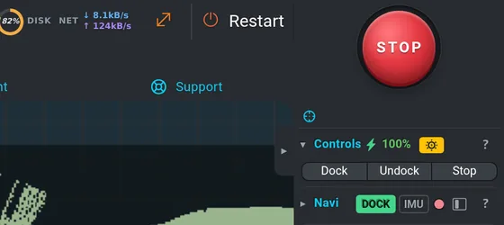

# Safety

Vitulus is a heavy robot with a sharp, fast blade. It moves by itself when a program, a mission
of the agent or a navigation goal tells it to.

> [!CAUTION]
> Keep hands and feet away from the underside while the mower is powered. Never lift or tilt the
> robot with the blade running. Children and pets must not be near a mowing robot.

## STOP



The big round red **STOP** button (a mushroom: a red cap in a collar of the frame) is always in the very **top-right corner** of the
window; the top bar runs into it from the left and the right panel starts under it (on a phone
held upright it is the right end of the top bar). It is on screen in every state — with a panel open or full screen,
the log, the large camera, the map editor, the help or the agent — and nothing covers it. The
**Esc** key does the same, always (also while you type or a dialog is open). It does all of this
at once, and lets go of the joystick:

1. cancels the navigation goal,
2. switches the drive motors **off**,
3. stops a running mowing program,
4. stops the blade,
5. stops docking or undocking,
6. opens the motor switch of the power module.

After a STOP nothing drives until someone switches the motors on again
(**Settings › Motors › ON**, or an Undock, which switches them on by itself). STOP is sent once —
it does not lock anything, so a new command (an Undock, the display) can switch the motors on again.

> [!NOTE]
> The agent panel has its own red **STOP** in its head. It stops the agent's mission and is
> answered by the robot core, never by a model.

## Motors are off after every start

After a boot, a restart of the robot stack or a restart of the base driver, the **drive motors
are OFF**. The robot cannot move until someone switches them on:

- **Settings › Motors › ON**, or
- **Undock** (the undock program switches them on), or
- the button on the robot's display.

The safety node switches the motors off by itself (with an alarm) when a motor reports a fault,
stops reporting, or gets hotter than 70 °C while powered.

## The gamepad (DS4) and the joystick beat the software

Every drive command passes one priority switch on the robot (the *cmd_vel mux*):

 · 3 the software (navigation, programs, docking, agent missions) · 4 the priority switch on the robot · 5 the wheels · 6 a takeover cancels what the software was doing")

| Rank | Who | Wins when |
|---|---|---|
| 1 | **DS4 gamepad** | a stick is moved (or PS / L1 / R1 pressed) |
| 2 | **Joystick in the UI** (and the keyboard drive) | it is pushed |
| 3 | **The agent's direct driving** — drive straight, turn, back off (`drive.*`, `nav.backup`) | nobody is driving by hand; while it drives, navigation waits |
| 4 | **The software** — navigation, a program, docking / undocking, an agent mission | nobody else is driving |

A paired PlayStation DS4 gamepad talks to the robot directly (no web UI, no Wi-Fi needed).

**Take over:** move a stick (or press **PS**, **L1** or **R1** to take over without moving).
At that moment the robot

1. follows your stick at once — the software's commands are thrown away,
2. **cancels** what the software was doing: the navigation goal, docking / undocking, and a
   running mowing program (it goes to *Stopped* and stops the blade, like Stop in Programs),
3. stops the agent's direct driving at once and tells a running agent mission that a person
   took over (the mission stops and waits for you, see [Agent](agent.md#supervisor-fault)).

```flow
Software drives | a goal, a program, docking or an agent mission
warn: You take over | move a stick (or PS / L1 / R1), or push the web joystick
err: The software's task is cancelled | goal, docking, program → Stopped, blade off
You drive | the robot follows your stick only
off: Let go | the robot stops and stays
ok: Start again | new goal, Undock, or Reset + Run / Resume
```

**Let go:** the robot stops and **stays**. The software does not drive on by itself — a new goal,
an Undock or **Reset** + **Run** of the program is needed. A node that keeps sending commands
after the cancel stays blocked until it falls silent for 1 s.

**A switched-on gamepad with centred sticks does nothing.** It does not hold the robot, it
does not stop a program — you can leave it on during autonomous mowing and grab it when needed.

- Right stick forward / back, left stick turn.
- Triangle / Cross = mower power on / off, Circle / Square = blade on / off,
  D-pad up / down = cut height, left / right = blade RPM. These buttons do **not** take over.

> [!WARNING]
> - Taking over does **not** switch the drive motors off — the robot stands because you hold it.
>   For a hard stop press **STOP** (it also cuts the motors).
> - With the motors off neither the gamepad nor the joystick moves the robot.
> - A web page opened before this change still drives with the old (lower) priority — reload
>   the page.

## The physical button

Holding the power button on the robot for **4 seconds or longer** cuts the power of the motors,
the battery output and the computer (the hardest stop; the UI goes away too). Holding it only
2–4 s is a standby that software can undo.

## The blade

 turns under the middle of the robot; the charging contacts (6) are at the rear.")

- The blade has its own switch: **Settings › Mower › START MOTOR / STOP MOTOR**
  ([Mowing](mowing.md)). Programs start and stop it by themselves.
- Switching the mower **power** on does not start the blade; it only re-applies the last height
  and RPM.
- **STOP** always stops the blade too.
- The agent never switches the blade on by itself — there is no such action. It may only run a
  **saved mowing program** after your unlock (**Mow** or **Free drive** in the dock lock); its
  supervisor accepts blade RPM only while that program runs and stops it on STOP, a takeover or a
  lost heartbeat ([Agent](agent.md#mowing-programs)).
- The safety node switches the mower off by itself (blade and mower power) when the robot tilts
  more than 30° or the mower motor gets hotter than 70 °C.

## Trying things without moving the robot

Open the UI with `?mock` at the end of the address (for example `http://192.168.0.1:7779/?mock`).
The page then **reads** everything live but **sends nothing** to the robot: a small *MOCK* badge
counts what was blocked. Good for learning the UI and for testing layouts.
