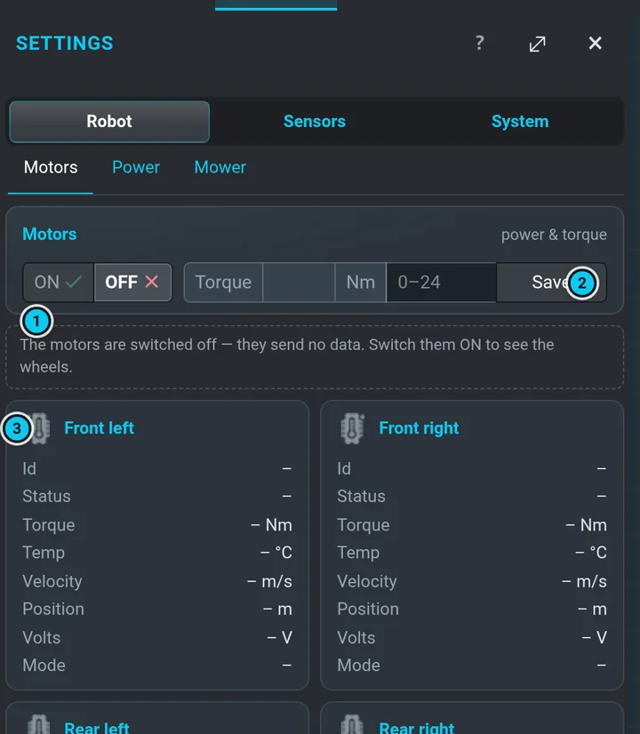
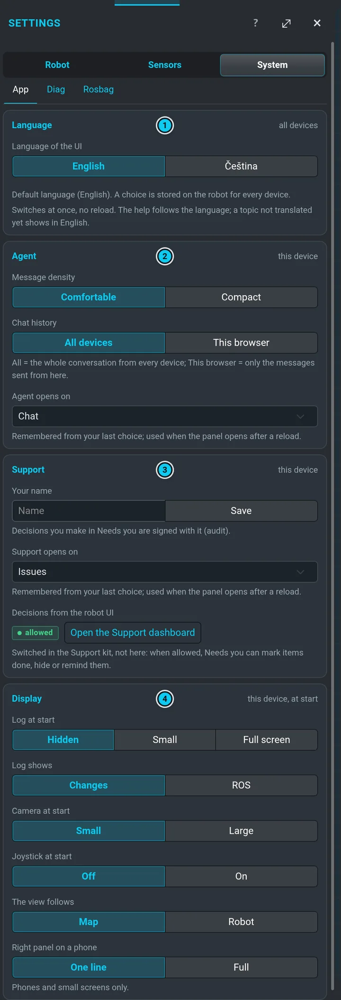

# Settings

**Settings** (⚙ in the menu band) has three groups in the top row; the row under it holds the
tabs of the open group:

| Group | Tabs |
|---|---|
| **Robot** | Motors · Power · Mower |
| **Sensors** | Navi · Lidar · Camera · IMU |
| **System** | App · Diag · Rosbag |

A group opens on the tab you last used in it. The **?** in the panel head jumps to the tab you
have open. An **ON / OFF** switch shows its state by the half that is filled: green = on,
grey = off, red = a fault (for example the lidar off).

## Motors

- **ON / OFF** — power of the four drive motors. **They are OFF after every start**
  ([Safety](safety.md#motors-are-off-after-every-start)); switch them on here before you drive
  by hand or dock. The filled half follows the real motor state.
- **Torque** (0–24 Nm) and **Save** — the motors' torque limit. An empty number field shows the
  allowed range (here and in Power).
- One card per wheel (front / rear, left / right): id, status, torque, temperature, velocity,
  position, voltage, mode (– = no data from that motor yet). A line above the cards says why
  there are dashes — the motors are off, they have not reported yet, or they stopped reporting
  (then the cards turn grey: old numbers). The wheel icons in the navbar mirror their state:
  green OK, orange warm, red hot, grey off.

## Navi

- **Speed** SLOW / MODERATE / FAST — the same setting as Slow / Mid / Fast in the right panel
  ([speeds](routes.md#speed)).
- **Lidar** ON / OFF; the card head says ON, OFF or *state unknown*.
- **RtabMap** sensor source (Camera / Lidar / Both) and distance — for the older RTAB-Map
  localization; normally left alone. RTAB-Map reports these only while it runs (when a map is
  made); until then a line says so, *now* shows –, and a source you pick is stored for its next
  start (it is sent with the distance under the slider). Once it reports, the slider shows its
  distance and the source its choice; **Apply** sends a new distance alone.
- **Advanced (planner)** — the planner's stored data (**Save data**, **Load data**, **Reload**) and
  **Assemble map** with its noise filter, obstacle margin and fill shape. Moved here from the map
  editor; normally left alone.

## Power

- **Supply** — charger input (V, A), battery (V, A, charging state, %), capacity, the computer's
  (NUC) output, and the motor and mower outputs (ON / OFF in words).
- **Temperature** — **Board** and **External** temperature, **Board fan** and **External fan**
  speed.
- **Outputs & limits** — motor and mower output ON / OFF (the filled half = the real state),
  charge and cut-off currents for run and standby, board and external temperature limits. Change
  only if you know why.
- **Hardware reset: everything off for N s** — the same card as in [Autonomy](autonomy.md).
- **Advanced: raw sleep controls** (collapsed, service use: to put the robot to sleep use
  [Autonomy › Sleep](autonomy.md#battery-sleep-faults)) — sleep time, **Sleep now** (Timed / Until charged), standby delay, charged
  offset, discharge timeout. **Sleep now** › Timed first says how many minutes it will sleep and asks again: it takes the value you type, otherwise the one the power module keeps (the last anybody wrote, usually the scheduler's). It cuts the power without shutting the system down; the
  scheduler shuts down first and sets the standby delay to 3 minutes
  ([How the robot sleeps](waiting.md#how-the-robot-sleeps)).

## Mower

Mower power, the blade (**START MOTOR** acts only after you hold it for half a second), cut
height and RPM — see [Mowing unit](mowing.md).

## Diag

The live list of the robot's diagnostics (ROS `/diagnostics`): a summary on top, then groups of
rows *dot · name · message* in a stable order. Green OK, orange warning, red error, grey stale.
Useful when something is red in the navbar and you want to know which part.

## Rosbag

Recording of sensor data for analysis:

- **D435 RGB-D camera** — REC / STOP and the frame rate (FPS, **Set**).
- **GNSS forensics** — records the GPS heading, fix and pose ownership (for localization issues).
- **Stored bags** — the list with **Download** and **Delete** (bin) on each bag (↻ refreshes).
  A bag that is being recorded shows **● REC** and cannot be downloaded or deleted yet. A bag
  tagged **unfinished** is left over from a recording that did not finish (the power went off,
  say) while nothing records now: it can be downloaded, but not deleted here.

Bags take a lot of disk space; delete what you no longer need.

## IMU

Calibration of the inertial sensor, meant for service. The steps are numbered:

1. **Run** — starts the IMU's own calibration. The robot does **not** drive by itself: turn it
   slowly in place with the small stick under the card (it only rotates) for about a minute.
2. **Save** — stores the result in the IMU.

Under **Service**: **Reset IMU** restarts the sensor (the calibration stays) and **Remove DCD**
deletes the stored calibration. On the right: the heading from the IMU, navigation,
magnetometer, RTK and fusion.

## Camera

Everything about the depth camera (D435): whether it streams, how accurate its depth is
(**Check** compares it with the lidar), **Calibrate…** — a wizard that calibrates the camera
against a wall without moving the robot — the sensor settings and the image layers. Details:
[Camera (D435)](camera.md).

## App

Settings of this application (the UI), not of the robot. Nothing here moves the robot or changes
anything on it except the stored language.

- **Language** — **English** or **Čeština**. It switches at once, without a reload, and is stored
  **on the robot**, so every phone and PC shows the same language (the line under the buttons
  says *Saved on the robot*). When the robot cannot store it (it is restarting, or the page runs
  as `?mock`), it is kept on this device only and the line says so. The help follows the
  language; a topic not translated yet shows in English with a note. The default is English.
- **Agent** — *Message density* (Comfortable / Compact, the same as ▤ in the agent panel),
  *Chat history* (All devices / This browser, the same as the all / mine switch above the chat)
  and the tab the agent panel *opens on*.
- **Support** — *Your name*, which signs the decisions you make in **Needs you** (audit), the tab
  the Support panel *opens on*, and whether *decisions from the robot UI* are allowed. That last
  one is only shown here; it is switched in the Support kit (**Open the Support dashboard**).
- **Display** — what this device shows at the next start: the log (Hidden / Small / Full screen)
  and what it shows (Changes / ROS), the camera small or large, the joystick, whether the view
  follows the map or the robot, the right panel on a phone (one line or full), and the robot's
  map over a background map (Dimmed / Full, the same as *Dim the robot's map over the background*
  in [Map › Display](mapping.md#what-you-see-on-the-map-layers)).

Agent, Support and Display are remembered **in this browser** (each phone or PC has its own) and
follow what you do elsewhere in the UI — set here what the next start should look like.
