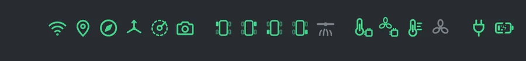
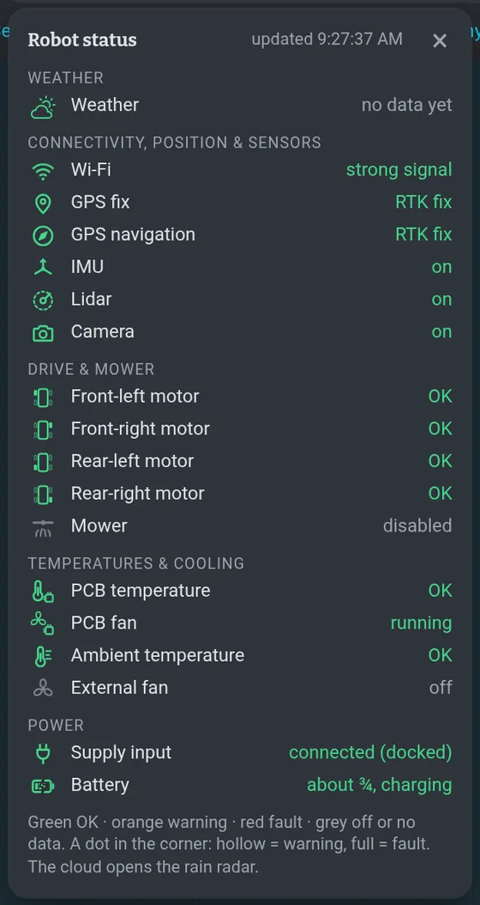
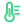

# Status icons and colours

## The four colours

The whole UI uses the same four tones — on icons, chips, cards and log dots:

| Colour | Means |
|---|---|
| green | OK |
| orange | warning — works, but look at it |
| red | fault — something is wrong |
| grey | no data or switched off |

The accent colour (cyan) is not a state: it marks links, the active tab and what is selected.

## The icons in the navbar

 · 3 computer (CPU · RAM · ↓ ↑) · 4 ? help · 5 Needs you (the bell) · 6 Restart · 7 ⋯ more · 8 STOP")

They sit in the navbar right after the logo, always at the same place, in groups (weather ·
sensing · driving · temperature · power). Each one is a line pictogram in the colour of its state;
a **warning** or a **fault** also puts a small **dot on its corner** (hollow = warning, full =
fault), so it stands out even when the colours are hard to tell apart. Hover an icon for its name
and its state in words (*GPS fix: RTK fix*).

**Click the icons** (anywhere but the cloud) for the **status card**: every icon with its name and
its state in words, in the same groups, and the time of the data. Click outside it or **×** to close
it. The card only shows — nothing in it sends anything to the robot.

On a narrow window (under 1100 px) and on a phone on its side each group shows **one icon — the
worst one of the group** (red before orange before a grey GPS / IMU / motor / battery = no data,
then green, then any other grey); the full row comes back on a
wider window. On a **phone held upright** the row under the menu is a **summary**: one icon per
group (the worst one) and the state in words — *No warnings*, *2 warnings*, *1 fault* — tap it
(the whole row) for the status card. A grey **GPS, GPS-nav, IMU, drive motor or battery** means no
data or switched off, so the summary counts it: *No warnings · 2 no data*. A grey lidar, camera,
mower or fan is normal (off while not needed) and is not counted.

**No live data.** When the page loses the robot (the dot is red or orange) or the robot sends no
icon states for 10 s, the icons are only the **last known** state: they turn grey and *no live data*
sits over them (on a phone the summary says *No live data*); the tooltips and the card say since
when. The colours come back with the next data.

| Icon | What | Green | Orange | Red | Grey |
|---|---|---|---|---|---|
|  | Wi-Fi | good | medium | bad | disconnected |
|  | GPS (position receiver) | RTK | 3D fix, no RTK | bad | no data |
|  | GPS-nav (heading receiver) | RTK | 3D fix, no RTK | bad | no data |
|  | IMU | on | — | — | off |
|  | Lidar | on | — | — | off |
|  | Camera (D435) | on | — | — | off |
|  | Mower | on | busy | error | disabled |
|  | Drive motor (one per wheel — the filled wheel is the one) | OK | warm | hot | disabled |
|  | Board temperature | OK | warm | hot | no data |
|  | Board fan | running | — | — | off |
|  | Outside temperature | OK | warm | hot | no data |
|  | Fan | running | — | — | off |
|  | Charger supply | online (= docked) | — | fail | none |
|   | Battery | full · ¾ · ½ (bars) | ¼ | empty | no data |

The battery shows its level as **bars** (4 = full … none = empty) and a **flash** while it charges.

The **cloud** — the first status icon — is the weather ([Weather](waiting.md#weather-map--rain)):
green = no rain expected, orange = rain expected, red = raining now; no icon = no weather data
yet. Click it to see the rain radar (**Map › Rain**).

The **dot** next to the logo is the connection of this page to the robot: green connected,
orange (pulsing) connecting, red no connection — hover it for the words, click it to reconnect
right away. When the connection drops, the notice band under the menu also says
*No connection to the robot · reconnecting…* until it is back. A dead link (Wi-Fi gone) shows
within about 8 s; a STOP pressed meanwhile waits and goes out after the reconnect
([STOP with a bad connection](safety.md#stop)).

> [!TIP]
> All icons grey with *no live data*? The page is not connected, or the robot stack is
> (re)starting — wait a minute, then see [Troubleshooting](troubleshooting.md#the-ui-does-not-respond).

## The computer monitor

On the right of the navbar the robot's computer (NUC) in fixed places: **CPU** and **RAM** in %,
then the network — **↓** download and **↑** upload with their unit (B/s, kB/s, MB/s). The numbers
are smoothed over a few seconds, so the block stays calm and never changes its width. A number
turns **orange** only when it needs a look: the CPU when its **average over 30 s** is 90 % or more
(red from 97 %), RAM from 90 % (red 97 %) — a short spike does not colour anything. Click the block
for a **card** with rings CPU · RAM · DISK, the network, the 30-s average and the load, and a link
to **Settings › Diag**.

Less room: when the navbar has no room for the whole block (a narrower window), upload ↑ steps away
first, then the block becomes one **chip** (an icon in the colour of the worst of CPU, RAM and disk)
— click it for the same card. It depends on the room in the bar, not on a fixed window width. On a phone the
computer is in **⋯** (a small dot on ⋯ when it needs a look). Grey = the computer's data is not
available.
